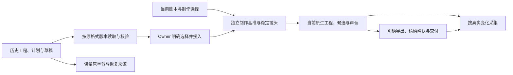

# 当前制作、旧流程与命名的剩余替换方案：呈现设置版核查

日期：2026-11-14。状态：Proposed，仅方案，不执行改造。对应当前工作区、隔离 schema 197 及本轮生产单，依据[本轮报告](../verification/production-replacement-render-assessment-20261114/REPORT.md)和 ADR-0066、0068、0069。原实施计划保持，不以本次评估关闭其未完成项。

## 结论

建议保留现有制作内核，分批补齐承接、退出旧业务、整理共享实现和统一名称，不整体重写。当前新单已有独立制作基准；旧作品也已经具备保存计划、原生／HTML 工程、已确认绑定、未确认及混合状态的接入能力。继续重建一套制作系统，会重复承担已经验证过的身份、事务、文件、费用和恢复保护。

尚未完成的是「旧作品能按原意接续」「日常用户有明确入口」「旧执行消费者受控退出」「当前代码只用当前模型」这四个闭环。名称可以最后统一，但不能靠改名完成前三件事。

目标状态：

历史读取器可以保留旧格式知识；当前制作内核不应继续到处猜两代字段。原档案、冻结 JSON、SHA 输入、草稿、音轨、原包和已应用迁移保留原样，不作为名字清理对象。

## 已完成部分：不再重复开发

- 旧生成脚本链及旧建单 RPC 已有退役迁移。
- 当前新单不再要求旧审核包、镜头草稿或审批作为制作基准。
- 精确音轨身份和采用正文已进入交付说明，不能继续以旧报告中的共用路径错配作为未修复缺陷。
- 当前里程碑、声音使用、本机导出观察和资源覆盖已有实现；埋点代码已在当前工作区，无须另行合并后才可测试。
- 原生／HTML 工程、保存 v2 计划、准确已确认绑定、未确认选择和混合状态均已有接入实现。混合状态不是当前尚未开发的功能。
- 原计划与未确认草稿的主声音／配乐／音效增益、配乐闪避、字幕样式和 fade 预填已有当前协议；非默认值、逐镜头差异、替换后保留人工设置已可验证。

这些进展不等于 D 或整体替换已经完成，尤其不能代替来源 UI、完整设置与全部恢复矩阵。

## 还值得修改的内容

| 优先级与问题 | 大白话：到底是什么问题 | 建议怎么改 | 如果不改 | 如何验收／发现回退 |
| --- | --- | --- | --- | --- |
| 先处理：正式输出底色 | 编辑器用棋盘格提示透明区域，正式不透明 MP4 也可能带着它输出。这是渲染输出边界问题，与 SQL 或命名无关 | 在 SDK 明确区分预览网格、正式不透明底色和支持透明的输出；由项目／导出设置给出正式背景。先核对实际部署的 SDK 版本，再单独改造 | contain、位移或透明素材的留空处可能带网格，技术交付仍可显示成功 | 对横竖图、contain、多镜头、透明 PNG、位移及透明格式检查实际成片像素；不能用强制铺满素材隐藏缺陷 |
| 先处理：两条字幕测试输入 | 现有可视测试选择 independent，却漏了必填字幕正文，生产入口正确拒绝。这是测试夹具问题 | 只补正确输入，并保留缺正文应拒绝的合同；FFmpeg 抽帧使用明确时间格式。增加对成片字幕可见性的检查 | 现有测试仍失败，容易误判字幕业务坏了；若只断言导出 ready，也可能漏掉视觉问题 | 正确输入生成 minimal／cinematic 的可见差异；错误输入继续拒绝。本轮只在私有副本校正，未修改原测试 |
| 继续 D：更广设置承接 | 部分旧值已经真正作用到新工程，部分仍只是放在来源档案里。问题是转换覆盖，不是全部设置都丢了 | 建一张逐字段映射表，说明实际应用、当前预填、仅留证据、暂不支持。补未确认裁切、源窗口、自定义构图、原声意图、封面与更广字幕布局；已有原生编辑优先 | 素材找回了，但画面范围、声音方式或排版可能仍需人工重建；用户无法判断是不是原样接续 | 使用非默认源窗口／变速／构图／字幕与封面，逐项比较工程及实际成片；不支持的明确展示，禁止静默套默认 |
| 继续 D：实际来源选择 UI | 后端已有多种来源，页面仍主要接续已有工程，没有完整的计划／草稿／混合来源选择。这是产品入口问题 | 同一页面只保留一次明确选择：来源版本、可接入部分、待确认内容和阻塞原因。原生／HTML 已编辑版本优先；不借源选择授权生成或计费 | API 能操作，普通使用却难以完成；可能把「候选已登记」误当「已经采用」 | 实际浏览器完成来源读取、比较、确认、接入、保存重开；脚本变化、指纹过期、错误 Owner、已有编辑均拒绝覆盖 |
| 删除前完成：所有来源恢复 | 一种原生作品能整库加文件恢复，不代表新计划、未确认和混合作品都已完成同样验证。这是覆盖与引用问题 | 每种接入来源分别做整库＋文件、逐项、来源 Owner 变化、同文件多引用、目录搬迁、离线源与中断恢复 | 日常制作可成功，但备份恢复可能有断引用或漏来源；不能安全宣称旧链可全退役 | 保留原 ID／SHA、脚本／镜头／轨、采用与未采用结果；冲突不能覆盖或靠重新生成补齐 |
| 后续：规模与复杂声音 | 小样例与 65 个同源音轨不能证明大型多来源工程的上限；复杂变速／嵌套仍可能只能标未知。这是性能和语义覆盖 | 测多来源／大文件／别名／嵌套与中断，再决定是否按不可变身份缓存；观察成本与业务验证分别计时 | 大工程保存延迟和未知统计比例仍不确定；不代表当前所有导出有故障 | 记录端到端时间、核验次数与资源；禁止跳过 SHA、放宽超源或把 unknown 写成 0 换取更好数字 |
| 后续：人工口播的技术命名 | 人工上传被登记为 generate_narration、工程混音模式显示 tts。看名字容易误判成在线生成，是协议语义和命名混用 | 当前模型把声音用途与来源分开，界面和统计按真实来源解释；是否拆任务类型需做完整版本迁移 | 维护者容易误算生成次数或误解付费路径；本轮事件对账未发现这样的统计错误 | 人工录入仍为发送 0、预留 0、执行 attempt 0；真实生成按明确请求记账，原历史行保持 |
| 后续：运行包清单措辞 | 23 个原包清单仍标 compatibility-contract-retained，当前启动检查则已拒绝完整 v4 执行。是记录状态滞后 | 在真正完成消费者退出后，更新当前支持说明，分清「原包字节保留」「恢复可读」「执行支持」三种状态 | 后续维护者可能把保留原包误读成承诺继续执行 | 清单与实际启动／归档读取测试一致；不删除原包或改其树哈希 |

### 设置承接应该怎样记录

| 字段范围 | 当前已知状态 | 后续动作 |
| --- | --- | --- |
| 主声音／配乐／音效增益、闪避 | 当前预填协议已支持；实际采用后应用。逐镜头配乐支持连续源窗口，替换保留人工混音 | 保留正反回归，补复杂结构及全部恢复，不重做一套增益系统 |
| cut／fade 与字幕 minimal／cinematic | 已有映射及实际输出；不是原设置全丢失 | 验证多镜、混合样式和原生人工样式优先；studio 的原意是编辑器处理，不能解释为自动恢复任意过渡 |
| 未确认裁切、clip_segments、自定义 composition | 来源中保留且做格式核验；不等于实际安装到当前片段 | 逐镜头显式转换源窗口、布局与变换，歧义提示；未确认不伪造原批准 |
| 原计划封面 | 来源绑定已核验、保留；还没有完整当前候选选择流程 | 作为可选择封面候选展示，不自动替换交付封面 |
| 未确认原声方式及更广字幕空间参数 | 部分原值可读，完整当前操作与表现仍需逐项核对 | 区分「输入意图」「真实已使用」「仅留证据」，明确采用后再采集使用事件 |
| 服务、连接、预算、旧批准与执行授权 | 仅作为来源证据，不转成当前自动授权 | 始终保持；新请求仍需本次选择、费用确认与未知请求核对 |

## 原八类：按当前状态分别处置

| 类别 | 现在用途及问题类型 | 完全替换时怎么做 | 必须保留什么／不改的影响 |
| --- | --- | --- | --- |
| 1. 旧生成脚本链 | 已退役 | 不重复安排删除 | 原迁移、冻结证据与归档继续保留 |
| 2. 批准建草稿、历史复用、混音／构图继承 | 旧批准／草稿写入仍触发隐式动作。是函数职责和调用结构问题 | 把必要继承纳入明确历史接入；映射／UI／恢复补齐并关闭旧写入口后，前向删除纯旧触发器及函数 | 当前原记录和引用锁不动。不改则保留第二套隐式动作，排查要追触发器 |
| 3. 任务完成组视觉／分镜审核包 | 2 个函数仍挂任务完成触发器，旧组包与结果校验混在一起 | 抽清租约、attempt、冻结输入、实际产物回执等保护；停止接收旧业务后，退出纯旧投影。迟到结果按准确身份核对 | 不得删通用保护或把旧未知请求重发。不改则两代结果模型继续并存 |
| 4. 7 个退役拒绝入口 | 只拒绝旧执行。本轮当前源码／有效 SQL 函数体未见调用 | 先核查旧消费者退出与新运行包合同；准确签名、RESTRICT 前向删除，同时清理当前探测／类型 | 原包保留，不承诺任意旧二进制继续执行。不改主要增加合同维护量，不会恢复旧生成 |
| 5. 空扫描器与旧预检 | scopes 返回空，防自动发现；preflight 为 Owner 验证后登记时间。二者用途不同 | 分别随旧扫描／Runner 退出处理；保留当前文件、连接、模型、目录、资源和版本检查 | 不改主要是兼容成本。不能把空扫描恢复成真实扫描，也不能按 preflight 字样批删当前保护 |
| 6. v2 手动命令与旧读取路由 | configure／pause／apply／bind／render／publish 及旧计划读取还在，保存配置仍有真实写入者 | 当前来源 UI 和恢复补齐后，整体关闭旧写命令；读取迁到明确历史来源边界，最后删旧路由及无用写函数 | 不改需维护两套操作规则。不能只删 URL 或改 command 名称，就认为功能已迁移 |
| 7. Studio、媒体编排和共享 Worker | 一部分是旧渲染，另一部分仍给当前领取／费用／租约提供服务。主要是职责和结构，兼有命名问题 | 纯旧渲染随旧入口退出；当前共享职责按资格→容量／公平→资源→原子领取→attempt／lease→回执／费用梳理为一条当前实现，再统一名称 | 保护矩阵必须全保留。只改名不简化结构；直接删 legacy 底层会破坏当前领取 |
| 8. 历史、冻结保护与格式回退 | 数据有恢复价值；当前核心仍存在两代字段回退。是协议边界与类型问题 | 用版本化适配器读取原格式，转换到严格当前类型；历史资料保留，当前代码移除不必要的双字段猜测 | 不改增加维护成本；删原记录／保护会破坏追溯。历史适配器本身不是应清理的无用旧流程 |

第 2 类实际挂载四函数：`seed_shot_preparation_drafts_after_storyboard_approval`、`reuse_shot_preparation_history_after_storyboard_approval`、`copy_shot_audio_mix_to_revised_draft`、`copy_shot_composition_to_revised_draft`。相邻 `copy_clip_segments_to_revised_shot` 应一起核查。第 3 类：`create_visual_review_package`、`create_storyboard_review_package`。冻结、失效、音轨同步与引用锁须逐项单列，不能搭车删除。

第 4 类准确签名：

- `apply_episode_configuration_repair_v2(uuid,jsonb,text,text)`
- `apply_external_connection_repair(uuid,uuid,text,text)`
- `local_identity.generate_input_shot_tts(uuid,uuid,text,boolean)`
- `local_identity.plan_input_tasks(uuid)`
- `local_identity.queue_workspace_planning(uuid,uuid,uuid)`
- `local_identity.replan_workspace_planning(uuid,uuid,uuid)`
- `local_identity.save_planning_selection(uuid,jsonb,integer)`

另外 `local_identity.script_production_scopes()`、`record_episode_worker_preflight(uuid,uuid)` 是各自候选，不混入七个拒绝签名。目录依赖与函数体文本检查都做了；前者不会完整表达动态 SQL 与外部消费者，因此没有现在就安全 DROP 的结论。

当前实际领取：`workerDatabase → local_identity.claim_input_task → claim_input_task_pre_lease → claim_next_worker_task_legacy`。这里的 legacy 底层确实执行更新 tasks 和插入 task_runs，不是空壳。当前口播预留还会把旧协议分流到 `reserve_workspace_narration_submission_legacy` 明确拒绝，不能删调用目标而不承接拒绝语义。

`confirm_legacy_workspace_preparation` 和 197 新增的 `read_legacy_workbench_source` 仍有当前接入调用。它们是受控历史适配边界，不应因为名字有 legacy 就又列成无用函数。

## 名字可以怎么彻底换

| 范围 | 建议 | 改动方式及边界 |
| --- | --- | --- |
| 当前通用 Worker | 例如 codexRunner／runCodexWorker 改成反映媒体任务职责的名称 | 局部重命名，联动导入、CLI、构建／发布清单、测试和当前说明，不重建任务或改原包 |
| 当前 SQL 领取 | 消除 pre_lease／legacy 层层包装后使用清晰当前名称 | 局部结构重构，继续同事务、同锁顺序、同权限；不再加一个新名字包装旧三层 |
| 人工口播的登记／声音模式 | 本轮人工上传仍出现 generate_narration 任务类型和 tts 混音模式，但 attempt=0、发送事件=0、预留=0，当前并未实际生成 | 区分声音用途与来源，如 narration + manual_import／provider／source；当前界面和统计使用明确来源。若拆任务类型，按新协议迁移领取／回执／CHECK／恢复，不修改原任务行。属于语义和命名混用，不是本单发生了付费请求 |
| 当前制作 ID／类型 | 当前身份在适配之后必须明确；历史类型按来源版本区分 | 清掉核心中的 preparation_revision_id ?? storyboard_package_id 等猜测；先补真实转换，再收紧类型，不能用 as 掩盖缺值 |
| 当前命令／路由 | 可以采用中性的「读取来源」「导入来源」，用 sourceFormat 区分格式 | 在一次版本迁移中调整客户端、服务端、输入校验与回执；原历史来源快照仍保留原协议 |
| 画面和声音显示名称 | 「镜头 01 口播」「配乐」等当前术语 | 不改变稳定 clip／轨 ID、文件路径和用户已经手工设置的名字 |
| 历史解码器 | 可以叫 HistoricalWorkspaceV1 等明确版本名称 | 不必保留当前核心里的旧业务名；原数据库列、JSON 键、文件名及备份内容通过解码器读取 |
| Episode／episodes | 当前生产单实体，不属于无用旧流程 | 如仍要改为 ProductionOrder，单独评估全栈迁移；成本大，主要收益是词汇一致，建议最后决定 |
| clean SQL 与生成类型 | 最终有效 schema 重新生成当前声明和新库基线 | 前向升级、新库、整库／逐项恢复等价后再生成；不重写已应用迁移和 ledger |

「当前运行代码不再依赖旧流程」可以作为完成目标；「仓库所有旧字符串为零」不能作为完成目标，否则会破坏不可变证据和恢复合同。

## 推荐实施顺序

| 顺序 | 交付范围 | 方法 | 完成门槛 |
| --- | --- | --- | --- |
| 0 | 输出底色与现有测试夹具 | 独立 SDK 修复；夹具最小修正 | 实际画面与错误输入合同通过。SDK 问题不与 SQL 清理混成一批 |
| 1 | D 剩余设置、封面和来源 UI | 在现有适配器补映射，复用当前工程及操作 | 每个字段有清晰状态，用户从页面能完成；人工编辑优先、候选不自动采用 |
| 2 | 新旧来源完整恢复与 B1 最终矩阵 | 测整库＋文件、逐项和来源 Owner；当前所有独立输入与旧来源交叉核查 | 无断引用、覆盖、身份漂移或自动重发，原字节保持 |
| 3 | E1 退出第二套旧执行 | 先终止／隔离实际旧消费者，升级执行协议门槛，再关旧写入与纯旧编排 | 当前正例、旧入口拒绝、迟到／未知结果、归档可读恢复同时成立；日常切换另行授权 |
| 4 | E2 整理共享 SQL 职责 | 局部重构当前领取／预留／回执，不重写全系统 | Owner／ACL／RLS、资格、容量、公平、资源、attempt／lease、未知请求和费用矩阵全过 |
| 5 | F1／F2 名称、严格类型与 clean 基线 | 当前名称迁移、历史协议集中解码、前向删除无调用入口 | 当前生产路径静态依赖不再经过退役业务，fresh 与 upgrade／restore 等价 |
| 6 | G 最终联验与采集启用前验收 | 最终固定版本跑完整默认套件、制作／恢复／权限／UI；隔离启用采集对账 | 代码、迁移和发布包一致；随后另行决定日常部署／重启／启用 |

没有必要重写整个项目。需要局部重构的是共享 SQL、两代协议在当前核心中的交叉处理；需要补功能的是设置／来源 UI；需要单独修的是 SDK 输出背景和测试输入。旧数据保留，纯旧执行在依赖退出后删除。

## 埋点如何随改造验收

复用现有采集，不另建一套。每个批次固定「实际业务事实→事件→只读汇总」对照：导入原采用不伪造过去事件，新明确采用才计；声音来源变化和混音变化区分；保存重开无变化不增计；费用预留／估算／供应商实付分别表达，未知实付仍为 null。

最后一轮使用最终源码、迁移和运行包，在隔离环境检查创建／制作阶段、排队与执行、受控请求／费用依据、候选采用／撤回／拒绝、显式重试、质量冻结、交付、本机导出和资源采样。同时检查关闭不采、重新开启不补造历史、采集故障不重发供应商。真实 Provider、长期／跨进程采样、复杂声音和 Dashboard 另列边界，不能用一次本地小样例宣称全部完整。

日常采集、迁移、部署和必要重启仍需执行时明确授权；本轮仅隔离测试和方案，没有执行这些操作。
