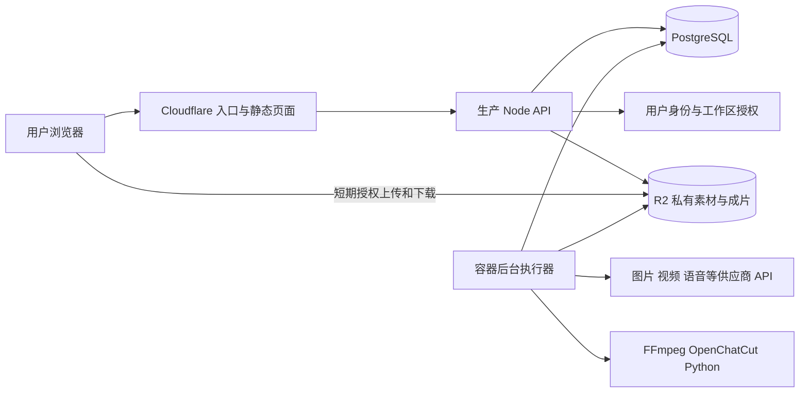

# Loop Control 面向其他用户的部署评估

调查日期：2026-11-10。目标由 Owner 明确为「开放给其他用户使用」。本文是候选方案评估，不是已批准的架构决定或部署计划；没有修改程序、日常配置、数据库或服务。价格为查询时官方页面展示的美元价格，部署前须复核。

## 结论

可以借鉴推文中的 GitHub 托管、GitHub Actions 自动发布及 Cloudflare 基础设施，但当前完整项目不能直接部署为 Cloudflare Workers 应用。建议先保留 PostgreSQL 和现有业务、任务与费用协议，把运行环境适配成 Linux 容器；Cloudflare 用于静态资源、入口防护及 R2 媒体存储。初期以单个 API 服务和受限数量的后台执行器运行，按实测瓶颈扩容。

如果产品缩小成「填写提示词、调用供应商、等待并下载图片或视频」，Workers + 异步编排 + R2 可以成为另一种可行实现。但那会减少当前项目的剪辑、对齐、技术校验和交付能力，应先作为产品范围选择，不能称为原项目直接搬迁。

## 推文实际提议

[原推文及两张附图](https://x.com/momoai_daily/status/2120042907474493473) 已通过已登录 Chrome 阅读：GitHub 保存代码，GitHub workflow 自动部署至 Cloudflare；用 Vercel AI SDK 对接 Seedance 等生成接口；邮箱登录，指定管理员邮箱；由 AI 协助修改代码。

附图没有给出可验证的仓库、部署清单、数据库方案、媒体处理方案或负载测试。「一句 prompt」描述开发交互，不是完整部署规格。Vercel AI SDK 与 Vercel 托管是两件事；是否需要 SDK 应由供应商协议和现有适配器决定。

## 当前代码与目标环境的差距

| 位置与证据 | 已确认事实 | 对外部署影响 |
| --- | --- | --- |
| `README.md:5`、`docs/specs/current-product.md:5` | 产品为单一 Owner 管理多个内容账号 | 内容账号隔离不能直接等同于独立用户工作区；需定义用户、工作区、成员及平台管理员职责 |
| `scripts/runtime/vite.config.mjs:3` | 日常入口由 Vite server 中间件装载 API，监听回环地址 | 正式部署应建立生产 HTTP 服务入口、静态构建及健康检查；无需重写已有业务处理器 |
| `src/local-app/localRoute.ts:57`、`scripts/runtime/application.mjs:85` | 精确校验本机 Host/Origin | 新域名、反向代理、HTTPS、Cookie 和 CSRF 必须一起适配，不能移除校验后直接暴露 |
| `src/local-app/sessions.ts:14` | 本机 Cookie 为 HttpOnly、SameSite=Strict，当前没有 Secure 属性 | 线上会话配置需绑定 HTTPS，验证失效、退出、登录保护及跨用户访问 |
| `src/local-app/keychainStore.ts:8`、`src/local-app/connectionPorts.ts:5` | 已有 SecretStore 接口，实际实现依赖 macOS helper 和专用 Keychain | 可在现有边界增加云端密钥实现；保留不可变凭据引用，不能把用户密钥打进前端或镜像 |
| `scripts/runtime/environment.mjs`、`docs/local-daily-runtime.md:33` | 运行身份绑定本机路径、挂载、容器和恢复回执 | 新环境需要明确的安装、恢复和身份绑定；不能复制配置后跳过校验 |
| `src/local-app/EmbeddedStudioHost.tsx:33`、`src/worker/openchatcutStudio.ts:312` | Studio URL 校验及生成均依赖 HTTP 127.0.0.1 | 用户浏览器的 localhost 指向用户电脑；需改为受授权的远程 Studio 路径、HTTPS 及明确的 iframe/message origin |
| `src/local-app/localWorkerService.ts:45`、`src/worker/mediaTools.ts:8`、`src/local-app/alignmentWorker.ts` | 后台创建 Node 子进程，执行 FFmpeg、OpenChatCut、Python 对齐 | 普通 Workers isolate 不能原样运行这些能力；容器/VPS 可作为迁移目标，但工具链仍需真实验收 |
| `src/orchestration/workerScheduler.ts`、`docs/adr/0025-prepared-runtime-releases.md` | 已有持久任务、租约、尝试次数、固定运行版本及恢复机制 | 应继续复用；升级时先停止领取新任务、妥善处理在途任务，再切换版本 |
| `src/local-app/localRoute.ts:206`、`:249`、`:258` | 文件和工程读取已有 Owner/归属检查 | 有复用基础，但不能据此宣布全系统已支持多用户；仍需覆盖上传、下载、缓存、Studio、历史和后台任务 |

## 推荐部署形态

图中浏览器直连 R2 是建议改造，不是现有能力；签名只能在业务归属检查后发放。执行器下载任务输入至独立临时目录，校验并上传产物，数据库记录对象键、版本和摘要；临时磁盘不作为最终成果的唯一副本。API 与 PostgreSQL 尽量同区域部署，避免每次业务事务反复跨区域往返。

最初可以把 API、后台执行器及 PostgreSQL 部署在同一主机、通过容器隔离，降低固定费用；代价是共同故障域和自行维护数据库。也可从一开始使用托管 PostgreSQL，换取较少的数据库运维。两种选择均需要独立备份与恢复验证。

Cloudflare Containers 是值得测试的计算候选，不能笼统说 Cloudflare 无法运行 FFmpeg。它已正式可用，提供完整 Linux 环境，并采用活跃 CPU 计费；其生命周期、持久化、镜像、实例容量及资源计费仍需适配。对现有项目，不能预设其一定比普通 VPS 更省钱或更省改造。[官方发布说明](https://developers.cloudflare.com/changelog/post/2026-04-13-containers-sandbox-ga/)

## 优化顺序与验收条件

1. **先做独立工作区和邀请制内测。** 将身份、内容账号和平台管理员分开；明确用户自带 API Key，或平台统一代付。验收使用两个独立用户互相访问生产单、文件、候选、Studio 和凭据，所有越权路径都应拒绝。现有 Owner 过滤继续保留，不从零推倒。
2. **把本机部署耦合收在运行环境边界。** 建立生产 HTTP 启动入口、Linux SecretStore、可配置的存储及媒体工具入口。保持业务语义和历史 SQL 不变；在空白 Linux 环境完成从安装到交付包的真实路径，证明可复制部署。
3. **媒体使用对象存储和按需本地缓存。** 避免大视频经过 API 全量缓冲；增加短期授权、分片/断点能力及适当的保留策略。验收大文件上传、拖动播放、刷新、下载、中断恢复、跨用户对象键和缓存隔离。R2 不是本机文件系统，不能只替换目录字符串。
4. **保持任务持久化，增加每用户资源限额。** 请求返回任务 ID，后台继续生成；区分新提交、供应商查询、下载重试及未知结果核对。限制并发、素材大小、成片时长、保留容量、每日支出。已有预算预留、快照、租约及未知提交保护应保留；以两个用户并发及执行器重启验证不会重复付费。
5. **最后建立自动发布。** GitHub Actions 做构建、必要检查、镜像发布和分阶段更新；数据库迁移单独前向执行，应用与执行器版本协调切换，保留上一版本。部署成功后应验证真实登录、任务领取、生成结果恢复和交付路径。流水线不代替备份、迁移策略和在途任务处理。

Vercel AI SDK 不是部署前提。现有 Provider 适配已经处理模型参数、轮询、下载和未知结果，不应为与推文技术栈一致而统一替换。新增供应商时再判断 SDK 是否减少代码，并核对该 Provider/模型实际支持的媒体参数。

## 方案限制

- **Workers 的 Node 兼容不是完整 Linux。** CPU 时间、内存、子进程及文件系统语义分别核对；等待外部视频 API 的墙钟时间不能误当成 CPU 时间。当前媒体工具无法直接搬入普通 Workers。
- **D1 不是 PostgreSQL。** 当前角色、事务、函数和队列领取等数据库能力不能直接按连接字符串迁移。Hyperdrive 连接现有数据库，不提供 PostgreSQL 数据库本身。
- **Workflows/Queues 能协调长任务，不能消除业务幂等责任。** 队列重复交付或步骤重试不能直接触发第二次付费生成；恢复必须延续供应商任务 ID 和原始请求快照。
- **邮箱登录只是身份入口。** Access 可保护应用和内测入口，但不会自动创建产品工作区、成员关系、素材授权、额度、付费与退款体系。
- **视频增长会改变成本结构。** 原素材、候选、多次生成、预览、成片和备份会同时占空间；对象存储出口免费不等于供应商 API、容器出站、CDN 视频产品和全部网络费用免费。
- **中国内地访问不能只看全球节点宣传。** 应在目标用户网络实测登录邮件、上传、预览和下载。Cloudflare China Network 是 Enterprise 的单独订阅，并要求接入域名具备相应 ICP 条件，不能把普通套餐当作已包含该网络。[Cloudflare 官方说明](https://developers.cloudflare.com/china-network/)
- **现有交付不包含第三方平台自动发布。** 当前「生产完成」是交付包通过检查；部署到公网不会增加自动发布能力。

Cloudflare 各项限额、当前价格、Containers 和 GitHub Actions 的官方来源见同目录 `2026-11-10-cloudflare-deployment-feasibility-sources.md`。

## 成本在哪里

月费用可按「API/后台计算 + 数据库 + 素材与备份 + 网络与请求 + 外部生成 + 登录邮件/监控等配套」估算，另计域名、税费和一次性改造时间。用户数不足以推算费用，应以生成镜头数、视频秒数、尝试次数、渲染时长、存储保留期和下载量估算。

| 费用项 | 可核对的基准 | 本项目中的含义 |
| --- | --- | --- |
| Workers | Paid 最低 $5/月，按量超出另计 | 只在实际使用 Workers 付费能力时计入；静态页面不应误算成全部业务成本 |
| API/媒体主机 | DigitalOcean Basic 4 vCPU / 8 GiB / 160 GiB 为 $48/月；专用 CPU 4 vCPU / 8 GiB / 50 GiB 为 $84/月 | 是官方例价，不是供应商推荐或容量承诺；共享 CPU 的渲染速度可能波动，须实测 |
| PostgreSQL | 可同机自管；DigitalOcean 托管页 1 GiB 节点为 $15.15/月，另按所选磁盘计费 | 低价单节点不等于高可用；备份、扩容和数据库资源另算 |
| R2 Standard | $0.015/GB-month，包含每月 10 GB-month 免费额度；请求另有额度和单价 | 平均存量 100 GB 的纯存储约 $1.35/月；不含额外副本、请求和其他产品费用 |
| 外部生成 | 所选图片/视频/TTS/音乐等 Provider 实际价格 | 与托管费独立；用户自带 Key 时账单直接归用户，平台代付时需费用预留和结算 |
| 备份与运维 | 独立副本、日志、监控、告警、邮件和维护时间 | R2 主副本不是独立恢复方案；不能把全部免费额度当作可持续生产预算 |

来源：[DigitalOcean 主机价格](https://www.digitalocean.com/pricing/droplets)、[托管数据库价格](https://www.digitalocean.com/pricing/managed-databases)、[Workers 价格](https://developers.cloudflare.com/workers/platform/pricing/)、[R2 价格](https://developers.cloudflare.com/r2/pricing/)。

**内测预算示例，不是报价或性能保证：** 4 vCPU / 8 GiB 共享 CPU 主机 $48、Workers $5、托管 PG 节点 $15.15 及最小 10 GiB 磁盘 $2.15、平均 100 GB R2 $1.35，已列项目约 $71.65/月；再预留备份、邮件、日志及其他开销，可先用约 $80–150/月作为小规模邀请制测试的基础设施预算。此估算不含 AI 生成、GPU、税费、域名、突发扩容及改造人工。若 PostgreSQL 同机，不重复计算托管 PG；若不用付费 Workers，也不机械加 $5。

**生成费用示例：** 100 条成片/月 × 每条 12 个生成镜头 × 每镜头 5 秒 × 平均 2 次尝试 = 12,000 秒计费生成量。若所选模型按秒计费，总额为 12,000 × 模型适用单价，另计图片、语音等。这个例子不代表当前实际用量或模型价格，也不能把失败但已计费的尝试漏掉。应优先测出单条可交付成片的实际成本。

## 最大的工程难点与决策

难点优先级为：多用户数据与费用归属、远程 Studio 和媒体授权、本机运行环境迁移、长任务与发布恢复、供应商限流和成本控制，最后才是配置自动发布流水线。当前已有归属检查、不可变执行快照、持久任务和费用预留，是可以继续使用的基础。

建议首个对外版本采用邀请制、限制并发和媒体保留期，优先用户自带 Key；先验证两个用户各自完成一次完整制作且不能访问对方资源，再基于实测决定开放注册、平台代付、高可用或更多执行器。若选择这条方向，实施前另写提议 ADR，并明确本机版与云端版的边界。

本次仅做源码与官方文档核查，没有执行云上兼容性测试、并发压测、真实付费生成或生产恢复演练；这些项目仍需在实施阶段验证。
