## 01 · owner-workbench

时间：2026-10-30 10:52:59（Asia/Shanghai）

使用隔离测试 Owner 正常登录；主页面可见测试账号与预建样本。主链将点击新建生产单，另建本轮验收单。

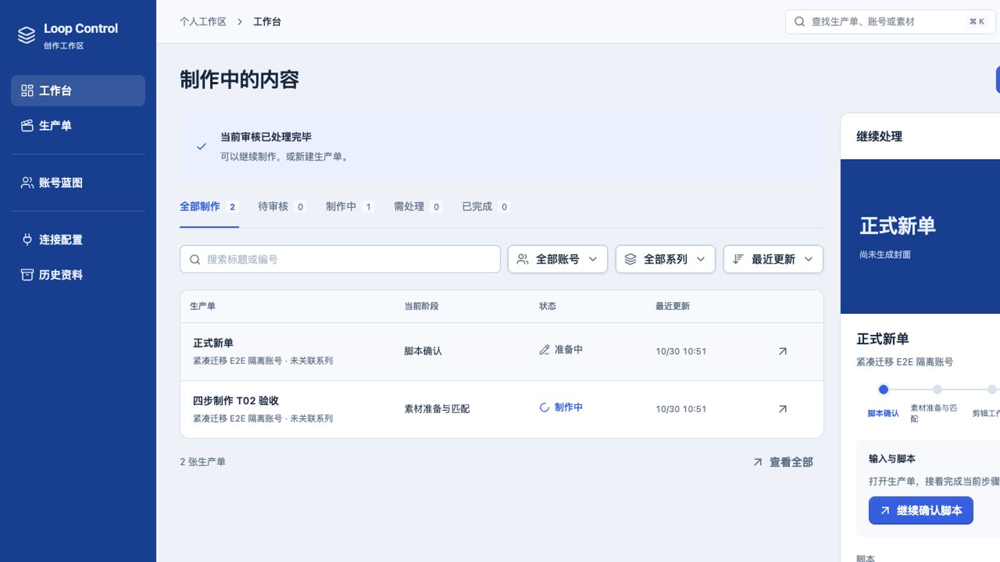

## 02 · new-episode-form

时间：2026-10-30 10:53:22（Asia/Shanghai）

通过普通新建生产单表单输入工作标题；账号蓝图来自隔离环境准备数据，未使用预建生产单替代主流程。

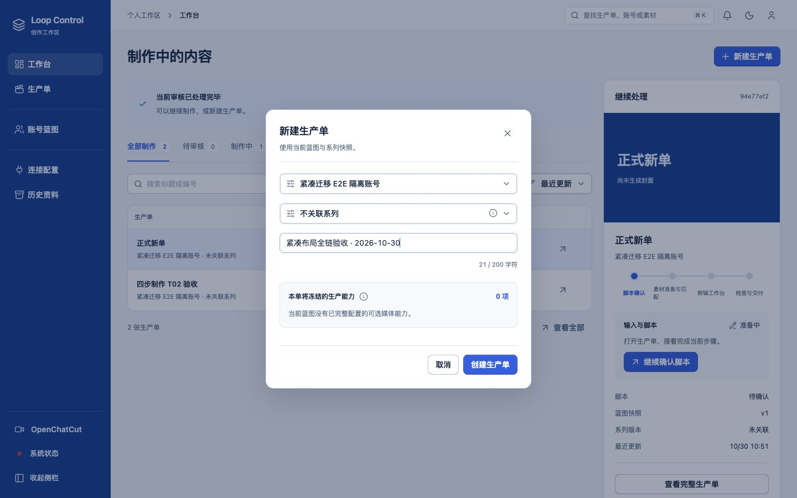

## 03 · script-uploaded

时间：2026-10-30 10:54:09（Asia/Shanghai）

通过上传脚本按钮选择受控 Markdown 文件；正文已进入正式脚本编辑框。没有通过数据库写入确认脚本。

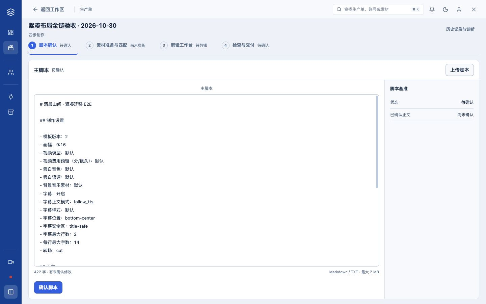

## 04 · script-confirmed

时间：2026-10-30 10:54:18（Asia/Shanghai）

确认脚本成功，系统进入素材准备与匹配；脚本步骤显示已确认。

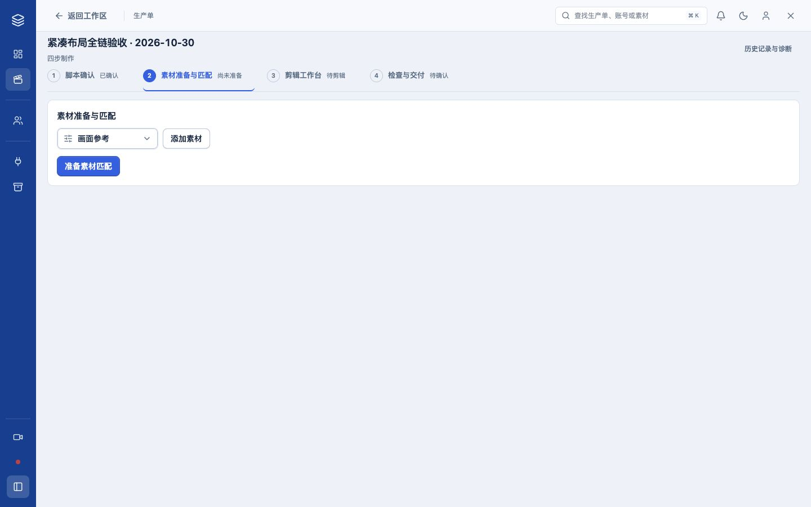

## 环境中断说明

首轮隔离环境的连接读取端口未配置，导致新建表单显示 0 项可选媒体能力。环境准备脚本重启时清理了首轮隔离数据库；上述截图保留，首轮不计作最终全链通过。已修正隔离连接读取 handler，不改产品或已冻结单据。下面重新登录、新建生产单并重跑完整链路。

## 05 · new-order-capabilities

时间：2026-10-30 10:58:14（Asia/Shanghai）

重新开始最终主链：普通新建表单显示已配置的 A-roll 与旁白 2 项能力，冻结当前账号蓝图。

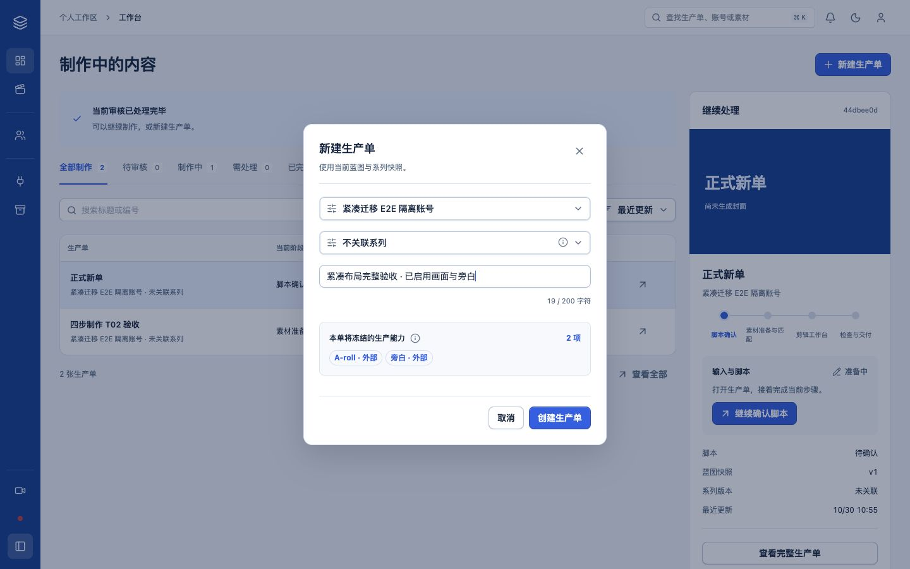

## 06 · main-script-input

时间：2026-10-30 10:58:15（Asia/Shanghai）

普通 UI 创建新生产单，上传主脚本 Markdown；正文可编辑、右侧基准未确认。

## 07 · narration-settings

时间：2026-10-30 10:59:22（Asia/Shanghai）

在素材页右栏切到口播，显式选择生成口播并保留脚本正文；本期默认声音/语速/语言设置仍可展开。已通过真实按钮授权生成。

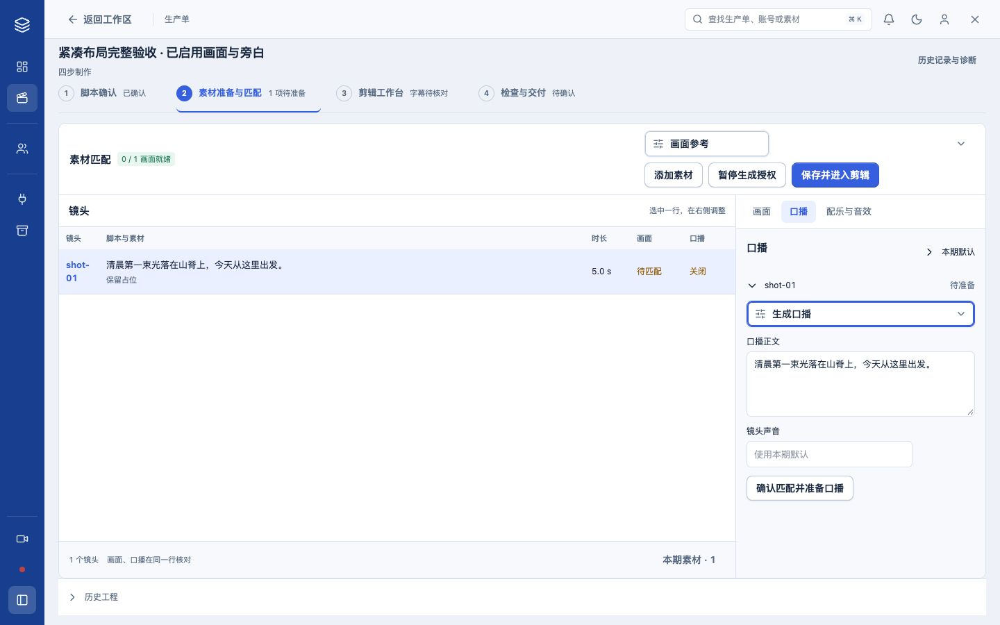

## 08 · narration-defaults-required

时间：2026-10-30 11:00:50（Asia/Shanghai）

首次准备口播返回「配置校验未通过」。界面显示默认声音，但新生产单尚未保存本期 TTS 默认设置。保留失败证据，接着通过本期默认表单保存后重跑同一步。

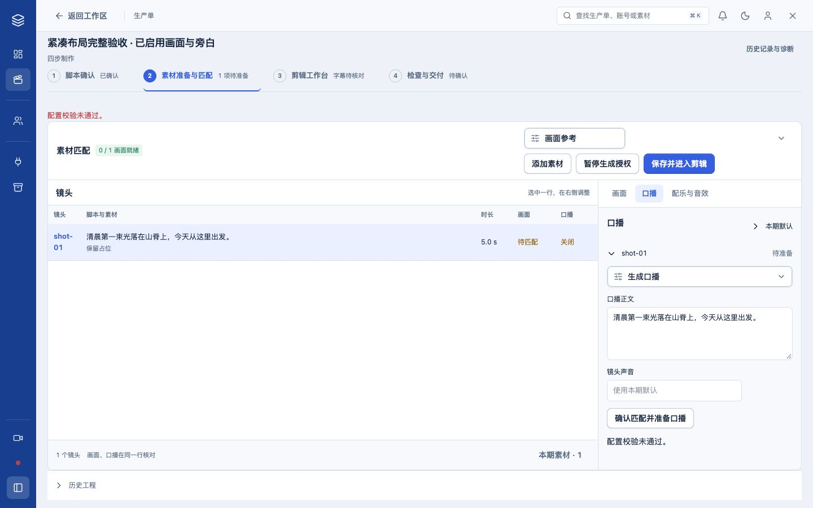

## 09 · narration-completed

时间：2026-10-30 11:02:02（Asia/Shanghai）

真实 UI 发起 generate_narration，隔离 loop_worker claim 后经受控协议生成实际 MP3，页面轮询回填并自动采用首次口播；显示 2.40 秒与已采用。此项不代表在线供应商质量或余额通过。

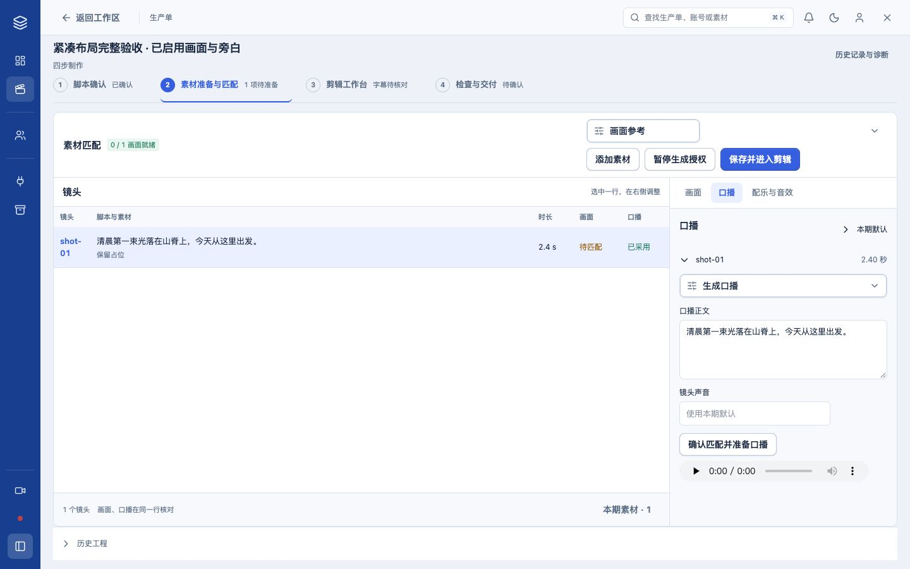

## 10 · visual-generation-settings

时间：2026-10-30 11:02:15（Asia/Shanghai）

首帧图片经真实上传登记后选择 AI 视频；使用已采用主声的 2.40 秒窗口，填写镜头动作与费用预留。调用对象为隔离受控 Provider，不产生真实付费生成。

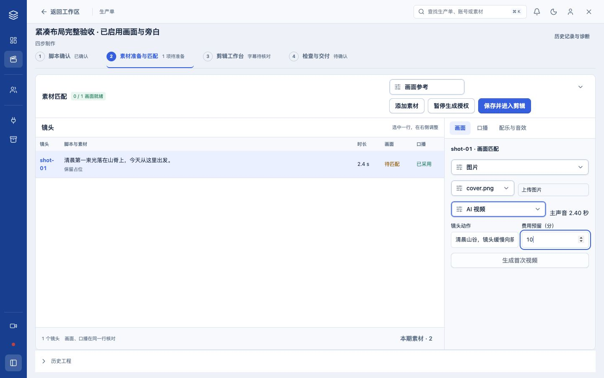

## 11 · visual-capability-mismatch

时间：2026-10-30 11:03:56（Asia/Shanghai）

首次画面提交被正常拒绝：测试模板默认 b_roll，但隔离蓝图仅配置 A-roll。保留拒绝证据。接着经普通脚本修订改为 a_roll，并重新采用规划，验证基准变化与原有内容保留路径。

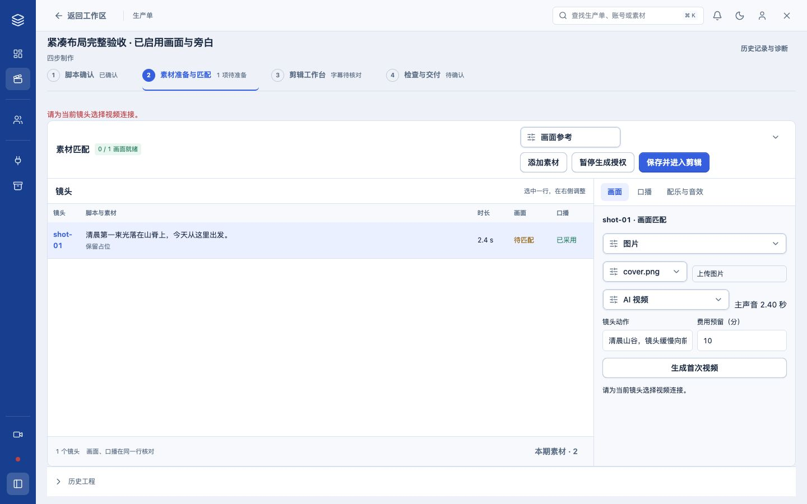

## 12 · script-revision

时间：2026-10-30 11:03:57（Asia/Shanghai）

修改主脚本镜头类型为 a_roll，填写脚本修订原因；通过真实修订按钮更新脚本基准。

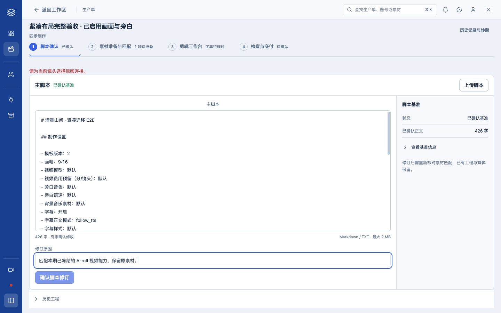

## 13 · replanned-voice-request

时间：2026-10-30 11:05:44（Asia/Shanghai）

脚本修订后显式采用当前规划，重新授权并准备口播。本期已保存默认值现在从真实 Episode 设置读取，界面不再错误阻止继承默认声音。

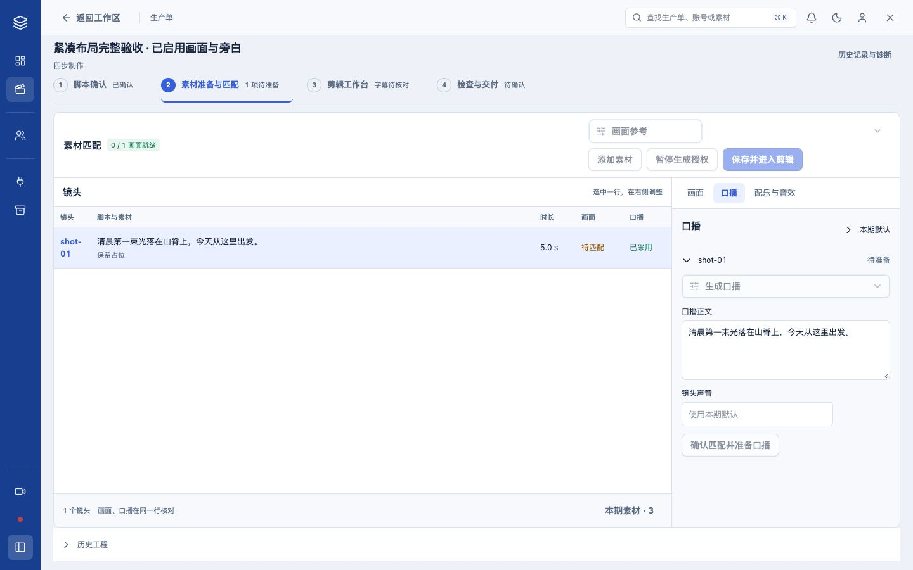

## 14 · video-budget-saved

时间：2026-10-30 11:16:02（Asia/Shanghai）

补齐真实账号视频生成预算入口：通过正式 Owner 命令设置隔离账号试片额度 100 分、总额度 500 分，未勾选完整额度授权。该操作只设置隔离应用额度，不充值、不提交在线付费生成。首次生成将等待旧入口兼容修复加载后重试。

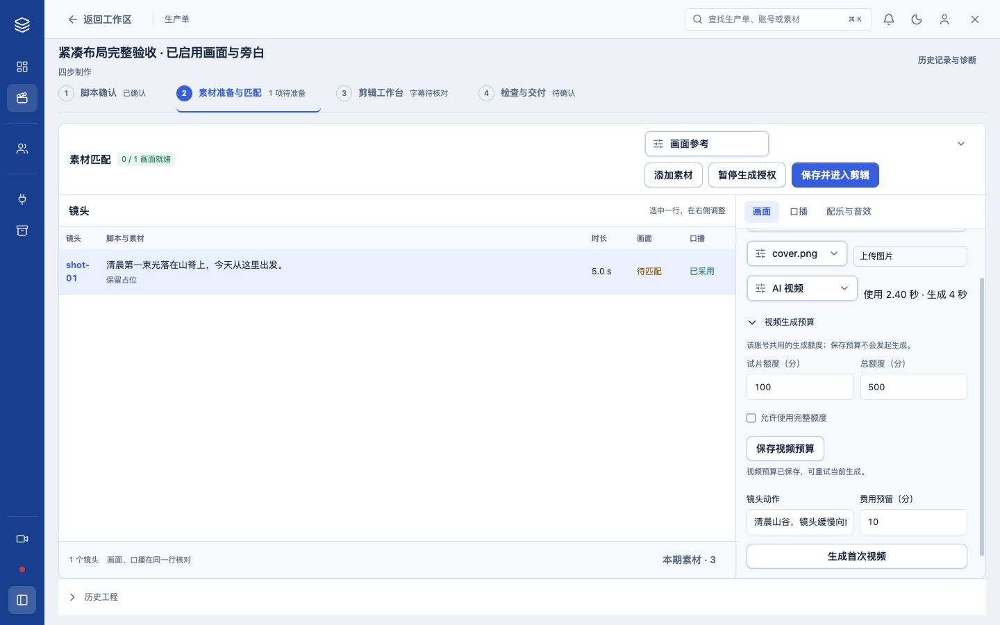

## 15 · first-video-duration-validation

时间：2026-10-30 11:29:47（Asia/Shanghai）

同一测试单恢复后，2.4 秒口播、4 秒生成请求仍被时长校验拒绝。保留真实错误并继续定位，不改阶段、批准或数据绕过。

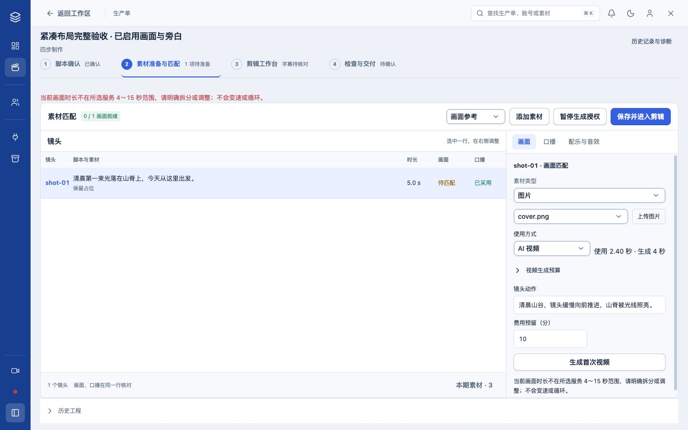

## 16 · short-audio-rejected

时间：2026-10-30 11:30:31（Asia/Shanghai）

上传人工配乐后，系统拒绝不足当前时间线长度的 2.4 秒音频，保留明确错误。准备 12 秒独立测试配乐后重试。

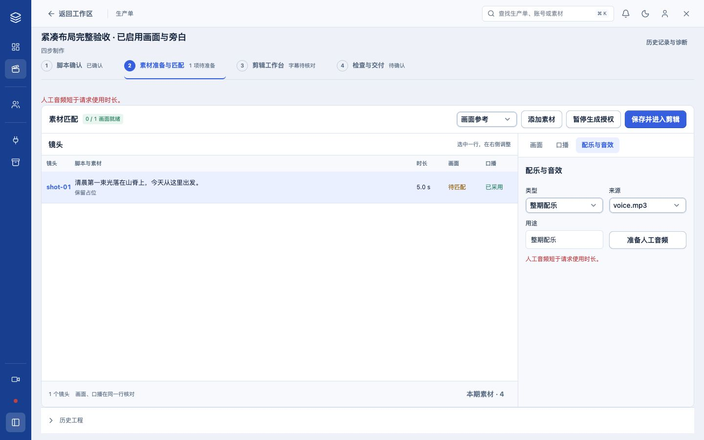

## 17 · bgm-adopted

时间：2026-10-30 11:30:39（Asia/Shanghai）

从真实上传登记的 12 秒测试配乐准备并采用整期音轨；短素材拒绝后，同一页面用足够长度素材恢复成功。

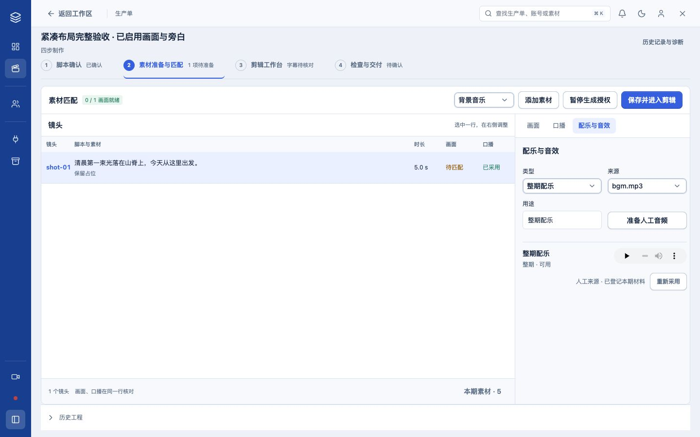

## 18 · replanned-narration-adoption

时间：2026-10-30 11:31:50（Asia/Shanghai）

重规划后，口播面板实际提示到工作台采用，而列表仍显示已采用。继续通过工作台正式采用现有音轨；修复列表与真实主声的一致性，不直接改数据库。

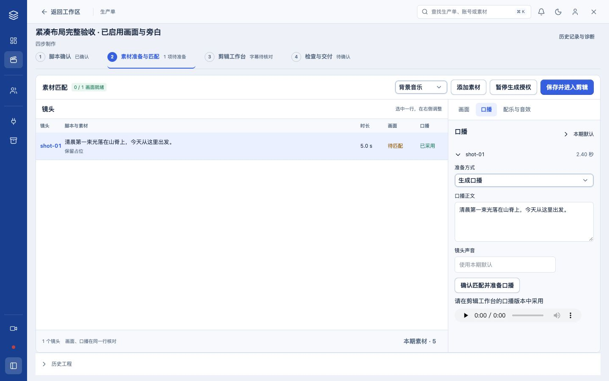

## 19 · narration-adopted-in-studio

时间：2026-10-30 11:32:27（Asia/Shanghai）

在真实 Studio 的口播版本中选择完整时长处理，正式采用当前 2.4 秒候选为主声。旧版本保留用于比较，未覆盖原工程。

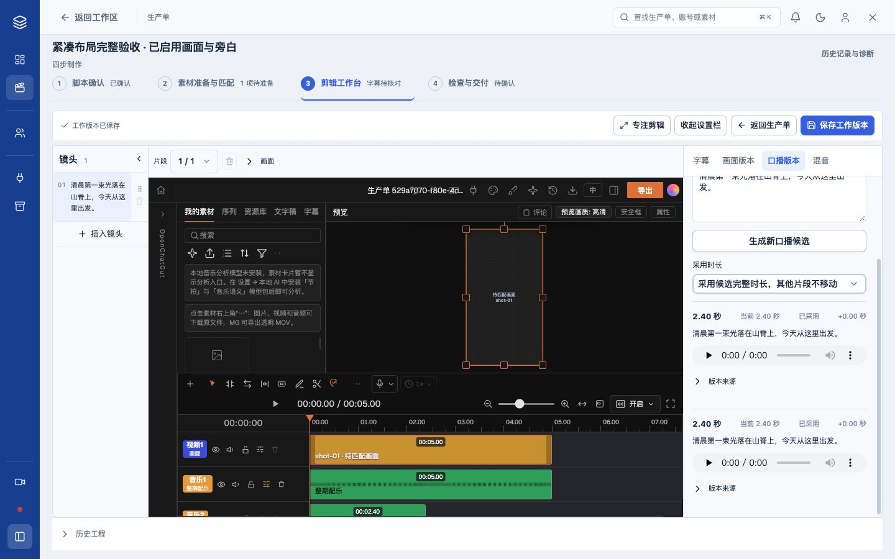

## 20 · first-video-queued

时间：2026-10-30 11:32:59（Asia/Shanghai）

正式采用当前口播主声后，同一首次视频请求成功入队：使用 2.4 秒、Provider 生成 4 秒；由隔离受控 Provider 返回媒体，真实 Worker 执行。

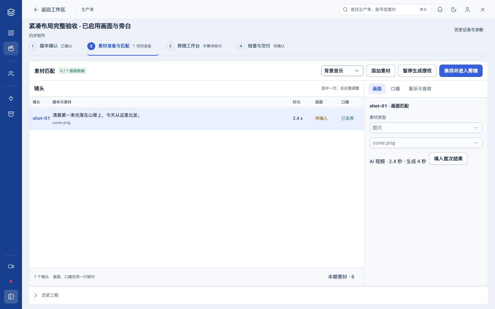

## 21 · first-video-filled

时间：2026-10-30 11:34:02（Asia/Shanghai）

填入首次结果成功：画面 1/1 就绪，真实工程中的目标画面为 wan-shot-01.mp4，使用时长 2.4 秒。

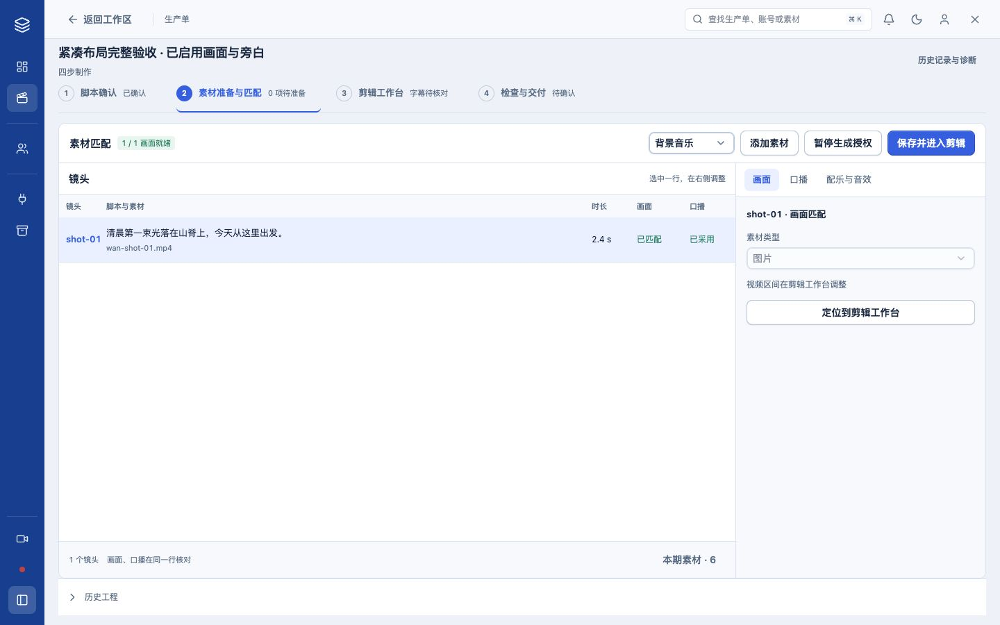

## 22 · focused-native-editor

时间：2026-10-30 11:35:20（Asia/Shanghai）

真实 OpenChatCut 已应用画面焦点 X=13 并保存工作版本。开启专注剪辑、折叠镜头导航、收起设置栏后，编辑器获得主要窗口空间；保留原生工具和时间线。

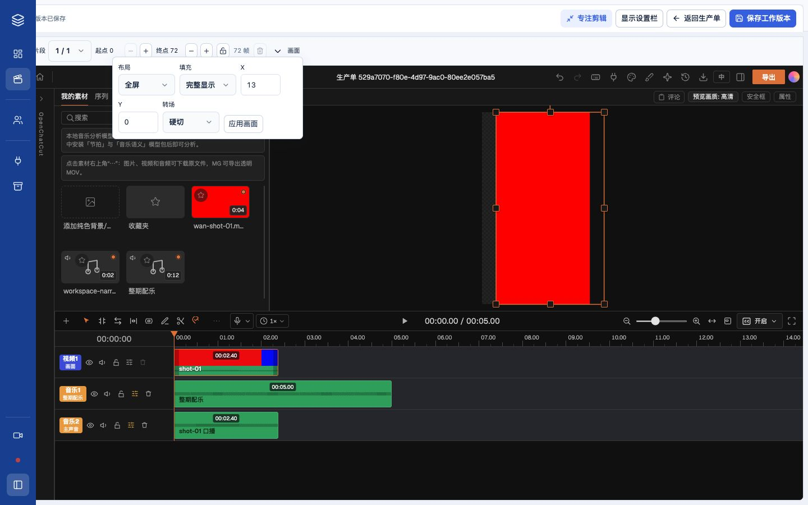

## 23 · captions-confirmed

时间：2026-10-30 11:35:52（Asia/Shanghai）

真实 Studio 应用跟随口播字幕，手工保存 0–2400 ms cue；状态显示时序有效后，再明确核对正文。原生字幕轨和预览可见。此项为人工校时，不将其记为 WhisperX 声学模型推理通过。

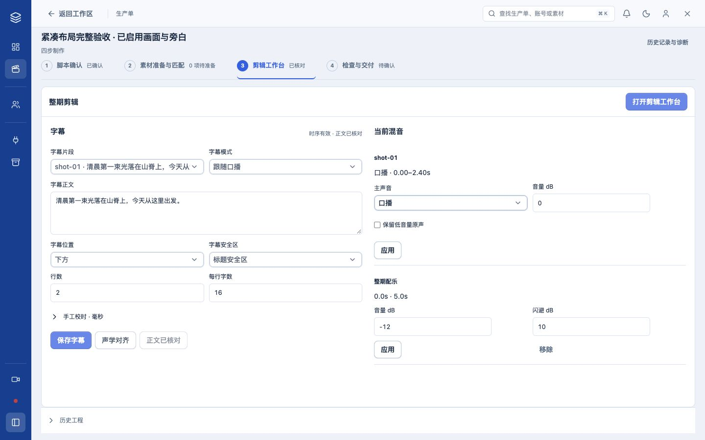

## 24 · reopened-editor-restores-edit

时间：2026-10-30 11:37:26（Asia/Shanghai）

关闭会话后重新打开真实 Studio，画面焦点 X 仍为 13，字幕正文保持已核对。最终配乐已按 2.4 秒画面重新准备与采用。

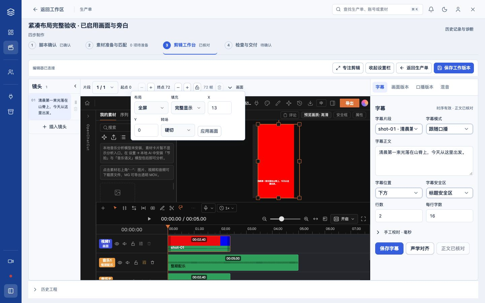

## 25 · mix-applied

时间：2026-10-30 11:38:02（Asia/Shanghai）

通过真实混音面板把整期配乐设为 -18 dB，保留口播主声和 10 dB 闪避；由原生桥接保存，不直接编辑工程文件。

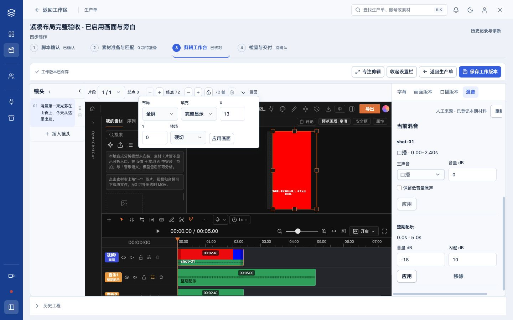

## 26 · final-export-checks-pass

时间：2026-10-30 11:38:51（Asia/Shanghai）

真实原生渲染导出 v11，316442 字节；实际使用来源、字幕、MP4 时长/画幅/音频/黑帧、代表帧解码和不可变 SHA 登记共 5/5 检查通过。尚未确认文件。

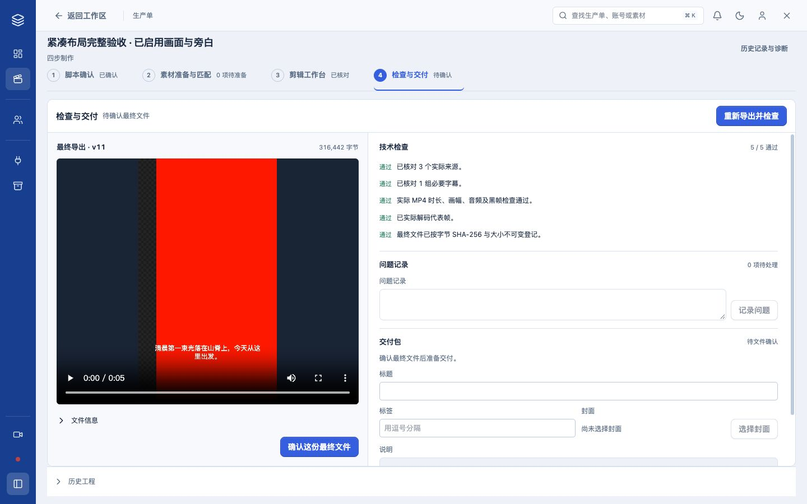

## 27 · open-issue-blocks-confirmation

时间：2026-10-30 11:38:56（Asia/Shanghai）

记录一条真实未解决问题后，最终文件确认按钮禁用；问题记录与技术检查分开显示，不能只凭技术通过完成交付。

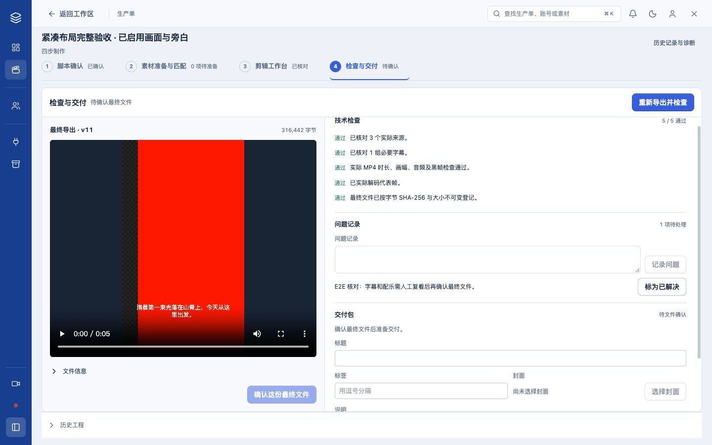

## 28 · delivery-draft-filled

时间：2026-10-30 11:41:04（Asia/Shanghai）

首次精确导出确认后填写标题、标签、说明并选择封面。随后返回编辑核对配乐尾部范围，验证导出失效与交付草稿保留。

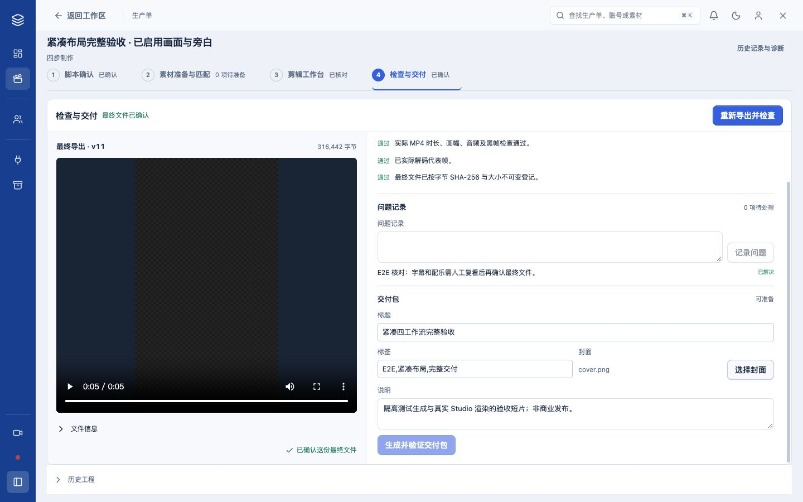

## 29 · saved-edit-invalidates-old-export

时间：2026-10-30 11:50:52（Asia/Shanghai）

通过正式混音动作移除过长配乐引用（源文件保留），保存工程后原 v11 确认立即失效，界面要求重新导出。保留口播主声和人工字幕。

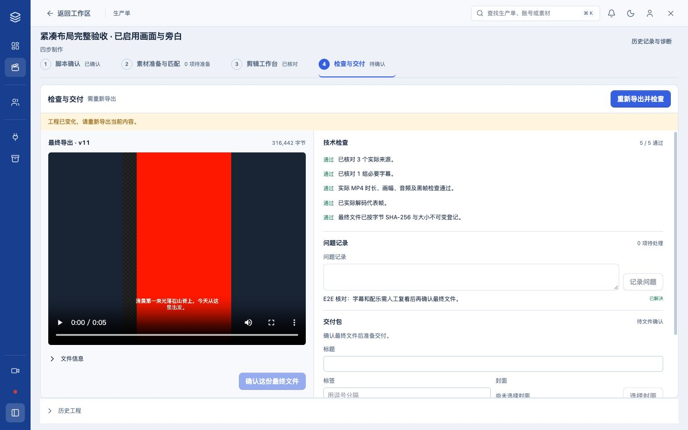

## 30 · delivery-draft-preserved

时间：2026-10-30 11:52:08（Asia/Shanghai）

最终 v12 163207 字节，播放时长 2.453333 秒、readyState=4、无解码错误；已重新确认。填写标题、标签、说明、封面后切到脚本再返回，草稿完整保留。本步窗口设置尚未实际应用，不能单独作为矮窗口证据；随后在独立布局单实际验证 1380×774：确认按钮 bottom=743。未提交测试正文变化。

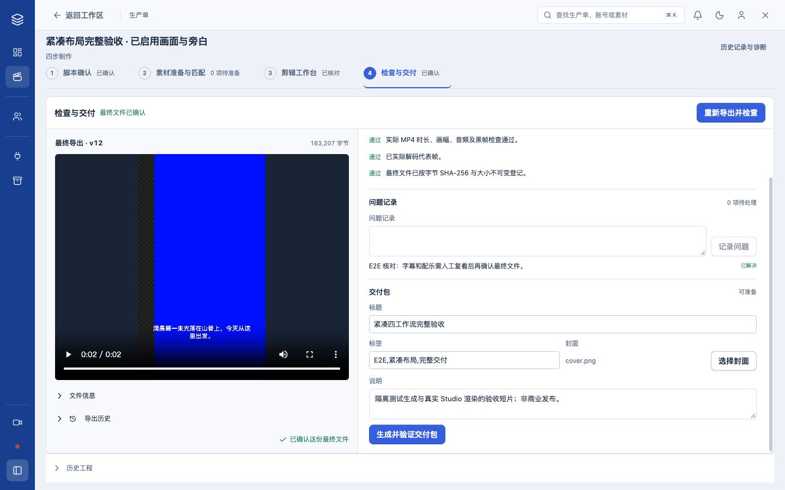

## 31 · production-completed-six-files

时间：2026-10-30 11:53:55（Asia/Shanghai）

真实交付 Worker 已完成并验证，生产单进入 production_completed。六类文件的磁盘和 Owner HTTP 下载字节 SHA 全部一致，交付视频与已确认导出完全相同；独立 ffprobe 与 ffmpeg 全片解码通过。

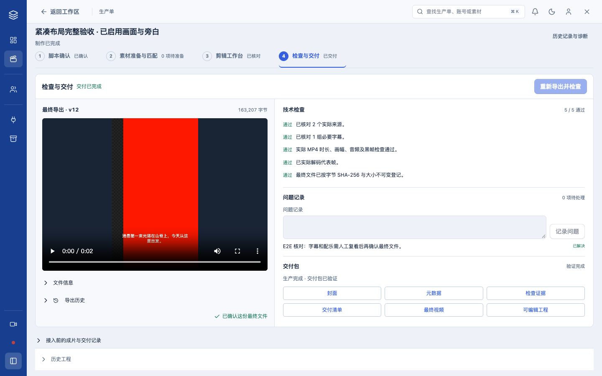

## 32 · completed-order-browse-enabled

时间：2026-10-30 11:54:45（Asia/Shanghai）

制作完成后，素材设置仍可切换画面与口播、查看镜头；准备、保存、生成等写操作保持禁用。完成单的交付页不显示虚假的正在导出。

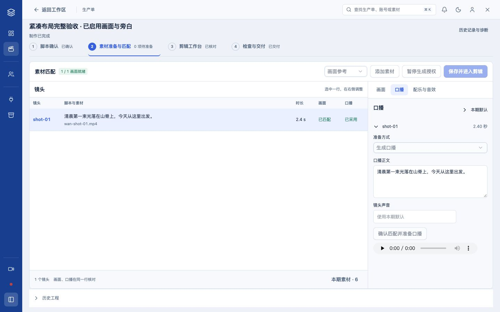

## 33 · focused-editor-layer-fixed

时间：2026-10-30 12:00:32（Asia/Shanghai）

独立布局验收单上传并匹配静帧，再打开真实 Studio。专注、收起两侧栏后编辑器约 1380×775，左侧状态和原生控制不再被主导航遮住。该补充单只验证布局，没有生成任务或交付。

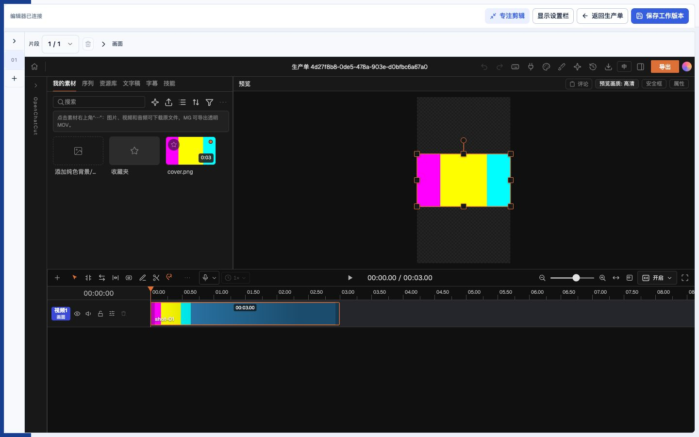

## 34 · 矮窗口键盘可达性与稳定截图补正

在独立布局单 `4d27f8b8-0de5-478a-903e-d0bfbc6a67a0` 以真实 1380×774 验证修订原因与按钮（bottom=743）。进一步以 1280×720 检查发现按钮底部超出脚本主区，加入主区独立滚动后，用修订原因输入框的 Tab 实际聚焦确认按钮：bottom=635.5、mainBottom=652、scrollTop=29。只恢复本地测试草稿，不提交修订。

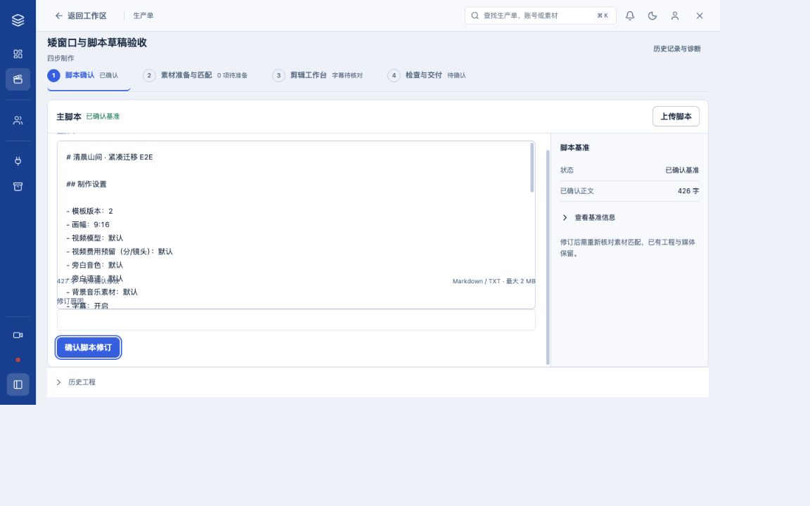

20项响应式与24项日常页面核验截图均在实际布局稳定后保存。制作完成截图31在完整工作空间加载且六类链接出现后补正，原截图早于初始读取完成；业务完成事实由独立文件核对证明。

## 34 · final-completed-view

时间：2026-10-30 12:05:02（Asia/Shanghai）

最终稳定页面显示交付已完成、生产完成·交付包已验证与六类文件入口。已完成单写操作禁用，四步浏览保留。完整验收单数据和文件保留供 Owner 复看。

