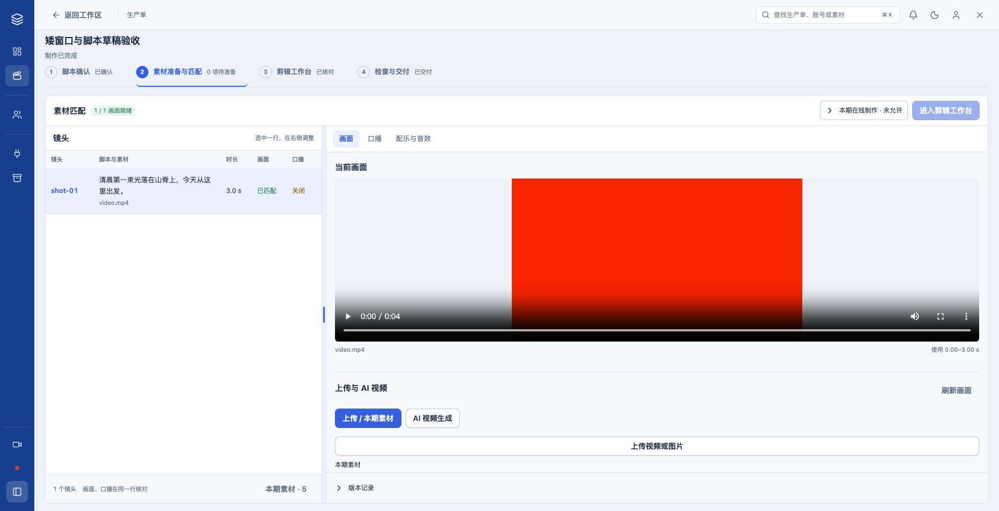
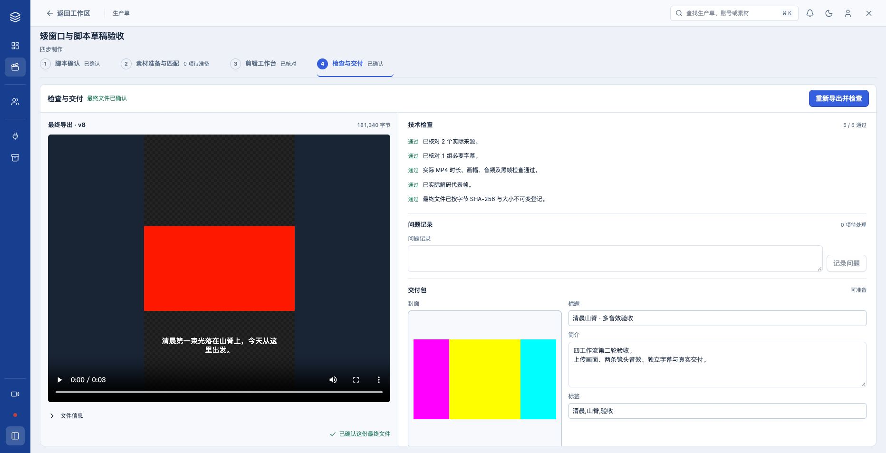

# 四工作流第二轮交互验收

本轮按 11 条页面批注及新增的自由调宽需求完成调整。日常页面已更新；原生产数据和媒体保留。默认延续蓝灰主题与 1440px 桌面布局。

## 批注落实

| 批注 | 当前行为 |
|---|---|
| 1 主脚本锁定 | 提交后为可复制的预览，点击「修改脚本」进入编辑；保存修订和放弃未保存修改分别二次确认。 |
| 2 历史位置 | 原工程备份与工作版本合并到右栏底部「版本记录」，默认折叠；其他工作流同位收纳。没有删除历史文件。 |
| 3 镜头列表与预览 | 默认约 41:59；右栏显示当前实际采用图片/视频及源区间，支持多个引用切换。预览与列表跟随已保存原生工程。 |
| 补充 自由调整 | 中间分隔线可拖拽；方向键每次微调 2 个百分点，双击恢复默认。浏览器记住比例；900px 以下上下排列。 |
| 4 口播配置 | 展示本期真实接入模型、按语言筛选的声音候选、声音 ID、语言和语速。模型目录可扩展；本轮仅接入 `seed-tts-2.0`，不显示不可调用模型。已确认生产单沿用冻结模型，模型改变仍需蓝图与重新确认流程。 |
| 5 上传和 AI 视频 | 当前镜头内切换「上传 / 本期素材」与「AI 视频生成」；可上传画面和 AI 首帧，保留动作、时长、预算、费用预留、任务恢复与候选比较；明确采用才替换当前画面。 |
| 6 多音效 | 「添加音效」可重复使用，同一镜头允许多条；每条独立准备、加入、设置偏移/时长、调整音量/闪避及移除引用，原素材保留。 |
| 7 素材用途 | 用途是登记分类，决定素材进入画面、口播、配乐、音效或封面入口。常用上传入口按所在面板自动归类。 |
| 8 上传位置 | 画面上传移到镜头右栏；声音与交付封面也在对应位置上传。工作空间创建前保留初始批量导入入口。 |
| 9 授权含义 | 改为「本期在线制作」，展开后明确涵盖 AI 视频、生成口播和在线配乐/音效检索。授权本身不提交任务，上传与本地编辑不需要授权。 |
| 10 剪辑入口 | 点击第三步直接打开已有真实 OpenChatCut 工程；保存关闭返回素材页，不再经过总览入口页。 |
| 11 交付布局 | 左侧图片占位与真实封面预览，右侧依次标题、简介、标签；标题和标签单行，简介默认多行。跨步骤返回保留草稿。 |

「原工程备份」用于接入前原稿恢复，「工作版本」记录后续保存，两者用途不同，因此保留并合并收纳。剪辑器内新增音效当前需保存返回素材页后加入，已有音效可在剪辑器中直接调音量和移除；页面保留明确提示。

## 实际页面

## 实际链路与证据

隔离测试单：`4d27f8b8-0de5-478a-903e-d0bfbc6a67a0`。从已有确认脚本继续，通过实际 UI 上传 MP3、在同一镜头加入两条音效并分别调节；上传 4 秒视频，预览后保留 3 秒目标窗口并采用；直接进入真实编辑器，确认时间线、手工字幕校时并核对；实际导出、5/5 检查、明确确认最终文件；填写封面、标题、两行简介及标签，切换工作流返回后草稿保留，生成并验证交付包。

最终阶段为 `production_completed`；六类文件磁盘和 HTTP SHA/大小一致，交付视频与已确认视频一致，ffprobe 与 ffmpeg 全片解码通过。没有通过数据库写入伪造阶段、文件确认或交付结果。

- [逐步操作日志与截图](OPERATIONS.md)
- [测试与失败修正记录](TESTS.md)
- [六文件独立验证](readback-4d27f8b8-0de5-478a-903e-d0bfbc6a67a0/verification.json)
- [本轮最终测试视频](readback-4d27f8b8-0de5-478a-903e-d0bfbc6a67a0/final_render.mp4)
- [独立终审：ship](FINAL-REVIEW.md)
- [前轮从新建脚本开始的全链 E2E 与 7/7 Provider 连接测试](../compact-workflow-migration-20261030/REPORT.md)

## 日常内容保护

更新前捕获七类完整记录指纹，更新后完全相同：6 张生产单、210 项任务、38 个审核包、22 次批准、86 个素材版本、240 个产物、65 条音轨；待执行和运行任务均为 0。原生工程打开仅用于用户已有页面，未在日常单中替换素材、调整字幕、发起生成或交付。

本轮开始时素材表已比前轮历史快照多 1 条，其余六类相同；该差异在本轮更新前已存在，未归因于本次迁移，也未删除。保护比较使用本轮当前基线 [daily-before.json](daily-before.json)，结果见 [daily-after.json](daily-after.json)。

在线 Provider 本轮未重复测试；沿用前轮报告中当次 7/7 连接通过的证据，不将连接通过解释为余额充足或整段生成质量通过。本轮没有充值、在线付费视频生成、发布、提交或推送。
