## 1 · required-script-border

2026/10/30 14:29:56

空脚本提交后字段红框、aria-invalid 和焦点提示生效，无底部重复错误条。

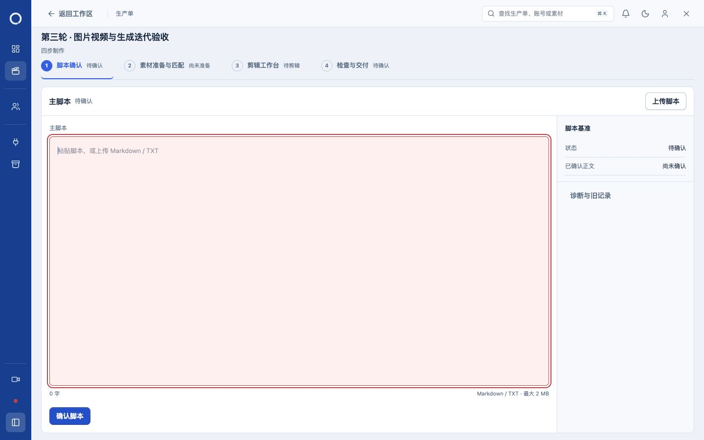

## 2 · revision-required-border

2026/10/30 14:32:03

已确认脚本进入编辑，修订原因未填时仅字段红框、聚焦并通过aria-describedby提供错误说明。

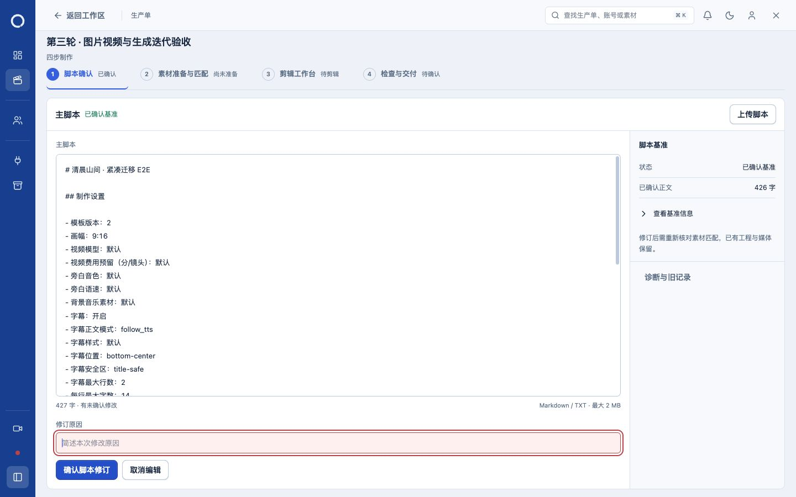

## 3 · discard-dialog-without-rules

2026/10/30 14:32:04

放弃修改二次确认保留，移除标题下和按钮上方分隔线。

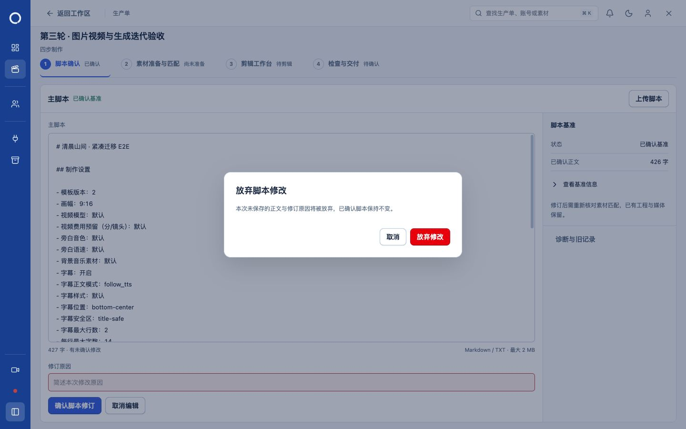

## 4 · reference-image-and-prompt

2026/10/30 14:33:52

图片页显示真实上传首帧；下方为独立多行视频提示词、时长、预算与费用预留。

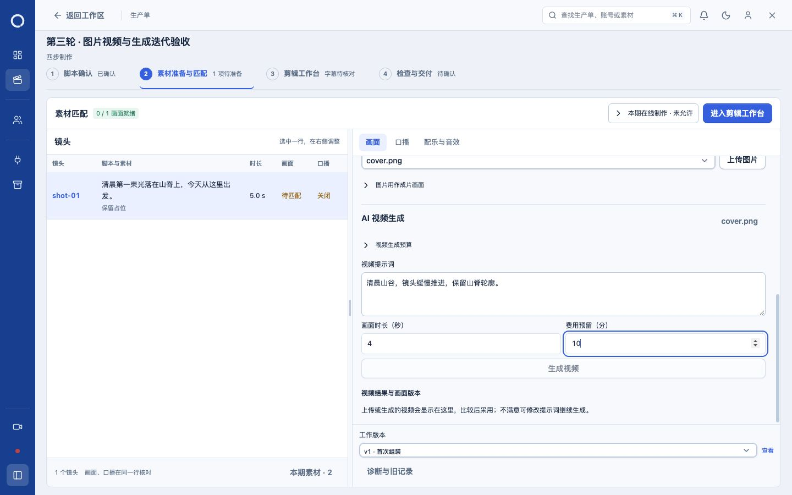

## 5 · brand-original-blue-large-name

2026/10/30 14:34:35

按用户纠正保留原蓝底，新环形标志和Loop Control浅冰蓝字标；品牌字体19px，展开侧栏无截断。

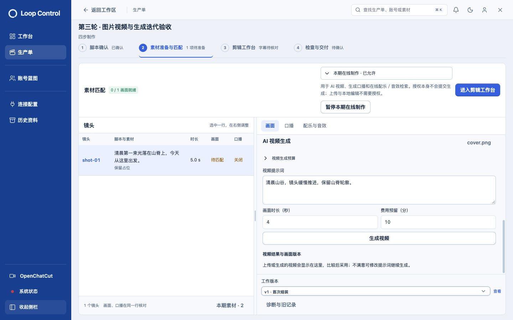

## 6 · brand-dark-blue

2026/10/30 14:35:00

深色模式仍使用原深蓝侧栏，浅色环形标志与19px字标可读。

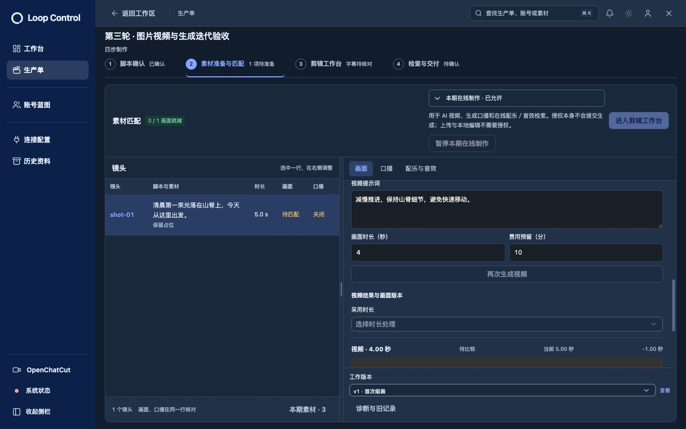

## 7 · two-generated-versions

2026/10/30 14:35:39

通过隔离受控Provider真实Worker生成两版，修改提示词再次生成后两版并存；采用前需明确时长策略，不自动替换当前画面。

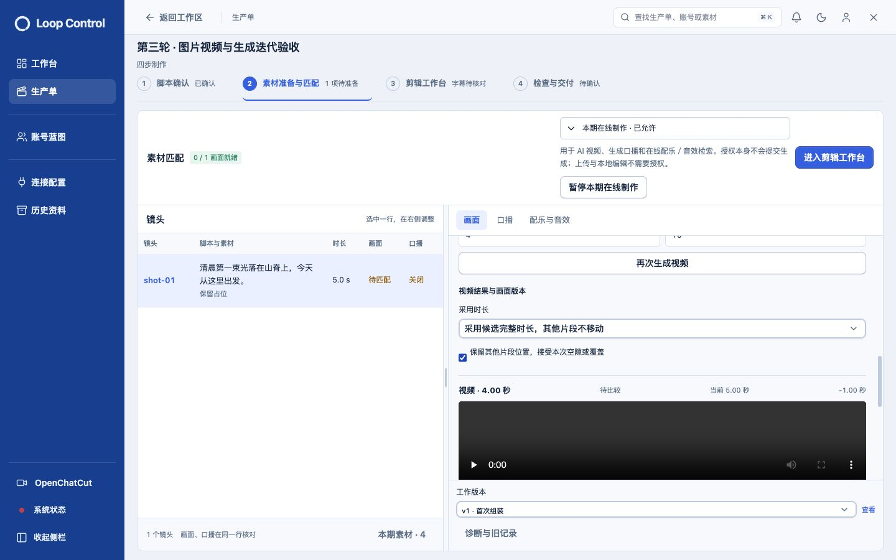

## 8 · adopted-video-preview

2026/10/30 14:36:13

明确采用第二版后，视频页预览实际采用视频；第一版保留在历史候选中，生成提示词草稿保持。

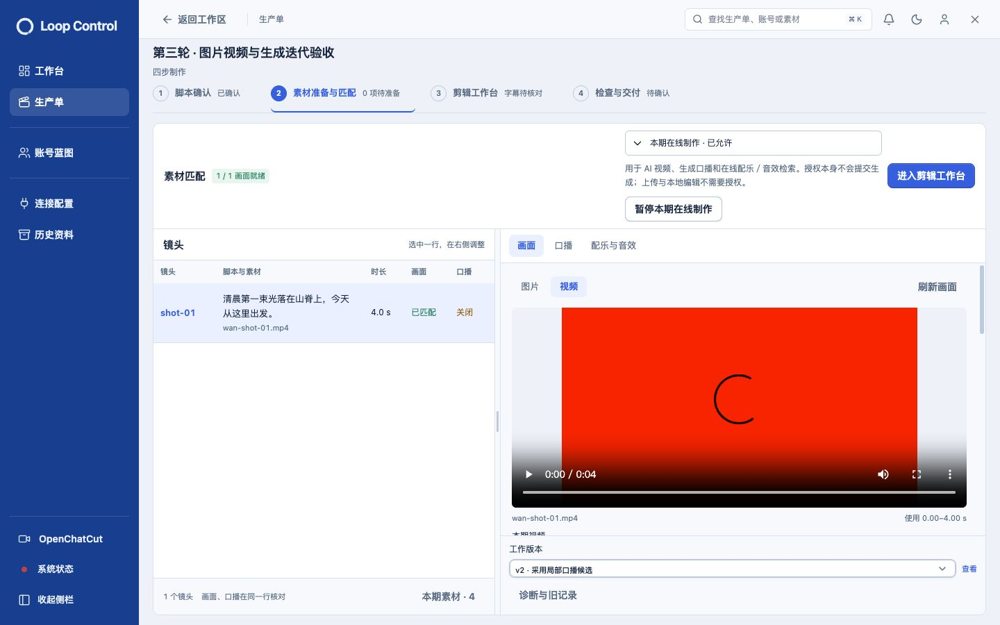

## 9 · uploaded-and-generated-versions

2026/10/30 14:38:41

手动上传视频与两版生成视频在同一镜头结果区共存；上传和登记版本不会自动替换当前采用结果。

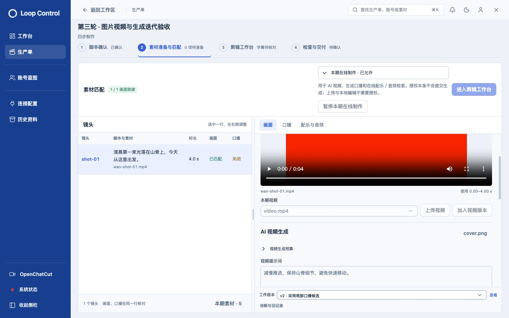

## 10 · responsive-1440-脚本确认

2026/10/30 14:39:22

实际 1440×900，无页面级横向溢出；检查新图片/视频预览和自然高度版本入口。

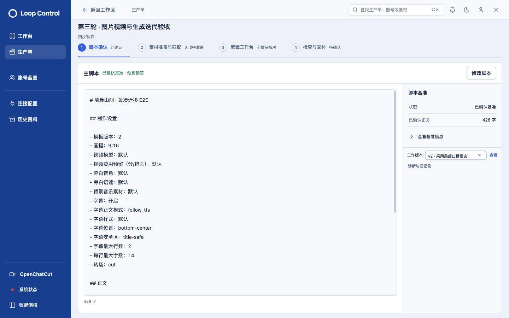

## 11 · responsive-1440-素材准备与匹配

2026/10/30 14:39:22

实际 1440×900，无页面级横向溢出；检查新图片/视频预览和自然高度版本入口。

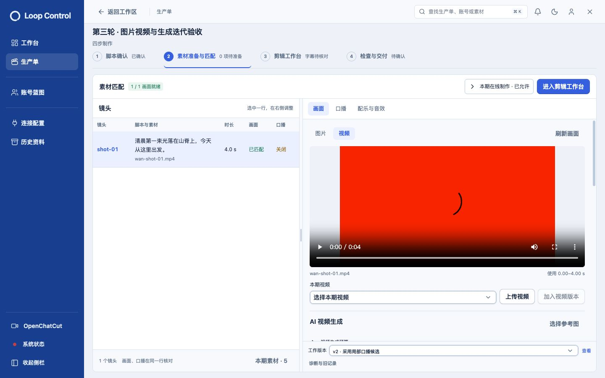

## 12 · responsive-1280-脚本确认

2026/10/30 14:39:22

实际 1280×800，无页面级横向溢出；检查新图片/视频预览和自然高度版本入口。

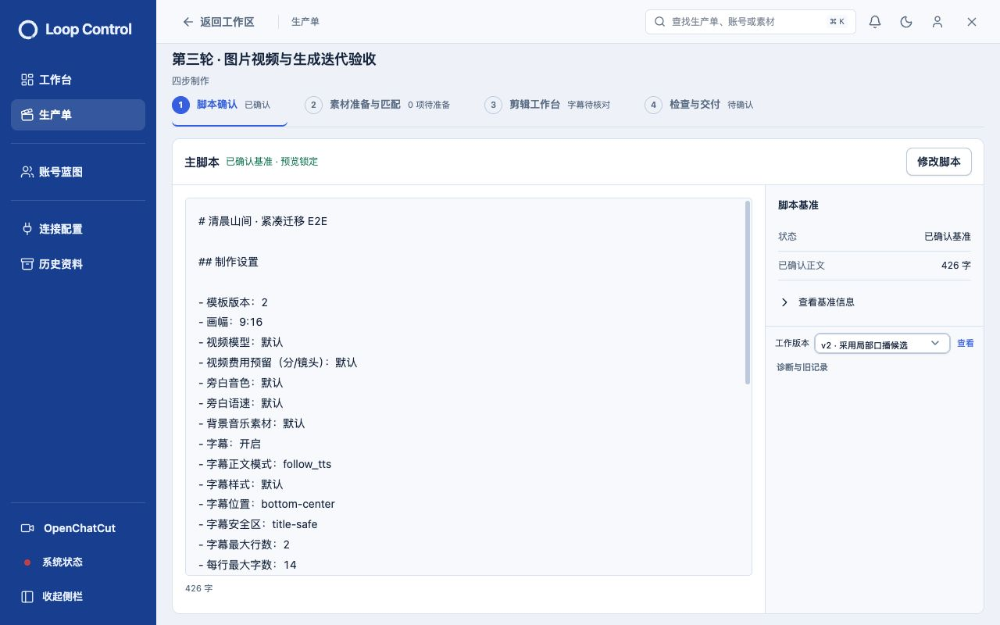

## 13 · responsive-1280-素材准备与匹配

2026/10/30 14:39:23

实际 1280×800，无页面级横向溢出；检查新图片/视频预览和自然高度版本入口。

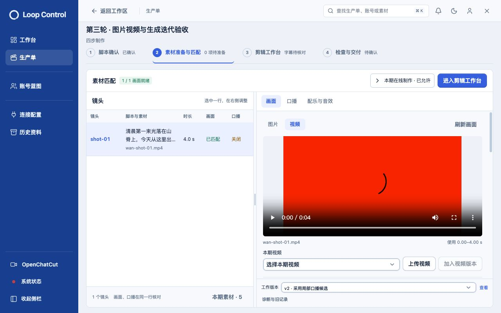

## 14 · responsive-390-脚本确认

2026/10/30 14:39:23

实际 390×844，无页面级横向溢出；检查新图片/视频预览和自然高度版本入口。

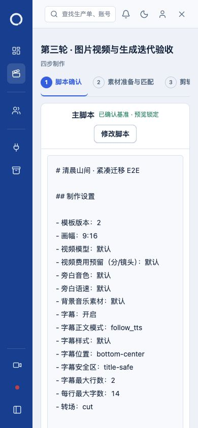

## 15 · responsive-390-素材准备与匹配

2026/10/30 14:39:23

实际 390×844，无页面级横向溢出；检查新图片/视频预览和自然高度版本入口。

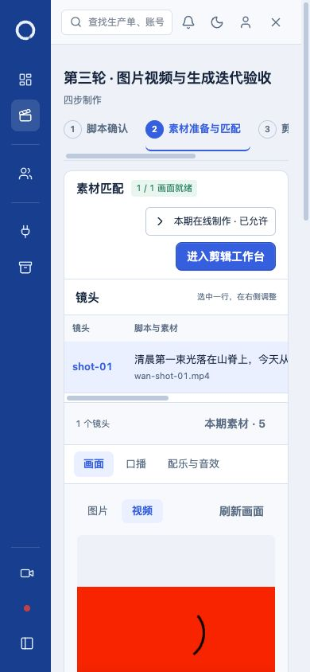

## 16 · brand-collapsed

2026/10/30 14:39:24

折叠侧栏仅显示浅色环形标志，保留原蓝底；展开字标19px完整显示。

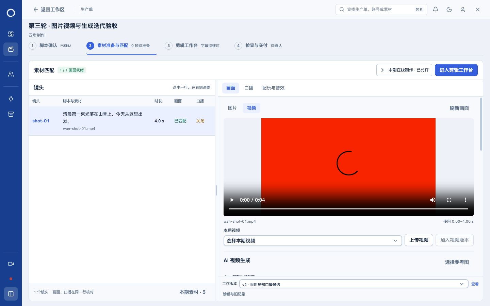
