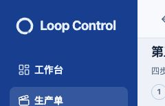
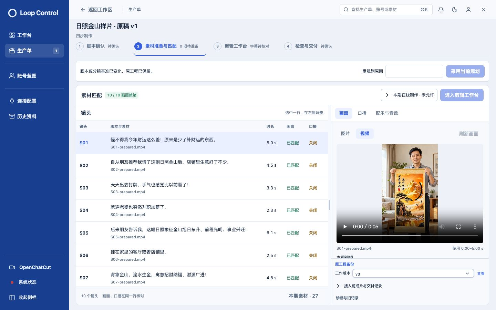
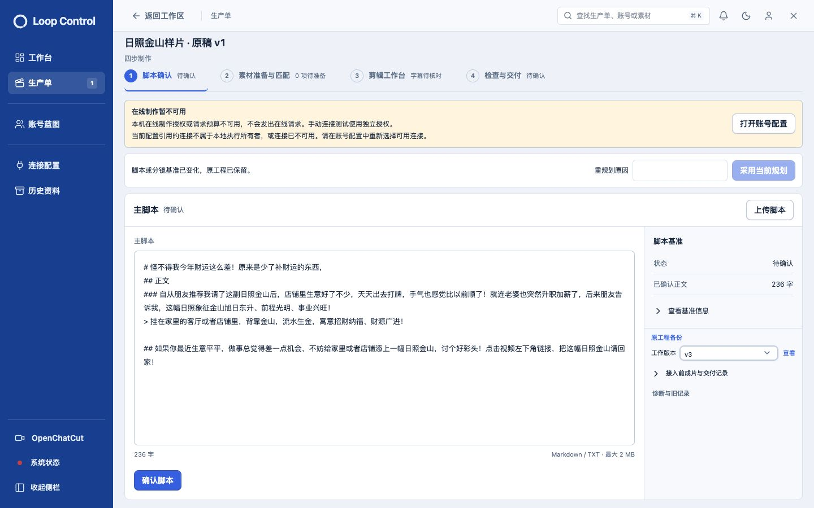

# 四工作流第三轮调整与品牌更新

2026-10-30。按7条新批注及后续品牌反馈完成。本地服务已更新，保留原蓝色侧栏，仅替换环形标志与 `Loop Control` 名称；删除「创作工作区」，品牌字号从16px增至19px。

## 当前变化

| 反馈 | 实现 |
|---|---|
| 历史固定高度、嵌套折叠 | 删除外层「版本记录」折叠。原工程链接、工作版本选择/查看、接入前成片、诊断入口直接可见。没有固定或最大高度，版本区由内容自然撑开，跟随右栏滚动。实际原单版本区135.5px、overflow=visible。 |
| 必填项提醒 | 缺少正文或修订原因时，对应输入红框并聚焦；输入后清除红框。通过aria-invalid、aria-describedby和屏幕阅读器提示保留无障碍信息，取消底部重复提示条。上传成功也会清除必填错误。 |
| 二次确认弹窗 | 去掉标题下和操作按钮上方的分隔线，保留保存/放弃确认与焦点管理。 |
| 报错后布局 | 前置检查放入四步区域内，原因与账号配置入口同位显示；避免页顶额外大卡和重复原始错误。重规划通知采用紧凑横排，1440px窗口实际高60px，脚本主区仍有483px高度。待确认修订优先停在第一步，不因已有工程自动跳到第三步。 |
| 图片/视频与提示词 | 镜头上方切换图片和视频。图片为首帧/参考图，可就地上传；视频显示当前采用结果和手动上传入口。下方单独编辑多行视频提示词、时长、费用预留和预算。生成结果作为版本比较，明确采用后才替换当前画面。当前已接入服务按首帧模式传图；保留图片作静帧/推拉的入口。 |
| 生成不满意继续修改 | 修改提示词后再次生成，新旧版本并存。生成版本返回原提示词、首帧ID及生成时长，可显式载入设置继续编辑；仍需明确提交、费用预留和采用，既有重复提交与未知结果围栏保留。 |
| Logo及文字 | 由用户指定的子Agent重绘代码原生SVG环标，共用品牌组件。沿用原蓝底，标志和字标为浅冰蓝；删除「创作工作区」。品牌19px，展开宽172px不截断；折叠仅保留环标，浅深色均已实际检查。 |

## 前置检查的真实含义

只读检查确认：这张单冻结配置引用的火山语音与百炼连接版本均存在、当前且未撤销，但连接创建Owner与本地执行Owner不同，因而被连接权限检查拒绝。当前部署使用 `manual` 连接测试方式，而生产请求授权已过期，实际返回 `network_expired`。前轮7/7手动连接测试与本次生产请求受阻属于不同检查，不矛盾；本次错误不能据此判断余额不足。

恢复在线制作需要在账号配置中明确选择本地执行Owner可用的连接，并更新生产请求授权。此次仅查明原因、优化提示和布局，没有自动改连接所有者、切换凭据、延长授权、增加预算或绕过权限。

[只读诊断事实](connection-diagnosis.json)。实际对原单未修改脚本文本，只重试既有失败确认请求，前置检查拒绝后事务回滚；更新前后业务指纹一致。

## 验证

- 全量普通回归：165文件1111项通过，[日志](logs/unit-suite.log)。
- 真实视觉集成：12项通过，包含生成设置读回、HTTP/PG/Worker、候选时长、未知提交恢复及权限围栏，[日志](logs/visual-integration.log)。
- 受影响界面：41项通过，[日志](logs/interaction-tests.log)。待确认脚本跳转问题先红后绿，[原失败](logs/pending-script-red.log)。
- TypeScript、前端构建、Worker/后端准备及运行产物完整性通过，[构建](logs/build.log)、[准备](logs/runtime.log)、[完整性](logs/integrity.log)。新增测试夹具最初出现类型错误，已修正，未放宽产品类型或断言。
- 1440、1280、390窗口，脚本和新素材区6项无页面级横向溢出，[记录](responsive.json)。原单错误态1440px无横向溢出，历史区无内部滚动或高度截断。
- 实际隔离UI新建单 `2cde086b-dec1-45cf-aea3-03a4dd591798`：上传确认脚本、必填校验、取消修订、图片上传、明确授权、生成第一版、修改提示词生成第二版、明确采用第二版、手动上传第三个视频版本。实际读到3个版本及1个当前视频，未自动采用第三版。生成使用明确受控Provider协议与真实Worker，不代表在线付费生成质量通过。
- 浅色/深色、展开/折叠侧栏和19px字标均实际检查。环标与字标沿用rail-ink，主笔画浅色对比约8.59:1、深色约13.72:1。
- 日常HTTP 200，七类业务指纹更新前后相同，待执行/运行任务0，[前](daily-before.json)、[后](daily-after.json)。没有改日常脚本、素材、工程、连接、授权或交付结果。

[逐步操作与截图](OPERATIONS.md)。本轮聚焦新增交互；完整交付E2E与在线连接记录分别保留在 [第二轮](../compact-workflow-round2-20261030/REPORT.md) 和 [初次迁移](../compact-workflow-migration-20261030/REPORT.md)。未充值、未提交在线付费视频、未发布、未提交或推送。
