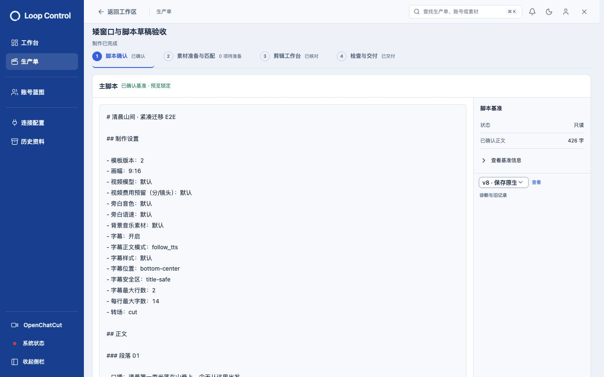
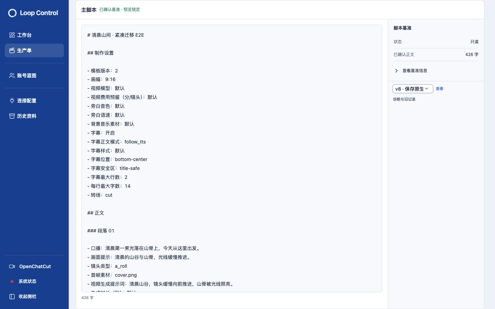
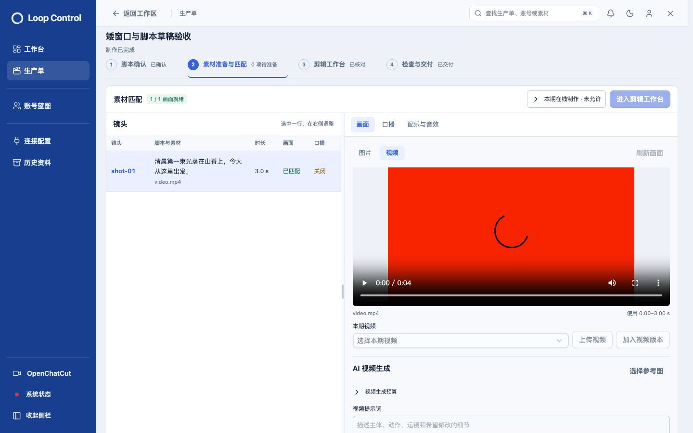
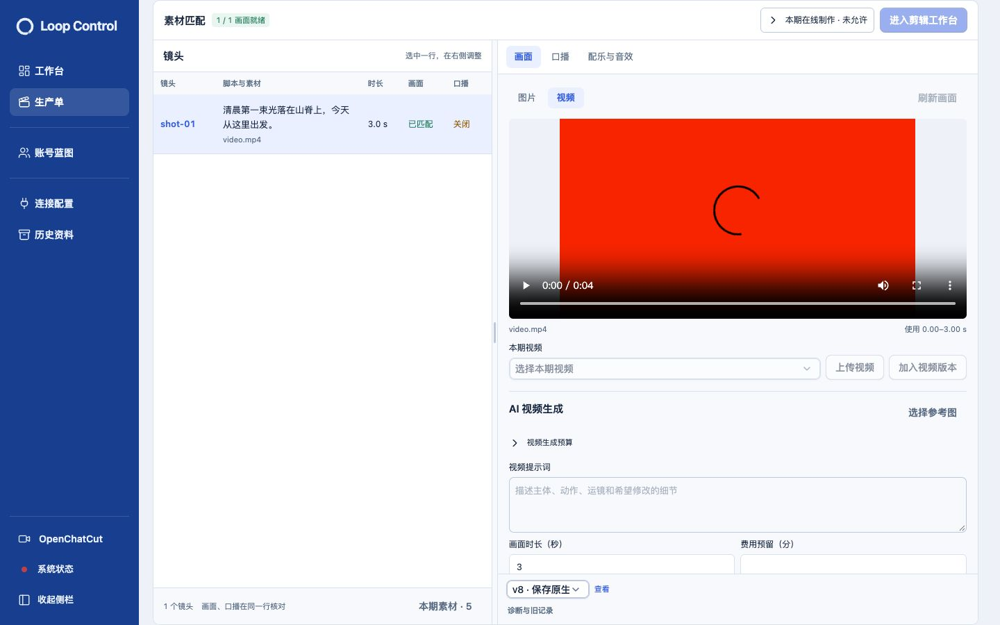
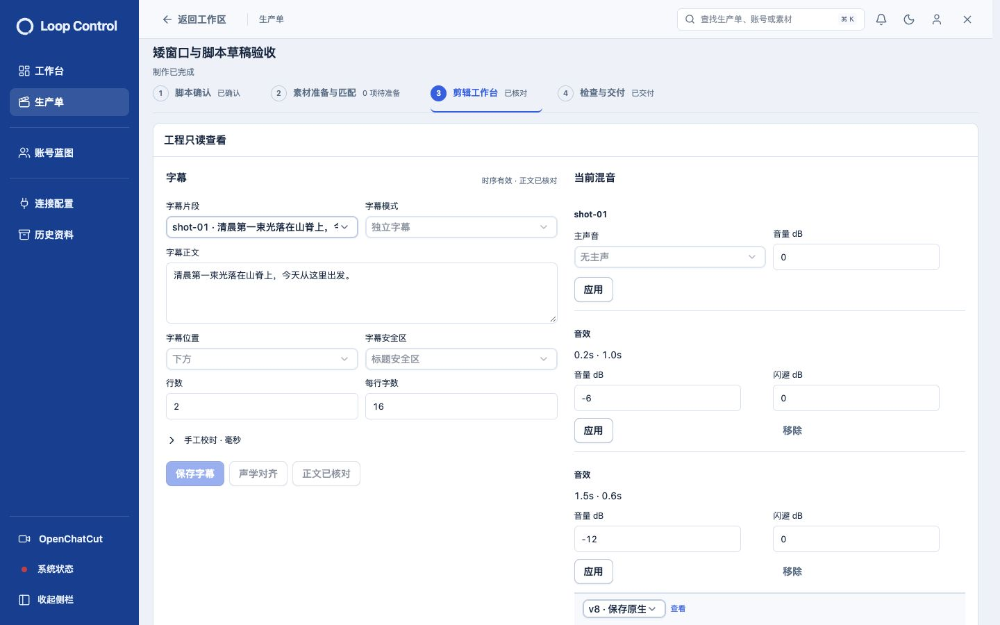
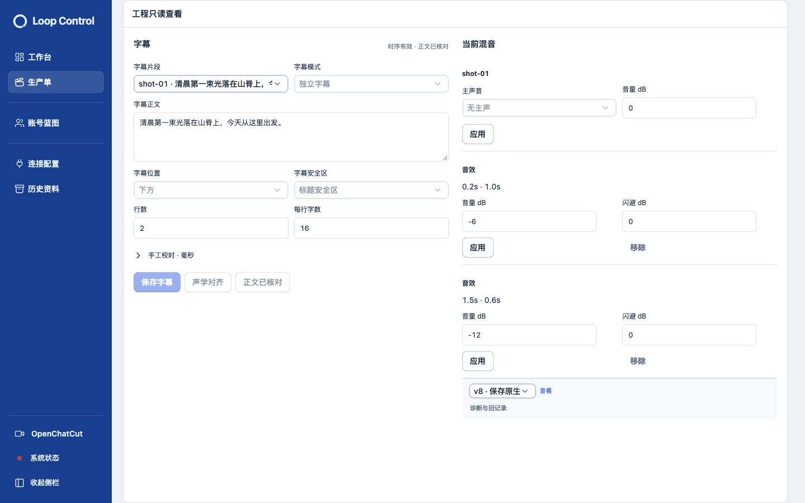
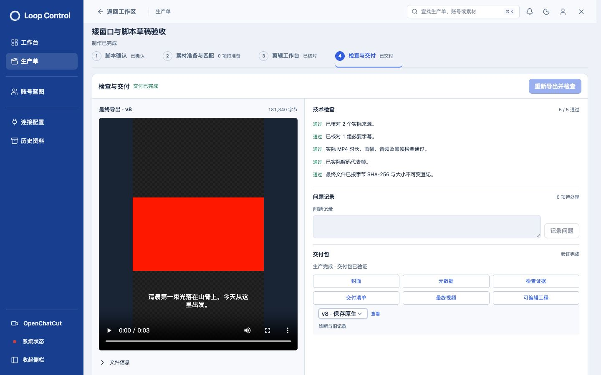
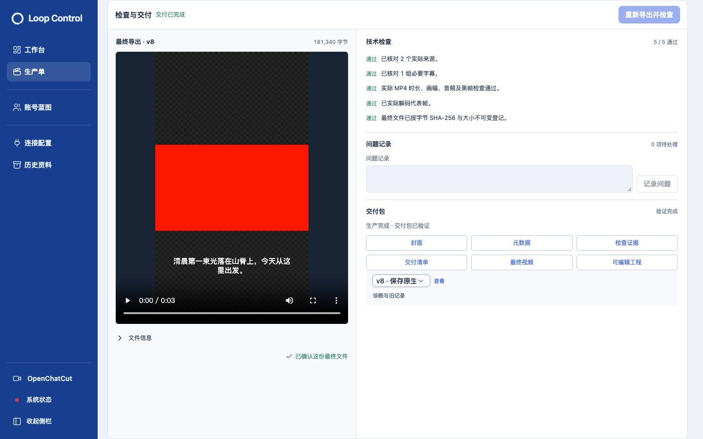

## 1 · 脚本确认-800px

2026/10/30 15:12:16

默认800px工作区，标题/步骤与工作区随外层滚动。

## 2 · 脚本确认-fullscreen-1440

2026/10/30 15:12:16

滚动后工作区铺满900px窗口，标题与步骤栏已滚出视野。

## 3 · 素材准备与匹配-800px

2026/10/30 15:12:17

默认800px工作区，标题/步骤与工作区随外层滚动。

## 4 · 素材准备与匹配-fullscreen-1440

2026/10/30 15:12:17

滚动后工作区铺满900px窗口，标题与步骤栏已滚出视野。

## 5 · 剪辑工作台-800px

2026/10/30 15:12:18

默认800px工作区，标题/步骤与工作区随外层滚动。

## 6 · 剪辑工作台-fullscreen-1440

2026/10/30 15:12:18

滚动后工作区铺满900px窗口，标题与步骤栏已滚出视野。

## 7 · 检查与交付-800px

2026/10/30 15:12:19

默认800px工作区，标题/步骤与工作区随外层滚动。

## 8 · 检查与交付-fullscreen-1440

2026/10/30 15:12:19

滚动后工作区铺满900px窗口，标题与步骤栏已滚出视野。

## 9 · 素材准备与匹配-fullscreen-390

2026/10/30 15:12:24

滚动后工作区铺满844px窗口，标题与步骤栏已滚出视野。

- 2026/10/30 15:20:14：1440×900，真实原生编辑器已连接，工作区默认800px。 [截图](screenshots/10-原生剪辑-800px.jpg)

- 2026/10/30 15:20:26：外层滚走标题导航后，真实原生剪辑工作区900px铺满窗口。 [截图](screenshots/11-原生剪辑-fullscreen.jpg)

- 2026/10/30 15:20:59：只填一份修订原因，确认弹窗说明更新素材规划且保留原工程和媒体。 [截图](screenshots/12-单次修订-确认.jpg)

- 2026/10/30 15:22:00：确认后自动进入素材匹配，新口播已生效；v4记录复用同一原因，v3/v2/v1历史保留，无第二个原因输入。 [截图](screenshots/13-单次修订-自动规划成功.jpg)

- 2026/10/30 15:22:19：1280×720真实编辑器，主工作区从800px滚动适配为720px，时间线与保存返回仍可用。 [截图](screenshots/14-原生剪辑-fullscreen-1280.jpg)
