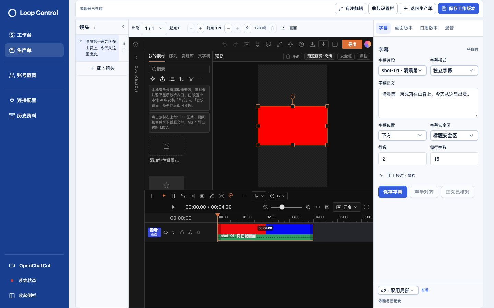
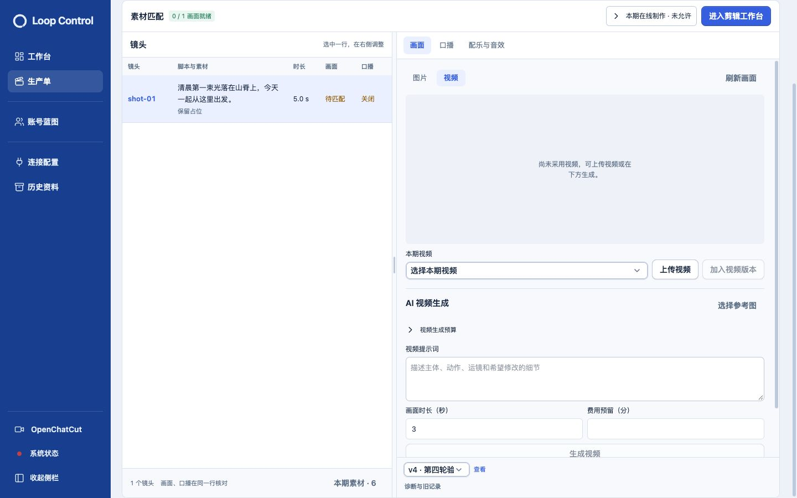

# 四工作流第四轮验收 · 2026-10-30

本轮已完成，并更新日常本地服务 http://127.0.0.1:5174/ 。只移除四步界面右栏的接入前整期成片与交付大面板；历史文件、原工程备份和整期工程快照保留。

## 行为调整

- 四页主工作区默认固定800px。外层滚动先移走返回栏、标题、步骤导航；工作区到达顶部后占满窗口高度。向上滚动可恢复默认布局。内部脚本、素材详情、剪辑器和交付区域仍可滚动。
- 修改脚本只填一次修订原因。确认修订后自动继续已有工程的素材规划，同一原因记入脚本审计与新工程版本；取消保持既有脚本。确认弹窗说明旧工程保存为历史、原媒体保留。失败后的更新/刷新入口不要求再填写原因。
- 工程版本选择器约120px，与原工程备份、查看同排，删除可见“工作版本”标题。版本表示整期OpenChatCut工程保存快照，选项包含保存说明与时间；并非S01/S02的生成记录。单镜头生成结果仍在画面版本区域。
- 右栏移除旧整期成片、技术检查与交付文件大面板，诊断入口保留。未迁移旧单第四页的实际交付内容仍可查看。

## 实际浏览器验收

[逐步操作与14张截图](OPERATIONS.md)。[四种窗口×四页测量](canvas-measurements.json)全部16项通过：1864×953、1440×900、1280×720、390×844；默认高度800，滚动后高度分别953/900/720/844、顶部0、标题步骤已滚出视野，无页面级横向溢出。测量中的第三页为已交付订单的只读设置，另补真实原生编辑器测试。

真实原生编辑器在1440×900和1280×720连接成功：800px默认工作区滚动后分别900px、720px，iframe相应伸缩，保存返回正常。截图10/11/14。

隔离生产单 `2cde086b-dec1-45cf-aea3-03a4dd591798` 从脚本预览进入修改，将“今天从这里出发”改为“今天一起从这里出发”；只填“第四轮验收：调整口播并复用单次修订原因”，确认后自动进入素材匹配，v4记录同一原因，v3/v2/v1仍在，无第二原因输入。随后进入原生剪辑并保存返回。[独立只读回查](revision-readback.json)确认脚本与工作区基准一致、脚本审计和工程版本原因一致、5份历史工程文件存在且SHA一致。

## 检查结果

- 普通回归：165文件、1112项通过，[日志](checks/unit-suite.log)。第一次沙箱执行28项本地HTTP测试因 `listen EPERM` 被阻止；保留[原始日志](checks/unit-suite-sandbox-listen-blocked.log)，允许本地监听后相同全量检查通过。
- 定向界面：23项通过，[日志](checks/final-interactions.log)。包括修改后复用新脚本ID与同一原因、无需第二原因输入。
- 真实HTTP/PostgreSQL/工程文件集成：2项通过，[日志](checks/integration.log)，覆盖修订围栏、已有工程重规划、原因复用、旧工程保存与跨Owner拒绝。
- 类型、构建、Worker/编排运行准备和源码产物完整性通过；`git diff --check`通过。[检查日志](checks/)。构建保留既有大包体积提示。

最初尝试由工程命令直接查询脚本审计原因，集成测试发现数据库角色没有审计表读取权限。已撤回此读取，改为确认动作复用已填原因，通过既有命令提交；不增加数据库权限。规划失败恢复使用说明性默认记录，既有脚本修订审计仍保留用户原因。

## 数据与服务边界

日常服务正常停止后启动，实际HTTP200；[更新前](daily-before.json)、[停止前](daily-prestop.json)、[更新后](daily-after.json)七类业务记录指纹相同，待执行/运行任务0。原用户标签页未刷新或提交；新建日常验收标签页显示登录入口，未绕过认证。本轮交互写入仅在隔离验收库完成，临时标签页已关闭，视口覆盖已清除。

隔离验收服务只优雅重启指定自建进程，原数据库和媒体保留；两个原有待对齐记录保留，该服务不执行对齐。没有删除历史文件、修改日常连接或预算，没有付费在线生成、提交、推送或发布。

本轮没有重新跑从新建到最终交付的全链E2E，也没有重复测试在线Provider；本轮验证集中于新增高度、脚本确认/自动规划、原生编辑和历史入口。完整迁移验收与Provider连接证据见[首次全链报告](../compact-workflow-migration-20261030/REPORT.md)，后续实际上传、多音效、剪辑和最终交付见[第二轮](../compact-workflow-round2-20261030/REPORT.md)，图片/视频生成迭代与连接受阻原因见[第三轮](../compact-workflow-round3-20261030/REPORT.md)。此前生产授权过期及连接Owner不匹配的限制仍未改动。
