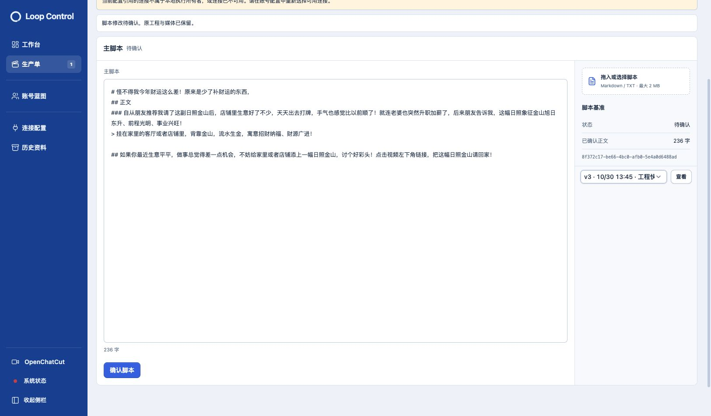
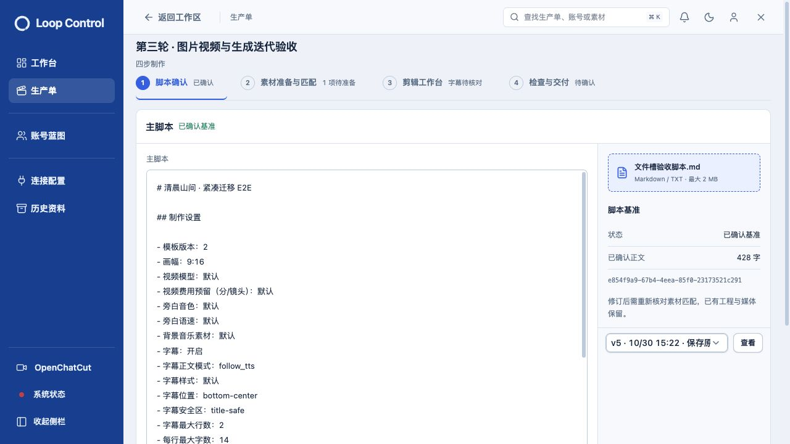
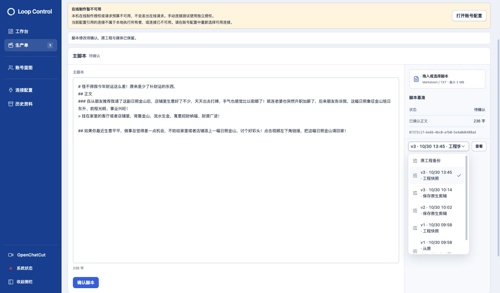

# 脚本右栏与文件槽 · 2026-10-30

已完成4条反馈，沿用蓝灰主题和既有800px/滚动全窗工作区。

- 原工程备份并入整期工程版本选择器，与查看按钮同排；菜单包含版本号、保存时间及说明，完整说明也可从选择器提示查看。统一只读查看动作，不删除原工程或历史文件。
- 四页共用右栏移除“诊断与旧记录”入口及其展开内容。
- 脚本基准ID直接显示在“已确认正文”字数下方，删除单条信息折叠。
- 顶部上传按钮改为脚本基准上方的文件槽，支持选择与拖入.md/.txt，显示文件名和大小限制。导入仅更新草稿，修订原因、确认和取消仍生效；预览锁定时不提供上传。

## 实际操作

1. 正式页面只读观察：文件槽位于基准上方，基准ID无需展开，工程入口32px高。原工程备份和历史快照切换时，查看链接SHA对应所选文件。未点击确认脚本或修改日常正文。
2. 隔离订单2cde086b-dec1-45cf-aea3-03a4dd591798进入脚本编辑，通过真实文件选择器导入“文件槽验收脚本.md”：正文及文件名更新，出现未确认修改和修订原因输入。取消后恢复原正文，未提交脚本修订。进入该单默认打开了原生编辑器，已先保存返回，写入仅隔离验收库。
3. 浏览器原生拖放模拟被工具明确拒绝，未绕过；拖入事件路径通过组件测试，覆盖不支持格式拒绝、有效脚本读取、未确认前不发送命令及必填修订原因。
4. 1440×900及390×844实际页面均无页面级横向溢出；窄屏右栏按现有布局跟随内容滚动，视口覆盖已清除。只关闭本轮临时隔离页，保留原用户标签。

## 截图

[1440窗口](screenshots/04-脚本右栏-1440.jpg) · [390窗口](screenshots/04-脚本右栏-390.jpg)

## 验证

30项相关界面回归通过（脚本8、主工作区16、旧单6），类型检查、构建、运行准备和git diff --check通过。[检查日志](checks/)。不重复上一轮全链/Provider检查，本轮无生成或网络授权变化。

日常服务正常更新、HTTP200；[更新前](daily-before.json)与[更新后](daily-after.json)七类业务指纹一致，活动任务0。未删除文件，未提交、推送或发布；历史内容和全部既有无关改动保留。
