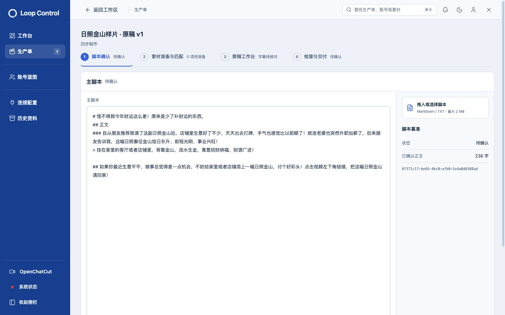
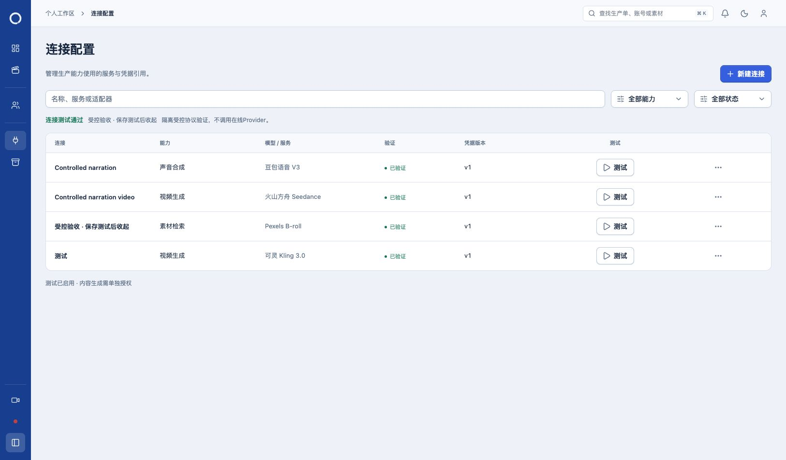
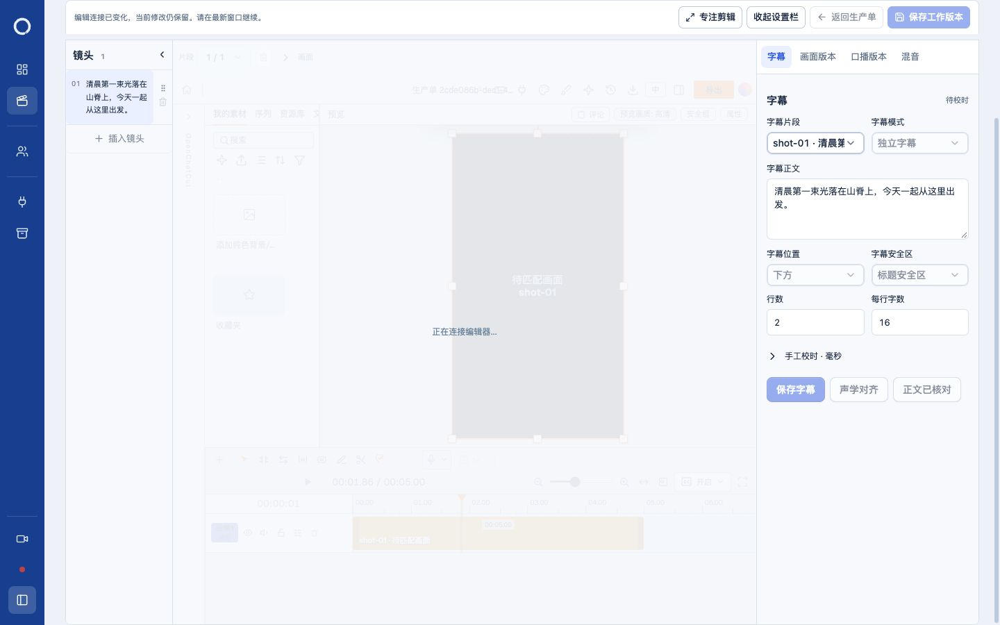

# 工程记录移除、滚动稳定与连接反馈 · 2026-10-30

已完成并更新日常本地服务 http://127.0.0.1:5174/ 。最终按Owner决定移除四步界面的工程记录入口，历史工程和成片文件保留。此次不再交付页内工程预览。

## 最终调整

- 四页移除工程记录、原工程备份选择与查看入口。只移除界面组件，不删除工程文件、不修改工程历史记录。
- 脚本待确认提示使用5秒toast，可手动关闭；普通重绘和步骤切换不反复弹出。必要的规划失败恢复入口继续可访问。
- 默认工作区800px，滚动期间在同一布局连续适配到窗口高度。删除阈值处切换React状态/布局的行为，不重开编辑器，不增加高度过渡动画。上下滚动均连续。
- 主区复用其他页面30/24/16px响应式边距，标题顶部84px；补偿滚动条宽度，使左右内容边缘对齐。顶部返回栏保持全宽，原生剪辑器仍可占满工作面。
- 子agent修复连接保存测试反馈：仅本次明确返回ready:true后收起表单并在列表显示成功；失败、抛错及结果未知保留表单，密钥不回显。
- 子agent调整列表：能力列只显示能力，服务/模型系列名称移到“模型 / 服务”列。真实连接没有具体model字段时不虚构模型ID。

## 实际操作与截图

1. 正式生产单只读检查四页，均无工程记录入口；未修改或确认日常脚本。
2. 1625×953窗口每次滚动18px，记录17个向下位置和14个向上位置。主区高度依次800、813.42、826.86…953，反向恢复800；每步最大高度变化约13.44px，原先的153px阈值跳变已消除。CSS高度过渡时长0s。[采样汇总](scroll-summary.json)、[向下](scrolling-desktop.json)、[向上](scrolling-upward.json)。
3. 1625×953、1440×900、1280×720、390×844四种窗口×四页，共16项通过：默认800px、滚后为窗口高度、顶部0、左右边距对齐、无页面级横向溢出。[完整测量](viewport-matrix.json)。另检查1024×768左右均24px。
4. 隔离生产单2cde086b-dec1-45cf-aea3-03a4dd591798真实OpenChatCut连接；1440×900与1280×720逐步滚动，iframe来源与连接保持，画布分别连续到900/720px，保存返回正常。仅隔离工程新增保存版本。[记录](native-editor-scroll.json)。
5. 独立受控连接服务localhost:55358使用原隔离数据库、合成密钥存储和受控验证，不访问在线Provider。界面新建“受控验收 · 保存测试后收起”并保存测试成功；再次打开编辑、未改字段直接测试成功后，dialog数量0、外层保留明确成功反馈。真实新建保存、测试、列表刷新通路经过本地HTTP与PostgreSQL；真实Mac Keychain未读写。失败/未知结果路径由组件回归覆盖。
6. 正式连接列表只读打开，8行连接均采用“能力”“模型 / 服务”列；未点击真实Provider测试或轮换凭据。

[临时提示](screenshots/13-临时提示-最终.jpg) · [自动消失后](screenshots/14-提示消失-最终.jpg) · [正式连接列表](screenshots/15-日常连接列表列归属.jpg) · [窄屏素材区](screenshots/11-素材全窗-390.jpg)

## 检查与保护

- 子agent独立27项连接回归通过；主Agent合并后的58项定向回归通过。[定向日志](checks/tests.log)。
- 当前工作树全量普通回归166文件、1120项通过。[全量日志](checks/unit-suite.log)。
- 类型、构建、Worker/编排运行准备与完整性检查、git diff --check通过。构建仍保留既有大包体积提示。[日志](checks/)。
- 日常服务正常停止后启动，[实际HTTP200](http.json)；[更新前](daily-before.json)、[停止前](daily-prestop.json)、[更新后](daily-after.json)七类业务指纹相同，待执行/运行任务0。其他并行工作（含GPT Image 2接入）保留。
- 临时受控服务收到SIGTERM后进程已不存在、端口已关闭，测试数据库、媒体和合成连接记录保留；停止记录文件未写出，因此以进程、端口及数据库/文件回查为准。[回查](connection-ui-readback.json)。既有55357验收服务未停止。临时浏览器页关闭、视口覆盖清除，原用户标签未刷新或提交。
- 没有真实在线Provider调用、付费生成、删除历史媒体、提交、推送或发布。本轮未重复从新建脚本到最终交付的全链E2E；此前全链记录保留在迁移报告中。
