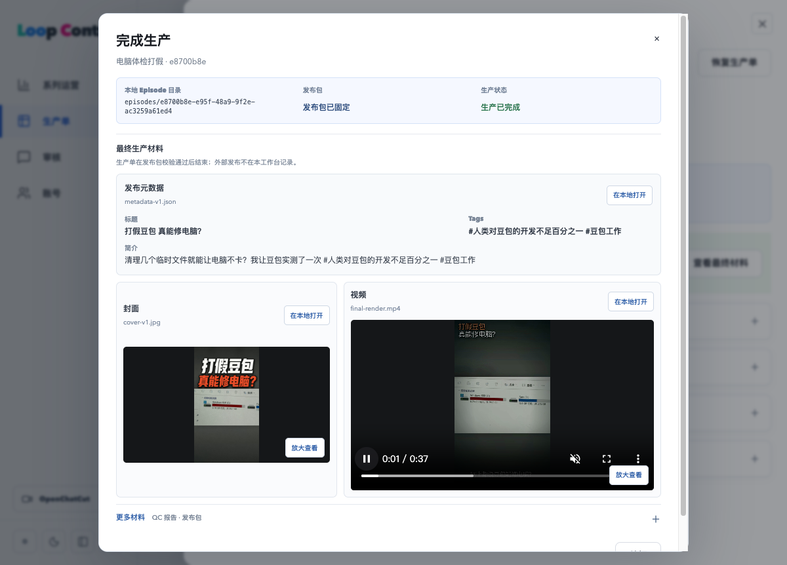

# D 阶段整合与日常收尾

日期：2026-10-26，Asia/Shanghai。Owner 已批准执行 D 收尾，要求历史账号在主程序中直接打开。本次只做本地整合与当前优化树的日常运行验收，未推送、合并远端或切换旧生产服务。

## 交付结果

- 从已合并 A–C 的 `cccc04ee` 整合 D 基线 `40489c17`，解决 5 个冲突文件。保留 C 的完整分页与测试进程限额，以及 D 的原生前端和本地 HTTP 边界。基线 925 项回归通过，本地整合提交 `2e14bd11`。
- 按明确清单接入原优化树的日常入口与 044–050 补修，保留原树已有未提交文件、PLAN、私有运行配置、媒体和证据。新增 051 仅记录已批准的历史媒体差异。
- 最终 117 文件、953/953 回归通过，默认 5000ms 未变；Node 2 项通过、1 项既有可选 n8n SDK 检查跳过。类型、原生前端、Worker/编排准备及本地后端编译通过。
- 473 个产品源码文件与实际日常运行树逐字匹配，见 [源码一致性](source-runtime-match.json)。

本报告在本地提交前归档，提交标识以 `git log` 为准。

## 历史账号接入

新一遍只读源快照为 34 表、3,640 行，与先前批准快照逐表相同；源端没有写入。追加接入同一批记录，不覆盖已有主键不同值，不导入旧登录密码、会话或 Vault 明文，不把历史单注册进本地执行范围。

| 账号 | 生产单 | 已归档 | 未归档 |
| --- | ---: | ---: | ---: |
| 豆包推广 | 6 | 6 | 0 |
| 日照金山样片 | 1 | 0 | 1 |
| 测试账号 | 4 | 4 | 0 |

11 单均通过实际 Owner HTTP 和独立 Chrome 详情页打开，标题、stage、归档时间与源值相同。代表产物实际读取并校验 SHA；8 个原有异常产物继续返回 409。历史执行范围为 0，历史 ready/running 任务为 0，Provider 账本无新增调用。

- [追加事务结果](history-import-commit-dclose-result.json)
- [HTTP 关联及异常拒绝](history-http-result.json)
- [媒体读取复核](history-http-media-result.json)
- [11 单浏览器记录](history-browser-result.json)

历史「电脑体检打假」的最终材料弹窗已实际打开，其 37 秒成片静音播放超过 2 秒、时间持续推进且无播放器错误。不据此声称完成旧内容的人工听审或重新 QC。

## 备份与恢复中的历史差异

源端 452 条引用有 8 条与现存文件不一致，Owner 已明确批准原样接入并保留失败项。它们不是本次生成失败，也没有被改成技术通过。

051 在 `local_identity.import_record.historical_media_integrity` 保存批准摘要与精确差异。备份/恢复只有在 artifact ID、Episode、原逻辑路径、期望大小/SHA、实际文件大小/SHA 全部匹配时，才将其记录为原有历史异常；未知差异或任一字段变化仍拒绝。Owner/Worker 不能直接更新该列；实际数据库约束已验证缺少批准字段会被拒绝。

页面、Worker 和发布包的产物校验没有放宽。原 artifact、审核、快照、归档和源文件指纹不改写。未来若原始文件被找回并恢复为正确字节，可继续按正常严格校验读取。

接入后的完整备份为 53 表、554 文件，并在新库 `loop_t24_restore_dclose_20261026` 和独立媒体目录实际恢复：10,724 行、权限对象、外键、文件 SHA 与 8 条原有异常全部保留。恢复库未连接 Worker，旧密码/会话不恢复，连接部署资格清零。

[备份回执](history-backup-result.json) · [新库恢复回执](history-restore-result.json)

## 日常运行修复

- 网络策略或额度未启用使用独立的 `provider_network_policy` 状态，界面明确显示尚未发起网络请求；真实 Owner HTTP 回归验证没有读取闭网秘密或发起 Provider 请求。
- 未来运维结果保留在原文件/数据库中，但不用于当前状态；实际读取错误仍显示失败。日常库中 17 条未来记录未删除，状态读取不再用它们覆盖当前结果。健康/备份计划仍为上海时间次日 09:00。未知提醒不自动重发或改写成功。
- 保存密码解锁专用 Keychain 已实际通过；通过正常 stop/prepare/start 验证最终源码装载、队列及数据持久化。日常主程序仍在 `http://127.0.0.1:5174/`。

## 实际失败与限制

- 基线首轮缺少测试客户端配置，且 macOS 临时路径别名触发原媒体边界拒绝。改用无凭据 loopback 配置及 `/private/tmp` 后完整 925 项通过，没有放宽断言、路径保护或超时。
- HTTP 验收脚本首次误将聚合增量响应当作平铺 Episode，第二轮诊断确认返回 `hashes/patches/sections`。按实际 `sections.episode` 契约修正后 11 单全部通过，未修改产品或业务状态；原失败日志保留。
- 已登录 Chrome 没有 CDP 接口，改用独立 Google Chrome for Testing 会话；Cookie 经私有文件导入，没有打印秘密或接管用户标签页。
- `src/worker/codexPrompt.ts` 是原优化树已验收的既有未提交文件，原字节含一个 EOF 空行。为保持 953 项验收及运行源码身份，未为格式改写；空白检查仅排除此已知项，其他源码、脚本与本报告通过。
- 并行测试数据清理对话先完成专用 VM 备份、重启和清理，本任务等待其结束后才操作日常数据库。此前磁盘 I/O 故障根因仍未定位；本轮完整备份、新库恢复及启停均通过，不将其写成硬件故障已根治。
- 四家 Provider 的既有豁免保留，本轮不新增模型/Provider 调用；E/F、跨主机安装和旧生产目录切换不在本次范围。

公开材料的私有值及格式扫描见 [扫描结果](public-scan.json)。原始失败和成功日志按原字节归档，源码、脚本及报告另做空白检查。
