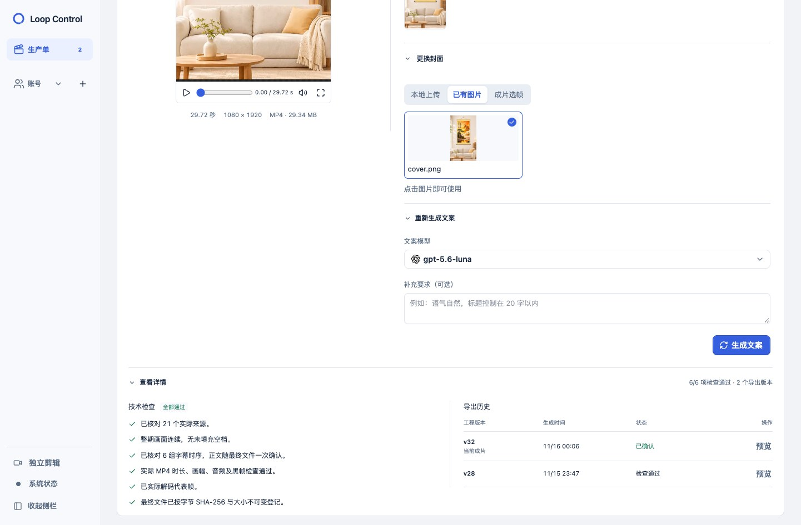

# 检查与交付三处展开区迁移（2026-11-22）

基线 `964b6176c`，起始工作区干净。依据用户批准的 `delivery-demo/disclosures.html` 迁移正式界面；没有数据库迁移、新依赖、自动AI请求或推送。

## 最终变化

- 更换封面：展开内容移到缩略图下方并占满右栏，使用本地上传／已有图片／成片选帧切换。上传槽支持点击与拖入，格式和20MB上限保留；已有图片显示真实缩略图与文件不可用原因，选择即用；选帧复用统一播放器和真实currentTime，画面限高232px。切换来源只查看，收起暂停播放；保存失败保留原封面。
- 重新生成文案：按模型、补充要求、生成操作排列，补充要求去掉一层折叠。复用现有WorkspaceModelPicker，统一品牌图标、选中态、刷新和配置服务；可控开关保留“未明确选择模型时打开选择”的行为。原Owner最近选择、请求身份、未知请求恢复、晚到结果保护与撤回保持原逻辑；单击生成才调用AI。
- 查看详情：检查清单与真实导出历史双栏，显示实际检查总数、工程版本、生成时间和状态；移除重复文件大小。历史预览按该行真实路径／SHA打开独立只读播放器，不替换当前成片。失败检查仍直接显示，历史交付视频／ZIP下载及重新生成入口保留。
- 三处正式入口继续默认收起，互相独立。740px以下容器的技术详情改为单栏；640px以下封面来源铺满右栏。局部覆盖全局横向label和chip样式，避免标签换行及模型居中；表格操作按钮去掉额外内边距，320px内保持在单元格范围。

## 验证

- `npm run check`、前端 `npm run build`、后端 `npm run backend:build` 通过。前端仍有原有的大chunk提示，没有新增依赖。
- 全量 `npm test`：384个文件，2738项通过，1项原有跳过。
- 六个相关文件66项通过；收尾媒体11项和模型8项通过。
- 先写失败用例，再实现：来源切换不写入、已有图片命令身份、当前视频3.25秒选帧参数、禁用失效图片及失败保留、统一模型菜单不生成、历史独立视频身份。
- 突变审查只在Vitest临时转换插件中把选帧时间改为0，没有修改正式源码或日常服务：3.25秒参数断言如期失败。临时插件已删除，最终源码的原回归通过。
- 隔离Owner／HTTP集成：`workspacePublicationCover.integration.test.ts`、`workspacePublicationRequests.integration.test.ts` 两项通过；覆盖上传、实际解码选帧、已有图片、字节下载、重启恢复、失败与版本冲突，以及文案生成／撤回／晚到保护。没有付费调用。
- 浏览器实际打开三处，切换来源、查看真实封面、统一模型弹层、232px选帧播放器。旧版本v28加载成功，1080×1920／29.72秒，读取独立旧路径与SHA；Esc关闭后焦点回到对应预览按钮。
- 1441px桌面双栏正常；390px／320px页面scrollWidth分别等于390／320，无横向溢出。390px模型弹层范围58–378px；320px历史按钮右边缘与表格右边缘同为287px，未再超出。正式页控制台无错误。

初轮全量缺少前端构建清空的后端dist，另有选帧暂停断言失败。补齐后端构建，在停止修改后的最终源码上重新执行，全量通过；没有跳过失败项或放宽断言。历史预览回归还发现一次弹窗未挂载，已补齐并验证真实视频与关闭焦点。

## 范围与盲区

浏览器仅查看、展开、切换来源和历史预览，未点击正式选图应用、选帧保存、上传或生成。实际写入验证在隔离测试工程执行。Safari、实体触屏、深色模式与大量封面候选未实测；缩略图使用lazy加载，只有选帧来源激活时挂载选帧播放器，历史弹窗关闭即卸载，没有新增轮询。

