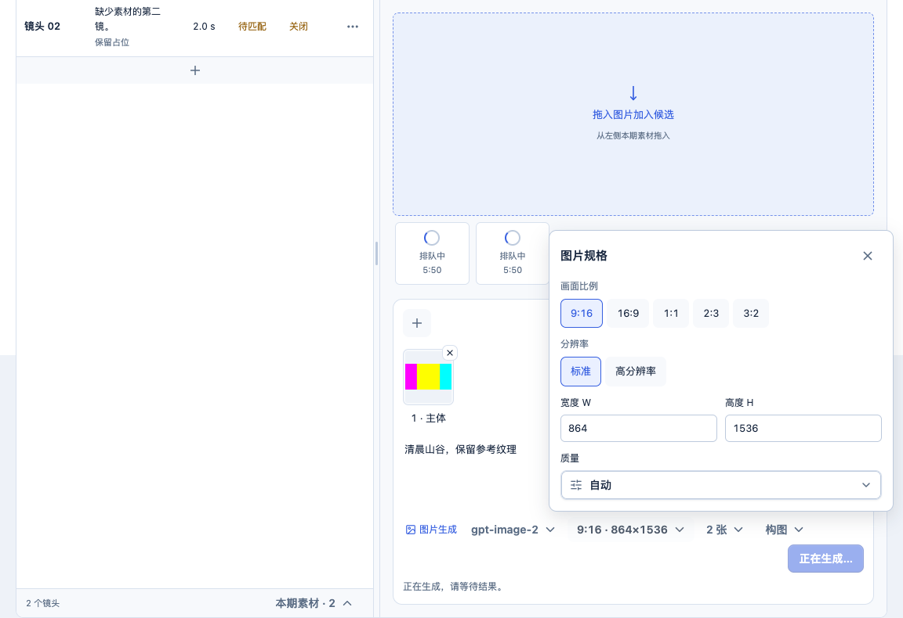
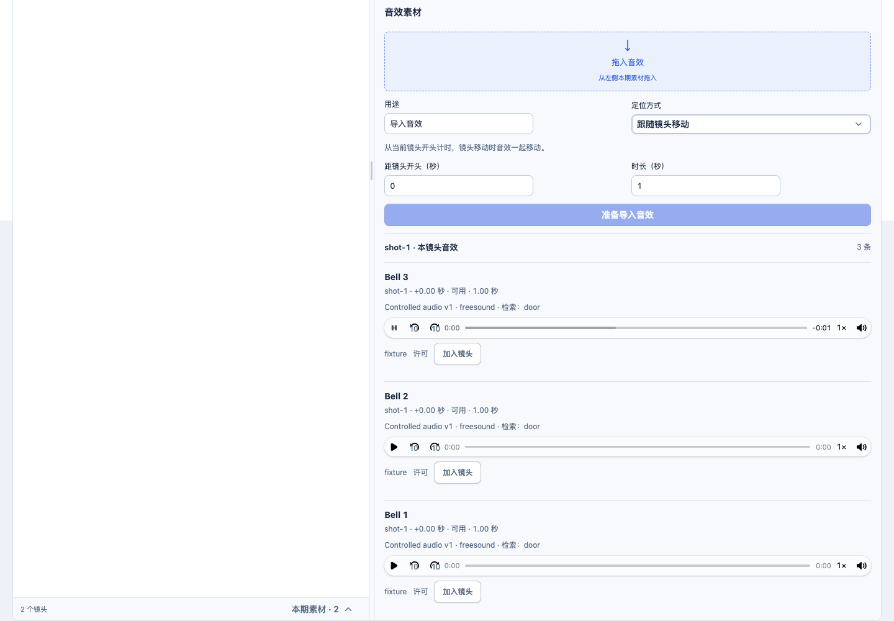

# 生成输入框与声音流程验收

2026-11-07。按用户批准的完整流程 demo 实施。日常入口为 http://127.0.0.1:5174/，当前运行版本 `763612165899`。

## 改动

- 图片、视频沿用当前分镜台，候选与预览在上，生成输入框在下。参考素材可上传、从本期素材拖入；图片参考图可排序、放大及编辑用途。
- 模型弹层可按模型、连接或供应商筛选，选择后自动展开规格。规格和数量以实际服务能力为准。保留构图、字幕留白、视频模式、时长、万相高级参数、草稿、费用确认及任务恢复。
- 候选序列按实际任务与张数显示环形等待，提供真实阶段和耗时，不提供推算百分比。失败、结果未知和发布待核对仍沿用原恢复入口。
- 音效意图提供可编辑检索词；点击检索后准备最多 3 条候选，保留来源、作者和许可，下载后可试听，只有手动采用才改变时间线。保存意图期间阻止并发检索。
- 整期配乐位于导入音效后，隐藏逐镜音效意图。草稿在本生产单共用，保存到服务端的 `music_defaults.settings`，选择检索连接不会覆盖已保存设置。

音效意图当前使用本地声音词表生成英文检索词；无法识别时提示补充检索词。不调用额外语言模型。检索使用当前已验证的 Freesound 连接，结果不足时不会用同一结果补齐。已有原声提取、人工音频、声音混音和候选采用逻辑保留。

## 验证

- 111 项定向测试通过：音频准备与采用、配乐跨镜头草稿、服务端保存、意图保存与检索互斥、图片与视频模型选择和清除、刷新恢复、参数冲突、参考图上限、构图、上传、未知结果、环形任务反馈及媒体供应商解析。
- `workspaceSoundCandidates.integration.test.ts`：隔离 PostgreSQL、Owner HTTP、实际 Worker 子进程和受控音频传输。核对 3 个冻结序号、3 个来源、可读取的 MP3、采用前工程不变、仅显式采用 1 条，以及配乐配置重启保留；非法数量和素材标识被拒绝。
- `workspaceGenerationComposer.browser.integration.test.ts`：正式 React 组件与隔离 HTTP。实测模型筛选及重新选择、自动弹出规格、参考图上传、原生拖入视频首帧、视频模式、刷新恢复、2 个图片任务环、配乐跨镜头及清除浏览器草稿后的服务端恢复、3 条候选试听与单条采用。
- 浏览器尺寸为 1440×1000、1152×790。窄窗无文档横向溢出，弹层在视口内；Esc 关闭后焦点回到规格按钮。音频实际播放到结尾，`readyState=4`。
- `npm run build`、`npm run runtime:prepare` 通过。构建仍有现有主包体积提示，本次未调整打包策略。
- 未运行真实供应商生成或检索。浏览器与 Worker 验证均使用隔离生产单和模拟传输。

## 日常更新与数据

更新前无 ready/running 任务或 Studio 子进程。已保存可读取的 PostgreSQL 自定义格式备份，并应用新增迁移 `151-workspace-sound-candidates.sql`；旧迁移未变。迁移仅扩展音效排队函数，不改已有记录。

更新前后以下记录的数量和完整内容指纹全部相同：

| 记录 | 数量 |
| --- | ---: |
| 生产单 | 3 |
| 素材修订 | 19 |
| 音轨 | 2 |
| 任务 | 11 |
| 制作工程 | 3 |
| 画面候选 | 22 |
| 音频准备 | 0 |

运行版本完整性校验通过，日常首页 HTTP 200。桌面处于锁屏状态，未对已登录 Chrome 进行点击或刷新；实际交互验收在独立浏览器完成。运行 Keychain 通过现有启动工具恢复访问后完成服务更新。

证据：`daily-before.json`、`daily-after.json`、`runtime-diff.json`、`sound-candidates.json`、`browser-done.json`、`browser-persistence.json`。数据库备份位于 `.loop-control/local/backups/20261107-generation-composer/before-151.dump`，本次修改前的源码保存在当前聊天目录的 `implementation-baseline`。未提交或推送，未清理其他未提交工作。

