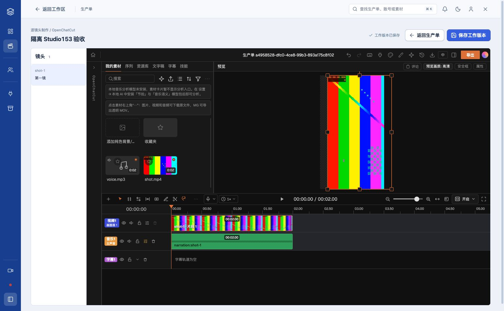
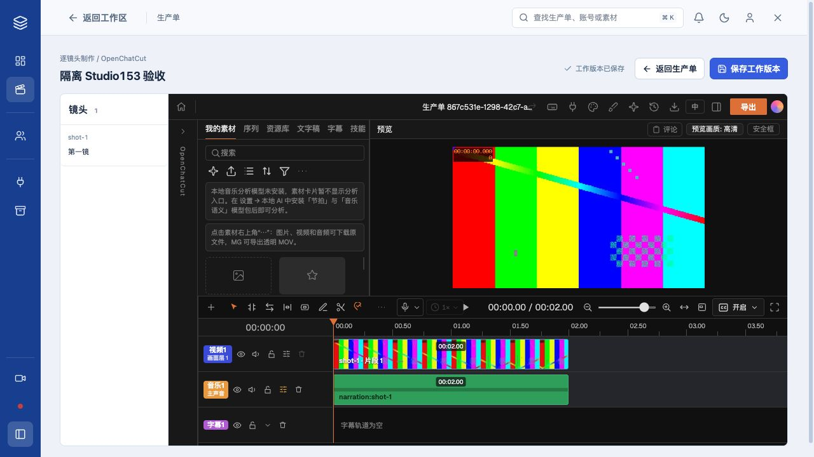
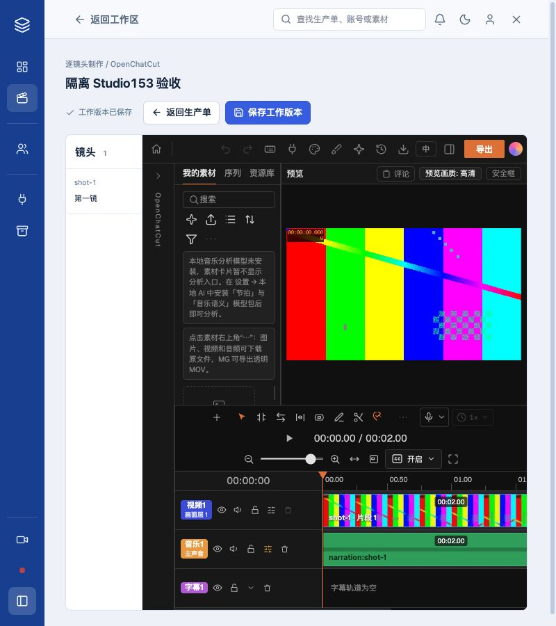

# #153：真实嵌入 Studio 核验

日期：2026-10-29。范围仅 T01，后续 12 张票尚未实施。四步默认导航、生成前移、局部重生和交付顺序仍由对应子票完成。

## 实现

A 宿主复用本机 OpenChatCut，镜头导航直接选择原生时间线片段。桥只负责加载、选择、状态、刷盘和返回；时间线状态由 OpenChatCut 持有。宿主保存等待真实编辑器刷盘，再经过 Owner、Origin/CSRF、当前输入、工程身份、工作文件预期 SHA 校验。来源和真实项目读取校验均在覆写工作文件前完成。

每次重新打开使用新 launchId 和通道，迟到消息不能作用于新会话。原生“返回工程列表”走同一保存返回路径。旧业务页面保持挂载，返回后保留原来的生成、提交修订等操作状态。既有完整输入门槛未放宽。

后台返回带 `lcBridge=1` 的真实适配地址才启用宿主；尚未重启的后台沿用旧独立入口。日常后台未重启，没有修改正式生产单、调用 Provider 或执行交付。

## 真实边界与浏览器

使用独立 PostgreSQL schema 副本、随机测试 Owner/Episode、本地合成测试视频和音频；请求经过真实本机 HTTP 和 loop_app 权限。日常数据与用户样片没有写入。测试服务和数据库仅针对本次夹具清理。

- 竖版：修改原生片段水平属性为 12，宿主保存；刷新重开和停止/重启 Studio 后均恢复为 12。随后有效编辑为 99、切换 9:16 保存，文件为 1080×1920。最终文件摘要见 browser-readback.json。
- 横版：真实 640×360 视频可预览、选择、保存，文件回读仍为 640×360。
- 桌面 1543×953、1280×720 和窄屏 800×900 实看；800px 页面 scrollWidth=innerWidth=800，时间线使用原生内部滚动。1050px 以下工具栏换行、导航缩窄；700px 以下导航横排，不强制所有控件挤进一行。
- 双标签：未获得原生写入权的第二标签没有报告保存成功，宿主保留编辑器并显示失败。未绕过 Studio 的所有权处理。
- 同端口恢复：在隔离夹具注入更新的合法工作文件与原生存储，旧宿主保存返回 409。通过既有 OpenChatCut 入口重开，端口相同、通道更新，随后保存成功；见 recovered.png。该故障注入只用于过期会话检查，不替代前面的实际属性编辑。
- 原生“返回工程列表”实际点击后保存并回到生产单。连接和消息检查均来自真实编辑器，无原型时间线或成功假状态。

## 自动检查

- Host 4 项通过：真实消息边界、等刷盘再保存、错误通道/来源、失败保留、工程身份及原生返回。
- 真实 HTTP 集成 1 个场景通过，验证 Owner 文件接口返回视频字节 SHA，并串联 Owner、CSRF、Origin、错误工程/路径/指纹、过期会话、真正旧合法 SHA、失败来源不改文件、修正重试、重启恢复、输入变更提示和显式替换。
- TypeScript、Vite 构建、Worker/本机后台准备通过；构建保留既有大 chunk 提示。准备产物不等于已重启日常后台。
- 全量测试执行一次：976 通过、35 失败。28 项因沙箱禁止监听本机端口；获准按失败文件重跑后，相关 9 文件共 64 项通过。
- 其余 7 项来自 ImpeccableNavigation 和 PcVisualFixes，已在任务前文件基线复现相同 7 项失败，未顺手修改其他 UI。结果见 suite-summary.txt。没有将整个仓库描述为全绿。

## 审查

### Standards

修复 3 项：失败保存覆写文件、原生返回断连、新宿主依赖未跟踪 UI 模块。后续复核发现新白名单误校验待替换旧工程，已修复并由审查者确认无遗留。

### Spec

修复 3 项：同端口重开保留旧指纹、失败保存改变有效文件、不完整原型归档。浏览器恢复、归档启动证据均已补齐。审查与验证没有混入既有大范围未提交迁移。

## 原型与提交边界

完整归档分支：`codex/prototype-four-step-152`，提交 `7d391dce8a6ddd87a48e71e636d9595529410f8b`。含原型、截图、A 版选择、dev gate 和启动命令。原始源码另存 ORIGINAL.tsx.txt；仅将归档中依赖未提交 Dan UI 的按钮包装替换为等价原生按钮，恢复说明在 ARCHIVE.md。原始归档提交 e7f32de1 仍保留。

归档按其自身 lockfile 在独立目录恢复依赖，类型检查通过；独立只读服务实际加载 A，定位 S02 后属性标题及时间线位置更新，见 archive-A.png。暂存树另在独立检出通过类型检查、4 项 Host 测试及 Vite 构建，见 commit-*.log。

当前分支原有约 955 项改动。提交按任务前文件快照分离，只包含本票改动；不包含既有界面迁移、Provider/脚本改造或 n8n 删除。原型分支未推送。架构决定见 ADR-0015。
