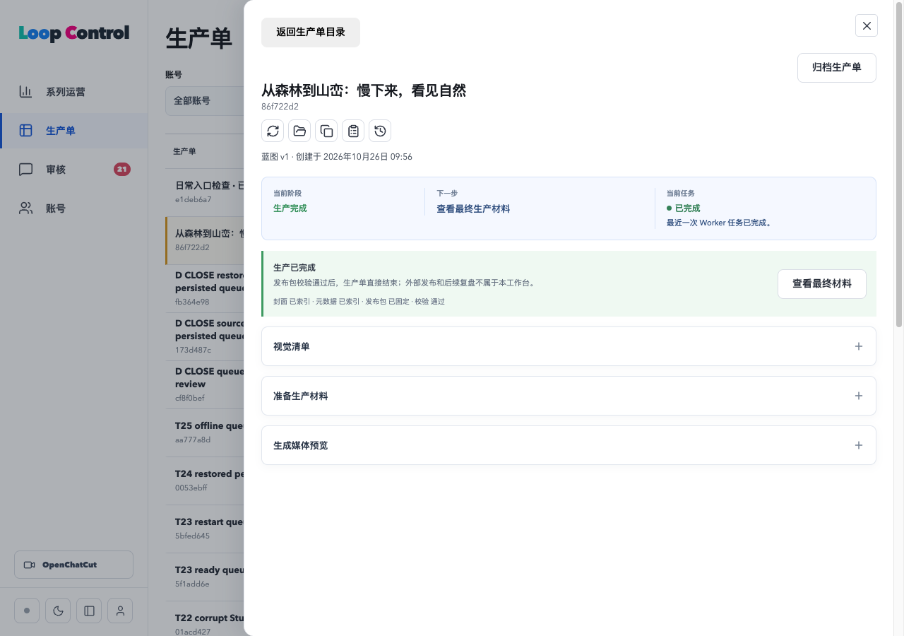

# 原界面与日常本地运行验收

日期：2026-10-26。当前 worktree：`/Users/dan/.codex/worktrees/local-first-optimization/loop-control`；分支 `codex/ad-closeout-implementation`，起点及结束 HEAD `40489c17aedca7a8c177dd40b3b72cae8fc2f782`。本次修改未暂存、提交、推送或合并。

## 结果

主程序已通过正常 `npm start` 在 [127.0.0.1:5174](http://127.0.0.1:5174/?episode=86f722d2-3675-4732-a8cd-d4276af51e7c) 运行，并在 Chrome 展示原生产单。侧栏、账号蓝图与系列、生产单表格及筛选分页、审核、运营、主题、详情抽屉和最终材料弹窗复用原组件，操作通过本地 HTTP 完成。

默认运行资源为 `.loop-control/local/`、Colima `loop-control`、容器 `loop-control-local-postgres`、卷 `loop-control-local-data`、数据库 `loop_control`；PG 仅监听回环 54329，Studio 使用日常实体副本及回环 5175。PostgreSQL 数据位于 Docker 卷中的 `/var/lib/postgresql/data`，不是单一 SQLite 文件。启动、Worker、备份、Python 和 Studio 不使用旧验收资源；历史入口只保留供显式回放。使用方法见[日常运行说明](../../local-daily-runtime.md)，决策见[ADR-0009](../../adr/0009-daily-native-workspace.md)。

Supabase/n8n 服务不是日常主程序依赖。前端原生构建依赖图检查 `sdkPresent=false`、`legacyControlPlanePresent=false`，不含旧 `src/App.tsx`。Worker 与持久队列、提醒和每日运维由本地应用负责。浏览器观测到的 HTTP 请求仅向本机 5174/5175，另有内嵌 data/blob 资源。

## 验证

| 检查 | 结果与证据 |
| --- | --- |
| 类型与构建 | `npm run check`、本地后端 tsc、`npm run build` 通过；[检查状态](checks-result.json)、[构建日志](build.log) |
| 完整回归 | 116 文件、937/937，通过默认 5000ms 预算；Node 2 通过、1 项既有可选 n8n 配置检查跳过；[原始日志](test.log) |
| 实际 Owner HTTP | 4 目录视图及分页、旧成片/发布包、新账号与 Prompt/蓝图预检、新生产单/重命名/归档/恢复/主脚本导入通过；改密撤销其他会话，当前会话保留，密码最后恢复为日常初始化值；[结果](http-acceptance.json) |
| 补齐原界面操作 | 音轨批注实际保存并验证幂等；跨生产单或无效音轨/审核包/QC issue 被拒绝，连接修复遵守网络策略；[结果](final-http-and-automation.json) |
| 应用内运维 | 向日常持久队列插入本轮健康/备份检查作业，由正常应用实际领取并各执行一次；健康通过，完整备份核验 51 表/975 文件；未新增媒体或模型任务；[结果](final-http-and-automation.json) |
| Chrome | 原 4 导航、抽屉和最终材料、独立设置表单、主题/侧栏、刷新及重启会话恢复；视频实际静音播放至 24.386 秒，1080×1920、46.848 秒；390×844 检查未出现页面级横向溢出；[观测](browser-runtime.json) |
| Studio | 使用同一正式运行函数与日常 OpenChatCut，从已有冻结三镜头输入新建工作副本，实际显示 3 视频、3 音频与字幕时间线；不改数据库、不创建审批、不重新生成；[观测](browser-runtime.json)、[截图](studio.png) |
| Python/模型 | 日常 Python 3.11 与独立模型缓存通过 OS 禁网探测，中文 wav2vec2 模型 ready；[结果](model-readiness.json) |
| 正常启停 | `npm stop` 后 app/Studio 端口关闭，数据库与媒体保留；`npm start` 后会话、日常新数据、旧 Episode 和 39 产物、最终 MP4/manifest 指纹再读一致；应用 PID/worktree、端口及依赖图均检查；[结果](restart-readback.json) |
| 来源保留 | 原来源库 51 表、29,060 行和 974 文件全部指纹匹配迁移前完整备份；历史公开证据无修改；[结果](source-preservation.json) |

最终视频为 136,047,301 字节，SHA-256 `6d126321a3939a379037047ef67d0b8f56187613f6541d09b5381f389fd291d4`；发布包 manifest 为 1,225 字节，SHA-256 `696e864471f61e40ac42a739e72987fa837cabac92248ef7a9408a79f914c6a0`。此次检查读取已有完整生产产物，没有重新跑一次在线生成。

## 边界及修正记录

- 日常库从完整备份恢复后完成原始行/权限/关联/序列和媒体对账，再重新初始化 Owner 密码、专用 Keychain 及关闭的网络策略。旧 Provider 验证历史保留，但部署资格清零；在线连接需重新绑定并验证。当前网络调用和模型 CLI 调用均为 0，4 家 Provider 豁免保持；不将旧耗尽预算或未知请求账本变成新授权。
- 已完成 Episode 正确拒绝 Studio 编辑；旧 QC 样本缺当前音频正文确认，正常 API 提示补确认。本轮没有代填 Owner 确认，因此 Studio 工作副本运行检查不冒充正常 Owner 全链重验。对历史样本继续编辑时，先在原界面核对并保存当前正文；成片查看不受影响。
- 本次只接通并准备当前 macOS worktree 的日常使用；跨主机安装器、原生产库切换、全离线生成和 E/F 总体容量验收未包含在内。原画质、第三镜头及字幕设置取舍保持 Owner 先前结论。
- 首次启动发现并修复日常 PG 角色成员关系和 Colima 已有回环转发识别。HTTP 实测发现重命名缺执行授权，新增前向迁移 046；补齐原音频/审核/修复操作授权使用 047。044 已应用后发现摘要版本空值校验，使用 045 前向修复，未修改已应用迁移。QC issue 归属通过 review package 关联，不再查询不存在的 episode_id。设置内容移到密码 form 外，避免嵌套 form；账号切换只保留组件既有的一次未保存确认。
- `test-01.log` 等中间失败和旧快照保留；最后通过结果以无后缀日志为准。旧定位器/启动脚本断言更新为原界面与日常入口，未削弱并发、会话或产物断言；设置新增测试首轮缺 pending fixture，补齐后完整回归通过。原始私有启动、模型、HTTP、恢复及失败材料保留在本次 `.scratch/`，密码、Cookie、CSRF 和 Keychain 不复制到公开报告。
- 构建保留约 620KB 主包提示，回归日志有既有 React act 提示，Python 有 gradient_checkpointing 弃用提示；不影响已检查路径。可选 n8n 配置测试的跳过不是日常运行依赖。

程序保持运行，Studio 独立检查进程已正常关闭；数据库、媒体、旧测试数据和所有证据保留。
