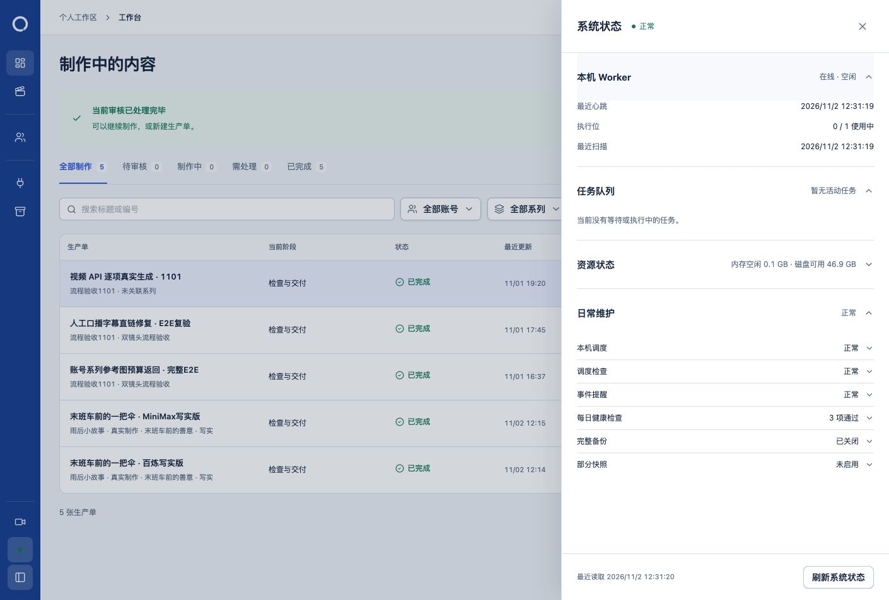

# 原生保存减少重复盘点

日期：2026-11-02。范围：仅优化 `saveWorkspaceStudio` 丢弃中间完整状态的路径，保持保存、字幕、候选采用及冲突保护行为。不提交或推送。

## 实现

在 `productionWorkspaceCommands.ts` 内部提取 `persistWorkspaceRevision`，承接原有版本化写入。其函数正文除返回当前工程记录外，与原写入正文逐字一致：内容指纹、不可变文件、乐观版本比较、历史登记和镜头输入同步保持。

既有 `updateWorkspaceProject` 的签名和完整状态返回方式不变，其他调用者无需调整。只有原生保存先消费写入后的工程记录，完成 `syncNativeWorkspaceCaptions` 后，再调用原来的 `readProductionWorkspace` 返回最终状态。省去未被使用的中间完整盘点及随后重复查询工程记录的语句。未引入缓存、跳过检查的开关、数据库迁移或 SDK 修改。

## 前后实测

使用相同结构和合成媒体的真实两镜头工程，每阶段保存 5 次；每次通过 SDK 的实际 HTTP 文档与所有权协议修改画面位置、字幕正文和时间，再调用 Owner 保存命令。数据库、文件和 SDK 实现均真实执行；spy 只计数并继续调用原函数，pg 查询包装保留 Promise／回调行为。

改动前，新用例的保存重开、字幕和旧版本拒绝断言均通过，最后以完整盘点应为一次的断言失败，实测连续 5 次均为两次。改动后相同用例全部通过。

| 单次保存指标 | 优化前 | 优化后 |
| --- | ---: | ---: |
| 完整工程盘点 | 2 | 1 |
| 显式数据库查询，中位数 | 217 | 160 |
| `verifyEpisodeFile` 调用 | 8 | 6 |
| 耗时中位数 | 381.28 ms | 314.82 ms |
| 耗时均值 | 371.39 ms | 397.06 ms |

每个对应样本均减少 57 条显式数据库查询。优化后存在一个 728.23 ms 的慢样本，均值没有改善；样本少且有波动，不能据此认定保存稳定提速。该夹具的 MP3／MP4 探测计数均为 0，因此也不宣称已测得媒体探测减少。已确认的收益是同次保存的重复盘点、查询和文件核验减少。完整样本见 [profile-comparison.json](profile-comparison.json)。

## 行为与回归验证

- 新增两项真实集成：保存返回已同步字幕，重启／重开后画面与字幕保持；旧 revision 或 SHA 返回 409，原工程字节与数据库指针保留。
- 故障用例在独立数据库撤销历史表 SELECT 权限，真实拒绝最终状态读取。查询轨迹确认字幕证据已经写入，随后读取才失败；整个 Owner 事务回滚，工程行、字幕证据、版本登记和既有文件字节保持。权限在夹具关闭前恢复。
- 原有原生保存、口播候选、图片／视频采用、字幕与最终成片检查回归保留：5 文件、18 项通过。包括真实 SDK 保存／重开、保存后缺采用回执的补确认、输入或候选字节变化拒绝，以及字幕正文／样式／时间、失效与成片确认。
- 连同新增用例，共 6 文件、20 项真实集成通过；故障轨迹断言补齐后，针对该用例再次通过。
- 隔离快照默认回归 193 文件、1268 项通过；隔离及主工作区类型检查、后台／Worker 编译与运行清单检查通过。

测试先在隔离源码副本执行，未在开发过程中修改日常使用的源码。已有 pg 并发 query 弃用提示和 React act 提示未造成失败，没有削弱原测试断言。

## 日常启用

验证完成后重新检查保存源码与本轮基线一致、队列空闲、原生编辑器端口未监听，再停止日常服务，统一同步一个生产文件和新增测试，准备运行产物并启动。日常 PID 为 `2806`。

实际检查数据库、媒体目录、运行程序三项通过，HTTP 200；页面显示系统状态、日常调度检查正常，Worker 在线，心跳和扫描持续更新。空闲成功记录按既有规则去重保存，历史失败没有删除。

日常更新前后 43 张业务表的数量和内容指纹一致，152 份工程 JSON／SQLite／附属文件指纹一致。未为验证发起付费 Provider 请求、改变自动备份设置或操作原工程内容。

## 恢复依据

私有证据目录：`/var/folders/6c/wzgq_5_n40lfd6c48djmqwf40000gn/T/loop-save-readback-20261102-ffv2lpy5/`。包含修改前文件、独立补丁、基线失败与通过日志、全部测量、写入正文等价核对、隔离验证源码，以及日常更新前数据库／运行产物副本和数据核验。所有测试夹具正常关闭；原有并行工作与暂存内容保留。
