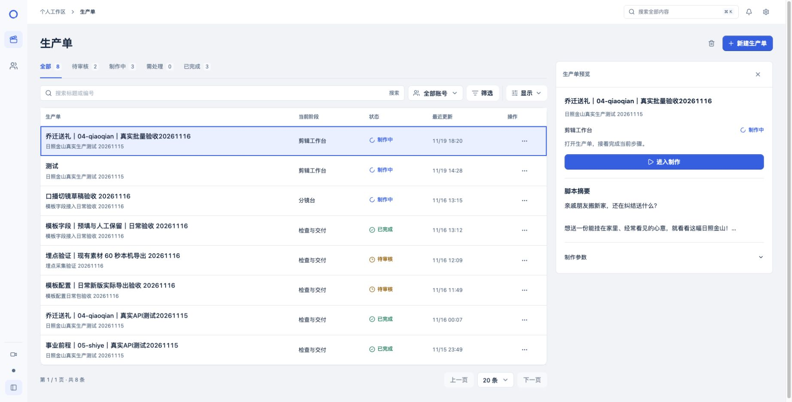

# 生产单视觉细化定稿验收（2026-11-22）

用户在第二版模拟数据 demo 上确认最终参数：列表与预览 7:3、列表标题 15px、每行上下留白 12px。本轮按确认结果更新正式生产单页，基线 `993e140d2`，开始时工作区 clean。

## 修改与边界

- 两列采用 `minmax(0,7fr) minmax(0,3fr)`，在扣除原有 20px 间距后按比例分配宽度；不再固定为 240px。1000px 以下继续使用现有原生预览弹层。
- 列表标题 15px、字重 500，长标题单行省略并保留原 Tooltip/完整可访问名称；辅助文字 12px，单元格上下各 12px。
- 默认只在行内显示账号，账号已筛选时不逐行重复；“显示”菜单可开启系列信息，偏好仅存本机浏览器，无系列不显示占位说明。物理收纳优先于冻结系列版本的规则保留。
- 搜索、选择器、筛选、显示与分页控件统一为 36px 高、13px 字号、6px 圆角，无普通控件阴影；正文预览采用更易读的 14px。
- 沿用真实记录、原有搜索/分页、统计、行操作、预览与制作入口。未修改 API、数据库、生产参数或剪辑工程，未发起付费制作。

## 验证结果

| 检查 | 结果 |
| --- | --- |
| 新增元信息与系列显示偏好回归 | 修改前 2 项失败，修改后通过；原有断言保留 |
| 列表/筛选/预览/行操作/导航相关回归 | 6 文件、37 项通过 |
| `npm run check` | 通过 |
| `npm run build` | 通过；保留原有大 chunk 提示 |
| `npm run backend:build` | 通过；前端构建后补齐全量测试所需编译产物，不重启日常服务 |
| `npm test` | 381 文件通过；2701 项通过、1 项原有跳过，共 2702 项，93.64 秒 |
| `git diff --check` | 通过 |

真实浏览器使用 `http://127.0.0.1:5174/?view=episodes` 的现有登录和 8 条真实记录：

| 窗口宽度 | 列表/预览实测比值 | 标题 | 行上下留白 | 主内容横向溢出 |
| --- | --- | --- | --- | --- |
| 1440px | 2.33323（即 7:3） | 15px | 12px / 12px | 无 |
| 1024px | 2.33335（即 7:3） | 15px | 12px / 12px | 无 |
| 768px | 原生预览弹层 | 15px | 12px / 12px | 无 |
| 390px | 原生预览弹层 | 15px | 12px / 12px | 无 |

实测四类工具栏控件均为 36px、`box-shadow: none`。系列显示开关刷新后保持选中；恢复默认关闭后，筛选“日照金山真实生产测试 20261115”得到 4 条记录、0 个重复账号说明，清除账号筛选恢复 8 条。390px 可以从显示菜单打开预览，Esc 正常退出。最后恢复原窗口尺寸、全部账号、默认隐藏系列及展开预览；浏览器 error 日志为空。

## 审查与盲区

已核对 diff 的功能范围、样式作用域、空系列/选定账号/偏好恢复、网格最小宽度和原有操作边界；无新增依赖、数据命令或后台任务。未降低断言、跳过测试或改写业务数据。

本轮未做 Safari、触屏实机、屏幕阅读器和深色主题人工验收；使用现有语义颜色及媒体组件，未新增需要浏览器兼容回退的布局 API。本地原始日志保存在 `.scratch/production-page-refinement-20261122/`。
