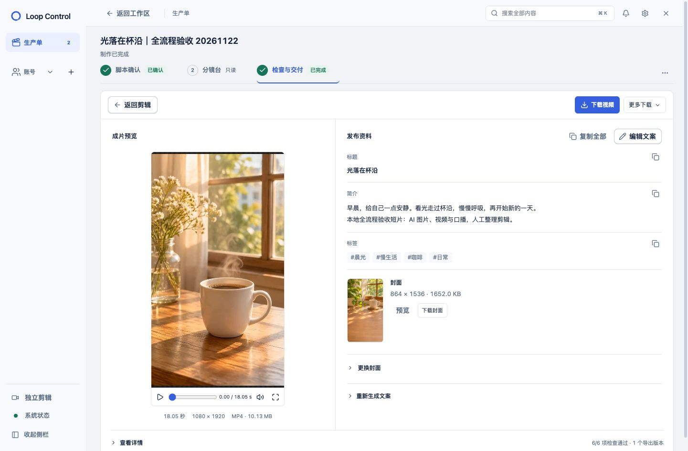

# 新建生产单真实 API 全流程验收

2026-11-22，基线 `97bcfce24`。用户授权图片、视频和口播真实 API、发现 Bug 修复；预算上限 ¥100。本次交付成功，按代表配置覆盖，未声称穷举参数组合。

- 新单：[光落在杯沿｜全流程验收 20261122](http://127.0.0.1:5174/?view=episodes&episode=f339edf0-8324-4201-8533-e6b08fef47b1&step=delivery)，ID `f339edf0-8324-4201-8533-e6b08fef47b1`。
- 账号：日照金山真实生产测试 20261115；未关联系列，独立创建，未编辑旧生产单。
- 完成状态：`production_completed`；2026-11-22 21:18:56 确认。重启服务、重新登录并重开后仍完成，系统状态恢复正常。
- 最终视频：18.048 秒，1080×1920，30fps，H.264 + AAC／48kHz 双声道，10,618,490 字节。SHA-256 `913b5d8f7fcbd56773e8959fadc8aec7f50063b92dba38f1837aad632025614b`。
- 真实付费任务 10 次：3 张图片、4 段视频、3 段口播；全部 completed，每项 attempt=1，无付费重试。费用预留合计 **¥45.53**，**不是实扣**。供应商逐次实扣未返回，不能将执行器静态 `actualCostCents=0` 当免费或结算金额，不能据此声称实扣已经核实。

## 每一步实际做了什么

| 步骤 | 操作和实际结果 |
| --- | --- |
| 1. 新建与脚本 | 从列表新建独立生产单，输入三段中性晨间静物脚本；v3 模板、9:16、目标18秒、字幕开启。确认后准确生成3镜，口播与画面说明分离，未调用脚本大模型。 |
| 2. 图片 | Flare低质量生成首镜、第二镜；Sunburst中质量生成第三镜，均864×1536／单张。实际预览，记录源文件SHA；第三张直接作为最终静态画面，其余作为视频首帧。核对切镜参数继承、切模型保留兼容草稿。 |
| 3. 口播 | 豆包seed-tts-2.0、Vivi 2.0、zh-CN；首镜1倍，第二镜改0.9倍，取消和确认配置差异均测试，第三镜继承0.9倍。三段生成成功并显式采用；采用前核对实际时长与字幕影响。原首镜已有声音未被默认修改重生。 |
| 4. 视频 | 调用MiniMax H3-Lite／768P、H3-Highspeed／480P、H3／2K，及万相wan2.6-i2v／720P，各请求4秒；均成功。最终采用Lite首镜和万相第二镜，其余保留候选。切供应商时保留不兼容参数并给出恢复默认入口，实测恢复后提交；万相固定生成声音校验有效。 |
| 5. 字幕 | 采用口播后，使用本机中文声学模型自动对齐；本单5次本地对齐任务成功、预留0，无外部字幕API。最终3组／6条字幕实际进入原生工程，代表帧可见正确正文。 |
| 6. 裁剪与音效 | 视频裁剪默认收起；展开后实际鼠标拖动起点至0.20秒，精确时间同步，核对并显式采用0.20–4.4333秒。音效用本次本机合成的柔和提示音MP3上传，直接形成候选并加入镜头；测试关闭说明、上传模式、音效播放器、设置弹层、键盘移动区间、精确时间、开始位置0.30秒、音量−18dB、遇人声降低6dB，保存后摘要与源区间一致。 |
| 7. 原生剪辑 | UI打开OpenChatCut、保存并返回，使用其现有CLI只编辑该单的离线草稿（先不落盘核对，再原子提交并保留历史）。首两镜降速到约0.706／0.667倍，分别填满6秒窗口；第三镜静态画面6秒，保留口播、字幕、音效时间和原声静音。重开实际编辑器确认3镜均6秒，已有剪辑未被分镜初稿覆盖。 |
| 8. 导出和确认 | 从正式“生成成片”入口保存并导出；6/6技术检查通过、无黑帧、无画面空档。正式播放器实播至结尾，检查首中末代表帧，ffmpeg全片解码通过；确认并完成，生成核心交付。 |
| 9. 发布资料 | 人工填写标题、简介、4个标签并显式保存；测试成片选帧保存封面，再用本单生成的图片测试上传替换。已有图片分支正确显示“暂无可用图片”：当前只列登记为封面的素材，普通生成图和已保存封面不自动登记为封面候选。最终封面864×1536；最新发布资料revision3。 |
| 10. 下载与重开 | 实际触发“下载交付文件（ZIP）”，生成最新发布包de310079-c64e-46cf-bdc1-823acda93b4b。浏览器工具拿不到下载落盘回执，未记为浏览器下载成功；改用正式交付流处理器对本单6个真实文件生成本地ZIP，独立unzip检查通过；正式单文件处理器的206范围0–1023返回与MP4原字节一致。重启后再打开完成页、展开6/6详情与导出历史，桌面截图保存；390px DOM几何检查无横向溢出，未宣称真机验证。 |

## 实测模型及参数

| 类型 | 模型与参数 | 请求数 | 结果 | 费用预留 |
| --- | --- | ---: | --- | ---: |
| 图片 | gpt-image-2.6-flare，864×1536，low，count1 | 2 | 成功 | ¥20.00 |
| 图片 | gpt-image-2.6-sunburst，864×1536，medium，count1 | 1 | 成功 | ¥15.00 |
| 口播 | seed-tts-2.0，Vivi，zh-CN，1／0.9倍 | 3 | 成功并采用 | ¥0.37 |
| 视频 | MiniMax-H3-Lite，首帧，768P，4秒 | 1 | 成功并裁剪采用 | ¥1.39 |
| 视频 | wan2.6-i2v，首帧，720P，4秒，single，audio开启，watermark关闭，promptExtend关闭 | 1 | 成功并采用 | ¥2.88 |
| 视频 | MiniMax-H3-Highspeed，首帧，480P，4秒 | 1 | 成功，保留候选 | ¥1.39 |
| 视频 | MiniMax-H3，首帧，2K，4秒 | 1 | 成功，保留候选 | ¥4.50 |
| 视频 | wan2.6-r2v，参考素材模式 | 0 | 本地图缺公开HTTPS地址，前置校验阻止提交，无扣费请求 | — |

逐项任务ID、时间、预留和尝试数见 [generation-ledger.csv](generation-ledger.csv)；不可变请求设置、任务结果、原单记录指纹、最终交付检查见 [evidence.json](evidence.json)。未取得本单逐任务供应商实扣回执，没有冒用旧账单或估算替代。

## 现场 Bug 与修复证据

1. **保存中仍可切换镜头。** 口播采用命令已提交，切镜导致旧行的读取所有者结束，保存结果未进入当前页面，下一操作带旧revision遭409。镜头序号、整行鼠标／键盘和准备情况跳转现在在实际保存期间统一锁定，已完成只读页仍可正常选镜；后台媒体生成期间不持续锁定。新增回归先失败，再修复通过；真实第二／第三镜采用时观察到锁定，完成后恢复。
2. **口播确认保存使用过期版本。** 修改口播语速的二次确认期间，本机字幕完成改变工程revision，确认仍提交旧revision。现在生成前及确认修改后重新读取当前工程，并比较默认配置，其他窗口真的修改配置时仍拒绝覆盖；取消不生成、不保存。新增“确认期间revision1变5”的回归先失败，再通过；现场重新修改0.9倍、确认并实际生成成功，第三镜继承成功。
3. **字幕自动写入不参与页面保存锁。** 自动对齐请求直接走原始command，与手动采用抢revision。现在复用已有命令入口的pending锁，自动字幕失败继续由本地提示负责，避免把后台错误冒充手动未知提交。新增父组件集成回归先失败，再通过；保留既有“自动字幕失败不挡手工准备”回归。之后真实图／视频采用、字幕完成、导出确认成功。

没有放宽服务端revision校验、权限、费用确认或提交未知保护，也没有自动重试付费生成。

## 验证与边界

- `npm run check`、`npm run build`、`npm run runtime:prepare`通过；Vite原有大包提示保留，没有改依赖或阈值。
- 最终 `npm test`：**386文件、2745项通过，1原有跳过**。中间全量发现自动字幕错误被共享入口升级成全局错误，修正调用归属后重跑全量通过；没有删除或放宽断言。
- 原有10张生产单整行JSON的前后SHA一致。该证据只证明这些数据库记录未变，不冒充全库或全部源文件的逐字节比较。
- `media-probe.json`、`archive-verification.json`、三张解码帧和`delivery-complete.jpg`保留在本目录。视频、ZIP、封面和可编辑工程在素材盘本生产单的`验收交付`文件夹，未将大型生成媒体提交Git。
- 浏览器下载工具两次无法取得落盘事件，已改用不同方法验证正式文件流和ZIP生成；浏览器的实际系统“保存到磁盘”结束状态仍未独立观察。登录过期期间暂停需要登录的验证，用户重新登录后继续，未读取密码或绕过认证。
- 本轮未真实调用wan2.6-r2v、Pexels/Freesound检索、上传口播、多语言／其他音色、所有时长／比例／高级参数组合、AI发布文案。未执行破坏性删除、目录迁移、账号或密钥变更、外部发布。预算与保持单片一致性决定采用代表组合，不将单元测试冒充这些真实供应商测试。
- 音频轨存在、全片解码、播放至结尾和字幕时序已验证；没有独立人工逐字听审、所有帧画质审查、Safari／真实触屏／屏幕阅读器验证。

