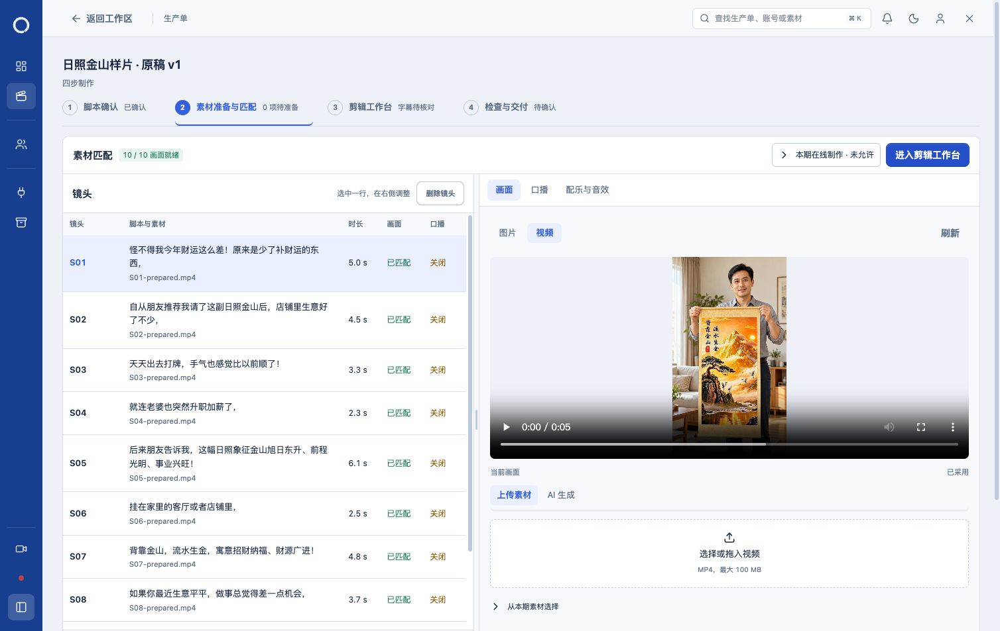
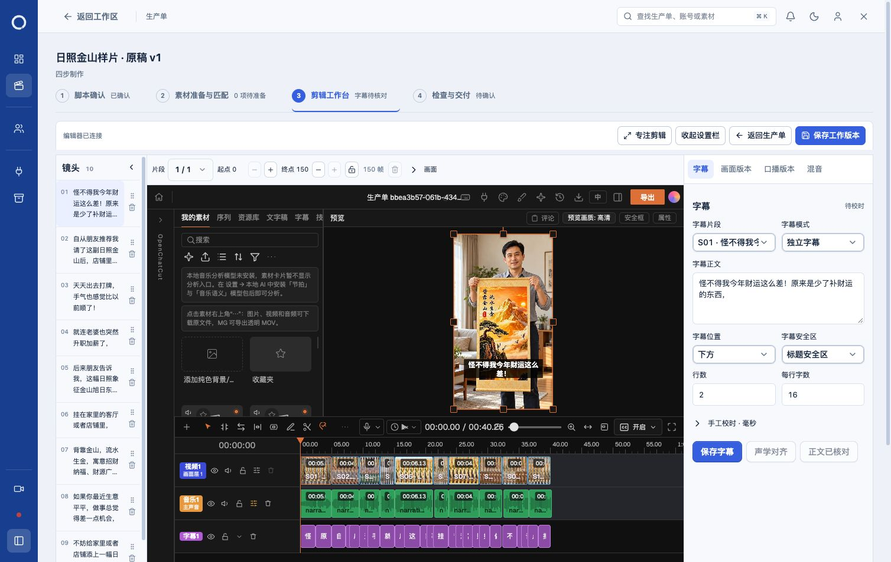

# 日照金山原单恢复编辑验证

2026-10-30，目标生产单 `bbea3b57-061b-4341-9ba1-3bf65d28899f`。

## 根因与修复

这张单处于 `waiting_input`，当前脚本为测试后留下的 Markdown 排版版本，原工作区仍绑定旧脚本及失效原因为“测试”的分镜包。`workspace.stale` 因而禁用上传和剪辑入口；与登录、本期在线制作授权无关。

新增持久的恢复原因与“确认排版修订，继续原工程”入口。服务端核对两版文件指纹及正文一致性，检查工程版本和任务状态；确认后建立新的制作依据，更新绑定并保留原生工程。实质正文变化继续阻止直接沿用。旧脚本、失效分镜、审批和历史文件保留。

## 实际验证

- 本地正式迁移流程应用 `098-workspace-formatting-resume.sql`，原迁移未改写；重建并重启日常服务 `127.0.0.1:5174`。
- 在真实生产单点击恢复，脚本已确认，10/10画面就绪，上传视频和进入剪辑工作台可用。
- 打开真实 OpenChatCut，显示“编辑器已连接”，10镜／40.26秒时间线、原视频、旁白和字幕加载；保存与片段调整控件可用。页面留在该编辑器。
- 恢复后工作区 revision 4；工程SHA仍为 `b17ab2581202f3b8d2181ec6cd94c89bf9dde47d42edd3e17ca04d5e050f2f59`，镜头绑定完全一致。
- 27份媒体逐文件核对大小与SHA全部一致。任务与审批使用既有 round7 `daily-after.json` 的完整行指纹比较，一致；原分镜“测试”失效记录保留，待执行／运行任务为0。
- 在线制作各授权开关仍为false。本轮未生成、替换或上传真实媒体，未恢复审批或调用供应商。

## 检查

1150项普通测试、2项真实HTTP／PG／原生SDK集成、27项相关界面测试、TypeScript、生产构建及运行包完整性通过；构建仅有既有包体积提示。日志见 `logs/`。

恢复前后记录见 `evidence/before.json`、`evidence/after.json`；素材页面及已连接剪辑器截图见下。

