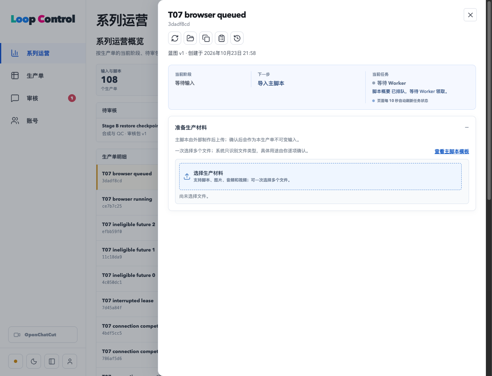

# T07：容量、公平与持续消费

2026-10-23，工作区基线 `eb83b30`；T07/#113 已在优化工作树实现并完成本地验收，Owner 已认可本地验收结论；本次提交归档实现、验收报告、回归日志和证据索引，未推送或合并。T08 未开始。没有操作生产。

## 结论与限制

- 全机容量与 Provider、Adapter、连接、CPU、渲染、下载资源组同时限制；已领取任务在执行器启动前占用槽位。满载保留 ready，不构建或启动空跑 Worker。
- 按持久 Episode 轮转位置及当前运行数量补位，持续发现执行中加入的任务；进程重启保留顺序。失败重试保存退避，实际 Owner 作废命令释放槽位并拒绝旧租约。
- **保留 T06/B 的“默认 5 秒门禁曾未通过、时序不稳定根因未解决”限制。** 本次最后一轮默认 5000ms、单 worker 为 **70 文件/676 项通过**，没有 testTimeout 覆盖；这是本轮结果，不能改写此前失败历史或宣称该不稳定已修复。先前 T06 同机对照证据在 [补验报告](../stage-c-t06-followup/README.md)。
- advisors 的 all/warn 检查仍有三条既有 RLS 性能告警，未称全绿；与 A 隔离基线的策略定义逐字一致，没有 T07 新对象告警。

## 核票与设计

开工时通过项目规定的 gh CLI 读取 #113、#112 正文/评论及原生 blocked_by：#113 为 OPEN、ready-for-agent，仅依赖 #112。本地 T06 实现 `8da46ed` 与已获 Owner 认可的补验 `eb83b30` 满足技术前置；没有代替 Owner 关闭云端 Issue。票单三项验收与 ADR-0008 一致。

在原 T06 统一 dispatcher 与 T05 围栏外壳内实施，无新 npm 依赖或浏览器队列 API：

- `worker_scheduler_settings.capacity` 是跨进程全机权威，默认 2；调用方的 `CODEX_WORKER_CAPACITY` 只能降低本轮领取上限，`LOOP_WORKER_CONCURRENCY` 仅约束当前 dispatcher。全局锁、配置行锁、候选 SKIP LOCKED、排序资源锁均在短领取事务中完成，执行时不持有事务。
- `worker_resource_ceilings` 仅由受信服务写入，独立连接及其他资源可设置更低上限；使用 `least`，无法借它提高保守默认值。配置写入与领取共用全机锁；降低配置约束后续领取，不抢占已有租约。
- `worker_episode_turns` 保存轮转位置，优先没有运行任务的 Episode，再按轮转及任务创建顺序领取。任务/Episode 参数限制规划或标识唤醒，不形成绕过全局公平的私有执行队列。
- dispatcher 领取成功后才构建/启动 Worker，通过 stdin 传包与 token；Worker 先校验/续租再沿原预检、实际执行与结果事务。首次 Worker/run attempt 仍为 0，tasks.attempt 为 1。
- `available_at` 保存 1 秒起、上限 30 秒的指数退避，尝试预算不变；服务专用退避读使用 DB 时钟，排除无效、耗尽预算和不支持 Provider 的任务，空集合返回 0。

迁移 `20261023133427` 只应用并记录在 verified（231→232）。A 仅只读核对既有告警策略；所有真实任务演练逐场景保护原任务，结束前后完整行摘要一致。权限用真实 SQL 验证：Owner/anon 不能配置内部容量、重置轮转或直接领取任务；无 token 的旧入口继续拒绝。

## 验收证据

| 标准 | 已执行结果 | 证据 |
| --- | --- | --- |
| 全机和重叠资源限制 | 原三组容量 red 为1/1/1；全机2后1/1/0；跨连接 Provider2为1/1/0；独立连接1、CPU、下载上限为1/0。并发 RPC 不能以调用方8提高全机2，同连接quota1与独立连接合计可占Provider2。 | [容量](capacity-final.json)、[受控执行](controlled-consumption.json)、[基线函数回滚复现](baseline-capacity-replay.txt) |
| 配置/领取并发 | 独立事务持有全机锁时，真实 PostgREST 配置写入在 pg_stat_activity 中被观察到 advisory 等待；释放后写入与清理完成。 | [配置竞争](configuration-race.json) |
| 连续消费、公平、重启 | A长任务未结束时B/C及新加入D继续；峰值2；两个独立Node进程保留轮转；重启后消费持久队列。 | [8项受控路径](controlled-consumption.json) |
| 取消、失败、退避 | 实际Owner save_episode_tts_settings RPC作废运行旁白；旧租约拒绝、下条推进。执行器失败后其他Episode继续、原任务退避再成功；受控推进过期租约时钟后重试成功；30秒上限由真实结果事务检查。 | [受控路径](controlled-consumption.json)、[249条SQL](sql-final.json) |
| 普通HTTP与真实产物 | 5次同任务提交202，普通middleware→领取→stdin包→真实Worker/FFmpeg，连续完成3个Episode，各一个attempt0 run和一个23,297字节MP4，数据库/磁盘SHA一致；完成重复POST200，服务重启后仍可查询。 | [HTTP最终路径](http-real-path.json) |
| 详情状态与刷新 | 真实Google Chrome显示“执行中”和“等待 Worker”；整页刷新后仍排队；释放受控执行器后页面自动变为已完成。 | [运行](browser-running.txt)、[排队刷新](browser-queued-refresh.txt)、[完成](browser-completed.txt)、[浏览器记录](browser-state-result.json) |



受控执行器测试使用真实数据库、真实结果事务与真实文本产物，但没有调用在线 Provider。HTTP/FFmpeg 路径使用普通 Worker，单独报告，不混称所有受控执行为真实生成。取消证明实际业务命令、数据库槽位和围栏语义，不能撤销已经发出的在线 Provider 请求；不宣称完整 Owner 审批链或 OS 沙箱。峰值2是本次配置样本，不是稳定生产单数量承诺。

## 回归与原始失败

- [默认5000ms完整应用回归](full-default-5000.txt)：70文件/676项通过；[Node](node-tests.txt)：2通过/1项本机n8n节点检查跳过；[类型与构建](types-builds.txt)通过，末次[类型](types-final.txt)、[编排器构建](orchestrator-build-final.txt)通过。已有 act 提示原样保留。
- [完整SQL](sql-final.json)：22文件/249条通过。旧资源组测试在回滚fixture中将全机设置为8，继续独立检验Provider上限3；新增测试验证默认整机2及权限/退避。
- [advisors原始结果](advisors-final.txt)退出1（fail-on=warn），三条 `auth_rls_initplan` 位于 external_connections、external_connection_verifications、storyboard_audio_selections；[与A只读对照](advisors-baseline-comparison.json)证明策略相同，未顺手修改。
- 真实red覆盖FIFO饥饿、跨连接绕过Provider上限、低连接限额未生效、立即重试，以及CLI未显式传environment时忽略CODEX_WORKER_CAPACITY；后者最后先red再修一行回退，[原始red](red-history/capacity-env-red.txt)。配置缺失拒绝领取，空退避集合不会持续等1ms。
- 首次Vitest误发现`.loop-control`中保留的T06源码快照且普通沙箱不能绑定HTTP；已停止并保留输出。后续仅排除该生成物目录，使用verified干净环境/本机HTTP权限。没有排除业务用例或增加预算。
- 过程中的fixture字段不完整、PL/pgSQL列歧义、过早观察第五次领取、宿主/DB时钟筛选竞态、空聚合边界及SQL退避时钟干扰均保留原始失败，再按定位原因修正。advisors首次误用SSL连接此无TLS兼容栈，改为仅loopback URL的sslmode=disable后读取实际结果。

私密原始日志、每轮失败/成功和验证helper共列于[原始证据索引](private-evidence-index.json)，含绝对路径、字节和SHA-256；验证目录模式600，未复制凭据。版本化报告仅含可公开的任务/产物/测试证据，T06原始证据未改写。

## 复跑与交接

仅在当前优化工作树、现有verified目标执行（各helper会校验身份）：

```sh
node scripts/isolation/capacity.mjs --verified --apply
npm run worker:build
npm run orchestrator:build
node scripts/isolation/capacity.mjs --verified --extended --configuration-race
node scripts/isolation/capacity-consumption.mjs --verified
node scripts/isolation/capacity-http.mjs --verified
node scripts/isolation/sql-tests.mjs --verified
```

完整应用命令：`node node_modules/vitest/vitest.mjs run --maxWorkers=1 --exclude n8n/import-workflows.test.mjs --exclude '**/*.integration.test.ts' --exclude '**/.loop-control/**'`，使用verified的cleanEnvironment，无超时覆盖。`--baseline-red`只在回滚事务中装入固定T06领取函数，预期退出1并观察1/1/1，不改变已安装实现；回归原始输出保留。

临时Chrome会话已关闭、原verified控制台配置已恢复。HTTP/任务/Episode都仍经过统一路径；T08的启动预构建、常驻唤醒/五秒兜底以及更后票不在本次实施。默认测试历史限制、三条既有性能告警和未测的在线Provider/完整审批链均继续保留。
