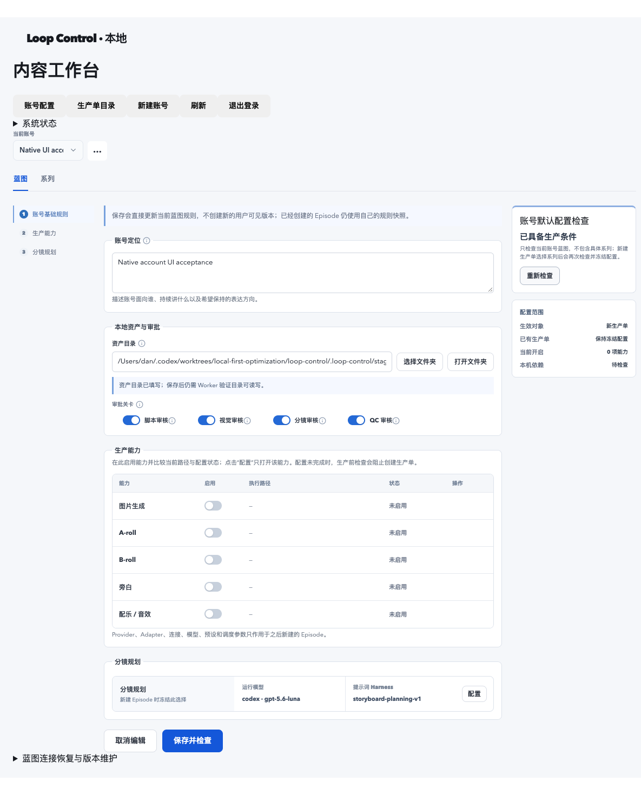

# 原生账号页面：目录操作与蓝图前置检查

2026-10-25，Asia/Shanghai。固定优化 worktree，HEAD `bca697bbc1e12626771d1283ec87a17bf85f02fe`。

**账号素材目录选择 / 打开、当前已保存蓝图的本机前置检查已接入正式入口。** 本轮只关闭所列 macOS 目录操作、蓝图检查及选择器退出清理范围；没有调用在线 Provider，没有进入 E/F，也没有完成多能力整单或新主机验收。

Owner 本轮确认「明白了。那就通过吧。这阶段通过了。继续处理下一个问题吧」，作为前一轮 Provider / Keychain 阶段的签收记录保留。它不将 Google `BILLING_DISABLED`、Freesound 401 或 Cloudflare / OpenAI 跳过改写为技术成功，不代表六家全部通过，也不批准新增请求或进入 E/F。下一项取自最初 A–D 遗留清单中的「原生页面接管尾巴」。

## 改动与边界

- **目录操作。** 原表单在 local 模式直接报不支持，现经 `POST /api/local/account-commands` 调用 `chooseAssetDirectory` / `openAssetDirectory`。默认在批准媒体根打开 macOS 系统选择器；选取仅更新草稿，Owner 仍须显式确认保存。取消保持草稿、不显示错误。打开操作走本机桌面命令，不通过旧 Supabase 会话或旧控制面。
- **路径与身份。** 复用正常 Owner 会话、精确 Origin、CSRF、账号归属和 `lock_owned_account_row`；选择前后分别核对会话及归属，不持有事务等待人工窗口。目录复用恢复映射、规范路径、现存目录与符号链接校验，不扩大媒体授权根。非 macOS 选择器返回明确不可用，允许继续填写已授权路径；本轮不宣称其他操作系统通过。
- **蓝图检查。** 新命令 `checkBlueprint` 绑定账号、当前蓝图版本及修订指纹。复用 `LocalEpisodeCommands` 中创建 / 启动生产单使用的同一 `preflight`，检查本机 Worker、素材目录、已选连接资格、静态执行配置及 Prompt Harness。返回 `worker-preflight/v2`，不创建生产单或任务，不唤醒执行、不下载、不调用在线资格或合成。沿用首个阻塞的行为，不宣称一次列全所有问题。
- **结果围栏。** 前端检查结果绑定请求、会话、账号、版本与修订；旧结果不得覆盖新蓝图，退出期间不得新发检查。保存改变修订后清除旧结果，点击「重新检查」读取已保存配置；未保存草稿不是本次检查对象。目录旧回调也不得改写切换账号后的草稿或错误状态。原注销 / 目录读取围栏及其 11 项测试源码字节不变。
- **选择器生命周期。** 桌面验收发现服务退出后挂起选择器成为孤儿进程，记录 red 后补 `AbortSignal`：请求断开与正式应用关闭都中止自己的子进程；人工选择等待上限 120 秒，使用明确终止信号。没有提高既有业务测试 5000ms 或模型检查 30000ms。实际绿色复验未手工杀进程。

源改动限于正常应用装配及测试、账号命令、正常路由、既有 Episode 检查入口和两处表单 / 工作台与其测试，共 9 个文件，无新增依赖、SQL 迁移或历史规则重构。SQL 一致性建议继续暂缓。

## 正式入口的实际验证

使用相同隔离 PG / 媒体、正常 `npm start/stop -- --deployment … --offline-test` 与应用工厂，创建一个独立测试账号和测试目录。暂停并记录 87 个既有样本调度标志后才启动本轮 Worker，避免消费历史队列；仅做就绪检查，规划器没有执行。结束恢复全部原值，5510 条原任务行逐项哈希不变，未新增生产单或任务。

| 验证 | 实际结果 |
| --- | --- |
| 修复前 | 组件选择后草稿未更新；旧 HTTP 账号命令返回 405；旧页面没有可用的本地检查按钮。原失败回执保留 |
| Owner HTTP / PG | 当前蓝图检查通过；旧版本 / 修订 409，未知字段 400，越界与符号链接 400，真实不可见账号 404，缺 CSRF / 跨 Origin 403，无会话 / 已撤销会话 401 |
| 真实 Chrome / 系统选择器 | 自动化接口无法绑定 osascript 窗口，由 Owner 协助完成真实选取和一次新的取消；选取结果经正常服务返回，取消后无错误且草稿不变，不将这部分称为全自动验收 |
| 保存 / 刷新 | 选中后数据库仍是原目录；经页面显式确认保存后，真实数据库为所选目录。整页重载、重新选账号后路径保持，旧检查失效；重新检查当前蓝图通过，页面打开目录成功，Finder 已实际显示本轮目录 |
| 退出边界 | 真实 HTTP 断开和正式 npm stop 均使对应系统选择器进程退出，无人工结束作为 green 条件 |
| 当前录入配置 | 恢复原 OS loopback 闭网服务，无 Worker。新检查返回 Worker unavailable，HTTP 200 仅表示检查命令完成，不能当能力通过；原 Keychain 和 Provider 账本保持 |

[HTTP](evidence/native-account-ui/http-final-result.json)、[实际选取](evidence/native-account-ui/browser-choice-result.json)、[实际取消](evidence/native-account-ui/browser-cancel-result.json)、[Chrome 保存刷新](evidence/native-account-ui/browser-final-result.json)、[选择器退出](evidence/native-account-ui/picker-lifecycle-result.json)、[历史数据](evidence/native-account-ui/history-preservation-result.json)、[闭网状态](evidence/native-account-ui/closed-final-result.json)。

## 回归与失败保留

组件与旧注销围栏针对性 19/19 通过。最终完整产品回归 **107 文件、815/815，默认 5000ms**；类型、原生类型、构建通过，Node 2 通过 / 1 个既有 n8n SDK 检查跳过。旧产品断言未弱化，测试范围未缩减，继续使用既有私有目录 / 历史源码档案排除项；裸 npm test 的档案发现问题仍未修复。

保留全部中间记录：组件 red、旧 HTTP 405、严格部署拒绝错配预算目录、OS 封套下浏览器 CDP 失败、错误 Cookie 导入格式、完整构建使运行中的预构建 runtime 失效的 unavailable、旧选择器退出 red、工厂测试未补新模块替身导致 1 文件未加载（106 文件 / 811 项通过）、恢复驱动独占快照重名的 EEXIST。修正各自夹具 / 生命周期后才验证，不靠放宽超时反复跑绿。

最初因工具没识别到系统窗口而推测窗口未出现，随后 Owner 明确确认实际弹出；该推测被纠正，不能据此声称 OS 封套阻止了选择器。曾提出的页面目录列表替代方案未实施，保留系统选择器。桌面步骤最终使用标准 offline-test Node guard、禁用外部端口与浏览器本机域名 allowlist，不混称应用或浏览器始终处于 OS 全断网；收尾已恢复原 OS loopback 录入服务。[桌面驱动记录](evidence/native-account-ui/desktop-harness-failure-note.json)

旧审核台两条 act 警告、构建 chunk 告警及原 n8n 跳过保留。真实 WhisperX 首次 30 秒失败、120 秒诊断不算验收、错误正文 0.838 反例、自然租约与秒级切换边界、各在线失败和跳过、完整多能力代表业务、新主机、真实通知、SQL 建议及其他未验收门禁均不因本轮通过自动关闭。

## 封存

本轮 **0 个新增 Provider 请求**，累计仍为 **10/17 次**，费用预留 **0.03 / 2 元**，未查询实际账单。全部旧账本保持字节及停止状态。Owner 对前阶段的签收与技术结果分开记录。

原 1133 项公开 / 1821 项私有证据保持，活动首页 / 复核报告另存原文。根 PLAN、43 个无关基线文件与 HEAD 不变，暂存区为空。期间另出现 `.scratch/ad-closeout-20261025/` 工作材料，不属于本轮，未读取内容、修改、暂存或纳入本轮证据。测试账号及目录保留，独立测试 Chrome 已关闭，其他浏览器会话未动。

封存审计逐项验证索引字节 / SHA、9 个源码快照、原门禁对象及历史账本。6 个已存 Provider 凭据仅在审计进程内读取，扫描其原文、URL 编码与 Base64 形式；公开材料和当前源码无匹配，新私有材料没有额外 Provider 凭据明文。首次审计因工作区沙盒拒绝隔离 Docker 的只读连接而中断，保留环境记录；获准访问同一本机资源后完成原审计，没有发起远端请求。[封存审计](evidence/native-account-ui/package-verification-result.json)、[沙盒中断记录](evidence/native-account-ui/final-audit-sandbox-note.json)。

未提交、未推送、未进入 E/F。当前仅主 Agent 复核，不称独立评审。[证据索引](evidence-index.json)
