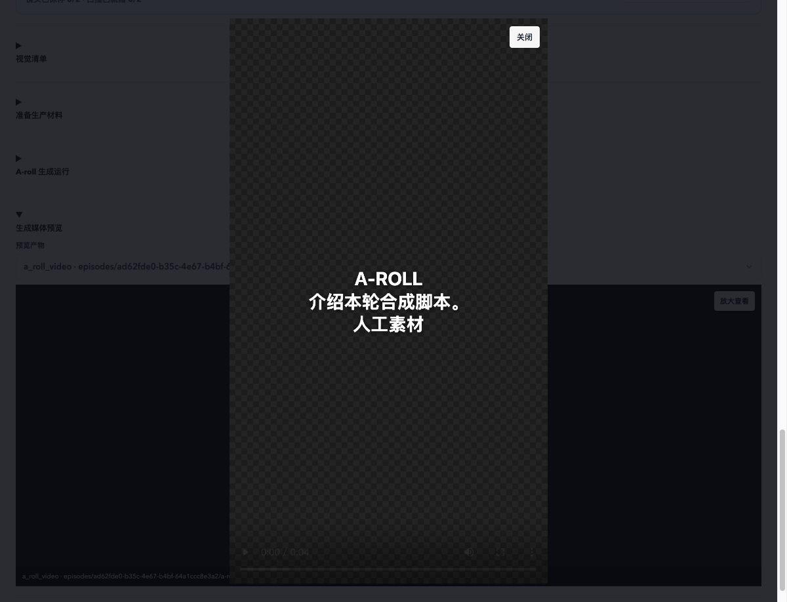

# T19：本地媒体接管与受控离线验收

> 归档说明：本次按 Owner 认可，将 T19 实现、验收及基线对照证据仅提交到当前分支。正文和原始 JSON 中的“未提交”、`committed:false`、`noCommit:true` 及 HEAD 均描述验收/补验时快照；原始日志保持不变。默认 5000ms 门禁仍未通过、根因未解决，其他未验收项及模拟资格、SecretStore 替身、T17 日志覆盖说明继续保留。未推送、未合并、未开始 T20。

2026-10-24，分支 `codex/local-first-stage-a`，起点 `af4856a8683d0a61f2f01911ccfe00077b4c9cc1`。**实现与受控离线功能链路已完成；默认 5 秒完整回归门禁未通过，不能宣布无条件验收完成。** 未提交、推送、合并或开始 T20。

## 票单、依赖与范围

本地已发布票单 T19 / #125 要求迁移媒体任务和素材绑定的数据访问，保留已注册 Adapter 和 Provider 算法，覆盖能力开关、人工素材、已有音轨、阻塞、重试与替换，并按媒体族核对真实文件、索引及页面预览。依赖 T17 已提交于 `d06b2a5`。本轮依照“不新增在线请求”的限制只读取本地票单与缓存，没有刷新 GitHub，也没有变更票单状态。

沿用 stage-d 原生 PostgreSQL `loop-control-stage-d-postgres` / `loop_imported`、`loop_empty`（55472），实际挂载的专用媒体卷和隔离 Chrome。验收应用仅监听 `127.0.0.1:55182`。没有操作生产、登录/系统钥匙串或既有 ACL。原生 Worker 使用独立最小角色，浏览器只经 Owner HTTP 命令提交。根 `PLAN.md` 的既有修改和无关规划文件保持原样。

生成前记录的 [Adapter 矩阵](adapter-matrix.md) 保留全部注册项；实际能力仍由就绪检查决定。

## 实现

- [Owner 命令](../../../src/local-app/episodeCommands.ts)：人工 A/B-roll、旁白、BGM/SFX 绑定，音轨选择，原声模式，镜头画面草稿、片段生成、媒体规划和显式重试；保留原领域函数，检查当前审核包、材料用途、文件指纹和实际时长。
- [原生媒体 Worker](../../../src/local-app/mediaWorker.ts)：复用既有媒体执行器、FFmpeg 和 OpenChatCut。连接只能按被冻结的版本、Owner、当前资格及租约围栏解析，秘密仅在 Worker 内存中使用。媒体未就绪返回结构化 `worker-preflight/v2`，不回落到其他连接或云端。
- [016](../../../db/local/016-media.sql)、[017](../../../db/local/017-media-fences.sql)、[018](../../../db/local/018-media-source-mode.sql) 为前向迁移，已应用至两个隔离库。分镜后媒体显式启用；静态图片另由 Owner 开始制作时的冻结选择显式授权。未开启能力不生成相应任务；对齐、同步预览及后续 Studio/交付仍不领取。
- [本地详情](../../../src/local-app/LocalEpisodeDetail.tsx) 复用现有工作台和产物预览，补上分镜批准后的媒体预览入口；当前与历史素材分别保留。
- 真实浏览器发现并修复片段数组经 `pg` 写入 JSONB 的编码问题。目视验收又发现既有卡片工程将文字误放 `caption` 轨道；[卡片工程](../../../src/worker/openchatcutProject.ts) 现使用 `V1/video`，未改写 Provider 生成算法。同工程、同渲染命令只更改轨道映射即恢复文字；[测试](../../../src/worker/openchatcutRenderer.test.ts) 增加相应不变量。修复前后文件、解码帧和页面截图均保留。

## 功能验收

| 项目 | 结果与证据 |
|---|---|
| HTTP→原生 PG→实际 Worker CLI | 七类样本通过：[最终日志](evidence/http-final-02.txt)、[结构化结果](evidence/http-result.json)；OpenAI/Cloudflare 图片、Pexels B-roll、Freesound BGM/SFX、人工、本地 A/B-roll 和能力关闭 |
| 人工/已有音轨 | A/B 绑定、重复提交单任务、替换保留旧任务；旁白/BGM/SFX 与既有音轨选择；原视频音频实际提取。原声选择仅制作前可改 |
| 阻塞/重试/权限 | [边界结果](evidence/boundary-result.json)：旧审核包、文件篡改/越界时长、CSRF、跨 Owner、未知秘密字段、角色越权及旧围栏拒绝；受控失败后显式重试，新路径、冻结版本和旧任务保留 |
| 就绪/撤销 | [就绪结果](evidence/readiness-result.json)：实际撤销 Worker 函数权限后启动及 HTTP 503、v2 预检、任务/标记不变，finally 恢复授权；缺少 FFmpeg 拒绝。四条合成连接最终均撤销，原引用 409、不回落：[撤销结果](evidence/revocation-result.json) |
| 真实 Chrome | 实际选择原片、保存原声/画面草稿、点击生成片段、上传并绑定 BGM、查看产物索引、刷新保留状态；1.023 秒实际裁剪视频可播放。七个最终产物在产品预览组件中加载，五个音视频样本播放时间前进：[逐族结果](evidence/browser-product-previews-final-result.json)、[提交/刷新结果](evidence/browser-final-result.json) |
| 文件/历史/权限 | [137 个索引文件](evidence/artifact-audit.json) 的大小/SHA 与实际文件一致；[38 表、22,187 条验收前行](evidence/history-final-result.json) 逐字多重集保留；[迁移摘要和 definer ACL](evidence/native-security.json) 检查通过。旧卡片空画面文件仍留作失败证据，不计内容验收通过 |

最终卡片实际显示冻结文字，人工目视截图如下。PNG/JPEG 的受控响应使用 1×1 合成图片，只证明编解码、文件、索引和预览接线；不证明在线图片质量或 Provider 实际生成效果。

## 回归门禁：未通过

Worker/编排预构建、应用和本地类型检查、前端生产构建通过。Node 测试 2 项通过、1 项既有跳过。全量 Vitest 使用同一隔离环境和默认 `5000ms`，未修改超时或断言期望值。

- 最终 [第 04 次](evidence/application-final-04.txt) 和 [第 05 次](evidence/application-final-05.txt) 均为 **93/94 文件、739/740 测试通过**；`ReviewWorkspace.test.tsx` 的“分镜批准后按整期 BGM、TTS、逐镜头声音的顺序显示并保存独立音效选择”超时。第 05 次在真实卡片渲染完成后执行，仍失败。
- 第 02、03 次曾为 94 文件、740 项通过，不能覆盖最终失败或用于关闭门禁。
- 首次回归误扫入私有旧比较快照，且两条源码断言仍读取提取前的媒体工具位置；保留失败日志，后续沿用 T18 的私有目录排除参数，并将断言读取位置移至共享模块，断言本身保留。
- **此前 B/T06 的默认 5 秒门禁历史失败及根因未解决仍有效。** 本轮没有完成同机基线全量对照，不能把本次超时确定归因于 T19 或宣称根因已解决。没有继续重复试跑或放宽超时来掩盖失败。

## 必须保留的限制

1. 默认部署、在线生成、其他 Provider 的真实在线资格/效果和完整多能力 Worker 组合仍未验收。T19 没有新增在线 Provider 请求或费用。
2. 四条连接的 `live/verified` 资格是专用合成夹具写入的元数据；SecretStore 是受控替身，未创建真实 Keychain。真实 Keychain、在线资格及真实 Provider 生成不可由此推导。最终已撤销这四个合成版本。
3. 图片响应是 1×1 合成 PNG/JPEG；Pexels 视频和 Freesound 音频来自本地可重建夹具。真实本机 FFmpeg/OpenChatCut 的执行、文件和页面验证与在线 Provider 验收是不同结论。
4. T17 中间通过日志曾覆盖，仅保留命令/退出码清单，最终原始日志与失败日志仍在：[T17 说明](../stage-d-t17/README.md)。本轮 stdout/失败日志/截图按唯一编号保留；`fixture.json` 和私有快照是滚动运行状态，不是逐请求档案，最终及卡片修复前快照已单独保留。没有声称保留所有中间响应。
5. 对齐、同步预览、Studio、QC/交付等后续任务可能被原业务触发器记录为待处理；T19 不领取执行它们，也不据此宣称 T20 或后续阶段完成。

## 证据与复核

[证据索引](evidence-index.json) 列明本次源文件及公开证据的 SHA-256；索引不自包含。原始失败、最终日志、权限/历史审计和代表产物在 `evidence/`。含凭据的数据库配置、Owner 登录材料、全量数据库转储、租约和私有服务日志留在本机 `.loop-control/stage-d/state/t19-20261024`，不纳入公开证据或提交范围；未采集/纳入含凭据 HAR。

[双轴复核](review.md) 的实现问题已修复；静态复核不替代运行证据，更不覆盖默认 5 秒回归失败。此报告不代表 GitHub 票单已关闭、已提交、已推送或已合并。
