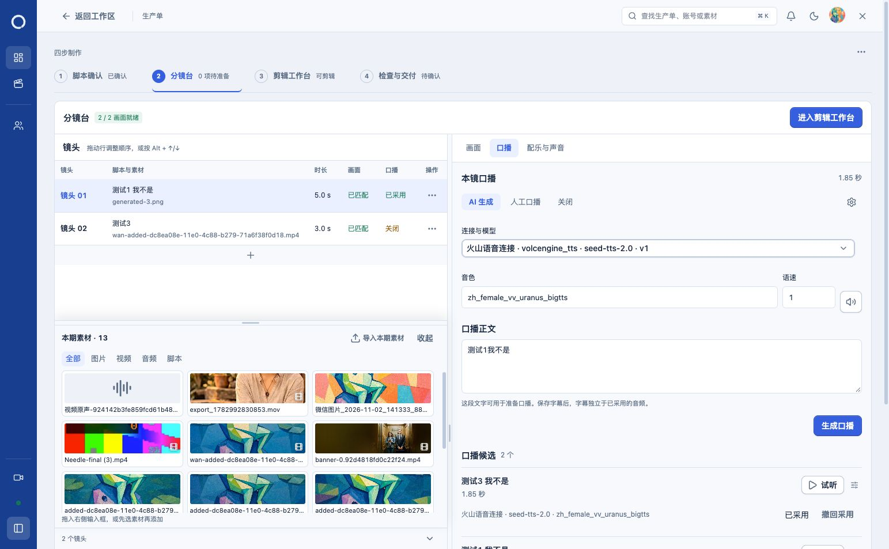

# 模板素材、口播与声音区域验收

2026-11-07。按用户指定的 `flow-validation.html` 和素材网格截图调整正式分镜台，沿用已有 lc 色彩、字体及组件。

## 已实现

- 本期素材改为三列真实缩略图网格，支持全部、图片、视频、音频和脚本筛选。选中后可拖入右侧，双击或点击预览按钮可查看图片、播放视频或音频、阅读已登记脚本。保留批量导入、失败提示、只读、面板伸缩和键盘操作。默认面板高度为 360px。
- 口播按 AI 生成人工口播关闭的顺序排列。模型、音色和语速直接显示，本镜编辑只保存当前镜头草稿，生成时冻结该配置；本期默认仍需在原设置中明确保存。正文与生成在上，候选试听与采用在后，字幕设置独立收纳并保留原保存入口。
- 人工口播可直接选择本期音频或导入 MP3，继续使用原采用前核对。已有口播的撤回、恢复、时长影响和字幕关系不变。
- 配乐与声音使用紧凑来源选择、上传及拖入控件，移除空的大面积拖入区。音效意图直接显示，整期配乐保留生产单范围及总时长。来源、许可、重试及显式采用仍可访问。
- 候选提供一键试听，完整播放器通过旁边的播放控制按钮展开。底层仍使用同一 AudioPreview，保留音量、播放速度、定位、重试，以及切换来源、离开页面或滚出可见区域时的暂停。

素材区展示已有脚本；批量导入仍接受当前支持的图片、视频和 MP3，脚本导入沿用脚本确认页。未引入模板的虚拟模型、候选、素材或供应商数据。

## 验证与评审

82 项测试通过，覆盖素材筛选、取消选择、拖放数据、只读脚本预览、逐镜口播参数请求、本期默认、字幕保存、人工采用与恢复、声音准备和采用、紧凑试听与完整播放器、原音频和视频生命周期。`npm run build`、`npm run runtime:prepare` 均通过。构建保留原有主包体积提示。

直接在用户已登录的正式 5174 页面验证：

- 1543×953 和 1152×790 的素材网格、口播、配乐布局；窄窗文档宽度等于视口，无横向溢出。
- 类型筛选及已登记图片的双击预览；实际图片和视频缩略图可读取。长文件名截断显示，完整名称保留在标题中。
- 实际口播用紧凑按钮播放至结尾，`readyState=4`；展开后可访问播放速度等完整控件，播放器占满候选行。
- 整期配乐页面显示生产单范围和 8 秒工程时长，不显示音效意图。未点击生成、保存、采用或撤回，没有真实供应商调用。

评审结果：模板的网格、直接可见配置和紧凑声音表单已落地；原生成、采用与恢复边界保留。已恢复浏览器原始视口，页面停留在口播标签。

## 数据与交付

本次仅前端变更，无数据库迁移和后台服务重启。日常首页 HTTP 200，当前运行后台与已准备产物的源码没有差异。七类业务记录的数量和完整内容指纹与上次更新后的快照一致，详见 `daily-state.json`。

修改前源码保存在当前聊天目录的 `template-sections-baseline`。保留其他未提交工作；未提交、推送或上传截图。截图均来自本机正式页面。

