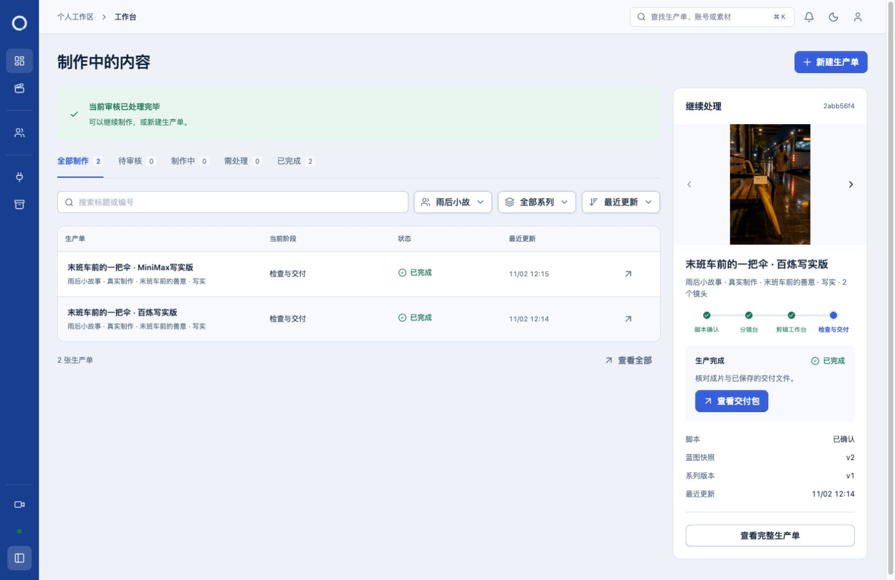

# 《末班车前的一把伞》main 真实制作验收

日期：2026-11-02。分支：main。两张写实版生产单均已完成，留在日常主项目。没有提交或推送代码。

## 生产单与成片

| 供应商 | 生产单 | 模型生成的原片 | 最终成片 |
| --- | --- | --- | --- |
| 百炼 | [百炼写实版](http://127.0.0.1:5174/?episode=2abb56f4-79b3-4d4e-8537-8d707e9b060d) | wan2.6-i2v-flash，4.000 秒，720×1280 | 4.053333 秒 |
| MiniMax | [MiniMax写实版](http://127.0.0.1:5174/?episode=be49fc67-8058-4bde-8a10-3c4ac61d59e0) | MiniMax-H3，4.458333 秒，768×1344 | 4.053333 秒 |

每张生产单都先通过主项目的真实 Owner 命令、数据库队列和正式 Worker 调用 `gpt-image-2`，生成一张 1024×1536 写实首帧。图片分别保存为 [百炼首帧](bailian-gpt-image2.png)、[MiniMax首帧](minimax-gpt-image2.png)。视频请求明确使用对应首帧素材 ID，并采用 cover 构图。

故事为雨夜公交站留伞：前两秒末班车驶离，后两秒推近黄伞和纸条。每条视频分给两个镜头，分别使用源区间 0–2 秒、2–4 秒；保留独立中文字幕。未额外调用付费配音或配乐服务。

- [百炼最终 MP4](bailian-photo-final.mp4)
- [MiniMax 最终 MP4](minimax-photo-final.mp4)
- [百炼运动分帧](bailian-photo-motion-review.jpg)、[MiniMax 运动分帧](minimax-photo-motion-review.jpg)：可核对公交、人物、镜头推进和纸条运动。

## 实际执行与验证

1. 主项目新建写实版生产单，导入并确认 v2 故事脚本，生成两个两秒镜头，明确授权在线制作。
2. 两次真实 `gpt-image-2` 图片请求成功，随后两次真实视频请求成功；使用原有已验证连接，没有创建或轮换密钥。
3. 通过真实候选准备接口、OpenChatCut SDK 文档接口与所有权接口采用视频，保存工作版本。关闭再打开工程，确认两个片段均引用生成原片的 SHA、源起点分别为 0／60 帧、时长各 60 帧，时间线 30 fps。不是修改 JSON 备份代替原生保存。
4. 实际导出、完整解码 MP4，确认导出身份及内容指纹。两张生产单均为 `production_completed`。
5. 两份交付包均 `verified=true`，各有封面、文案、检查报告、交付清单、成片、可编辑工程共六项。逐项通过 Owner HTTP 下载，核对字节数与 SHA；实际下载 ZIP，独立 `unzip -t` 校验通过，每份六项。
6. 向真实应用重放十次完全相同的操作标识与输入：两次图片生成、两次视频生成、四次采用确认、两次导出确认。均返回成功，任务记录、工程指纹／版本、收费网络账本保持不变。
7. 所有原片均不超过 8 秒，包括退回旧版 6 秒；最终成片均约 4.05 秒。队列 ready/running 为零，原生产物待核对登记为空。

证据：[最终断言](final-assertions.json)、[原生百炼核验](bailian-photo-native-verification.json)、[原生 MiniMax 核验](minimax-photo-native-verification.json)、[交付下载核验](delivery-verification.json)、[重复提交核验](idempotency-verification.json)、[百炼最终检查](bailian-final-checks.json)、[MiniMax 最终检查](minimax-final-checks.json)。

## 费用与提交次数

总计五次收费提交：初版百炼视频一次、gpt-image-2 图片两次、写实百炼视频一次、MiniMax 视频一次。没有因中断或重复操作再提交。

| 项目 | 价格估算 | 网络占额 |
| --- | --- | --- |
| 退回的百炼插画版，6 秒 | 0.90 元 | 1.00 元 |
| gpt-image-2 两张 low 1024×1536，含文字输入余量 | 约 0.10 元 | 0.20 元 |
| 百炼写实版，4 秒，720P 无声 | 0.60 元 | 0.70 元 |
| MiniMax 写实版，请求 4 秒，768P | 2.00 元 | 2.50 元 |
| 合计 | 约 3.60 元 | 4.40 元 |

**4.40 元是保守的软件预算占额，不是实付账单。** 未取得供应商逐笔账单，不能将估算或余额变化冒充精确扣费。原片编码尾帧余量也在预留内；用户总上限为 5 元。依据见 [原价格证据](price-evidence.md)、[写实版价格证据](photo-price-evidence.md)、[已关闭网络账本](closed-network-ledgers.json)。

价格来源：[百炼官方](https://help.aliyun.com/zh/model-studio/wan2-6-i2v-flash)、[MiniMax 国内官方](https://platform.minimax.cn/docs/pricing/overview)、[OpenAI 生成指南](https://developers.openai.com/api/docs/guides/image-generation)、[OpenAI 价格](https://developers.openai.com/api/docs/pricing)。图片使用 8 CNY/USD 作预算保守换算上限，不把它称为实时汇率。

## 过程修正与恢复

- 初版采用了手绘插画首帧，虽然百炼产生了真实运动视频，但用户明确拒绝这种卡片式视觉。两张初版草稿已可恢复归档，旧百炼视频和费用仍保留；没有把旧版当作验收通过，也没有忽略其费用。
- 用户随后明确要求 `gpt-image2 → 视频`，因此改为两张写实首帧及两家各 4 秒视频，在原 5 元限额内重做。
- 用户批准运行更新、SQL133 和短暂重启。先保存数据库备份、核对 Worker 验证文件与日志，仅应用待迁移的 SQL133。部署前已有真实隔离回归记录，主项目运行程序准备通过。
- 并行对话继续改共享源码时，运行完整性保护拦截了两个操作；数据库和网络账本确认旧 MiniMax 请求从未提交。等待相关优化与最后重启完成后继续，没有绕过保护或重复收费。
- 第一张 gpt-image2 图片生成完成后，另一个对话再次完成最终重启。已有素材与任务保留，恢复使用原产物，未重发图片请求。
- 写实脚本初次提交因缺少必填“首帧素材”字段返回 400；补齐字段后重新提交，不涉及收费请求。
- 可选的原生恢复 CLI 首次因 Keychain 处于锁定状态失败；解锁已有本机运行 Keychain 后复查成功，结果为 `pending: []`。

## 主项目收尾与限制

原有三张生产单及原账号行与本轮开始时一致。新增内容仅为本轮账号／系列、两张已完成写实版和两张归档草稿。没有删除日常素材。

两份临时网络策略均已关闭，日常网络配置已恢复；部署设置与本轮开始时语义一致。服务已重启恢复，运行清单和健康／空闲调度复查通过。页面实际播放两条成片，时间均推进、播放器无错误。见 [浏览器播放核验](browser-playback.json)、[最终运行状态](final-runtime.json) 和 [主项目两张完成单截图](main-orders-completed.jpg)。临时复制的浏览器会话文件在收尾后移除，保留用户本来的登录。

百炼版本纸条小字存在生成瑕疵，中文字幕正文正确。交付标签有一处早期遗留“六秒故事”，实测成片为 4.05 秒；已完成生产单只读，没有绕过约束改写其交付文件或数据库。生成模型的画面质量不等同于产品流程验收。本轮完整流程和实际文件校验通过，但没有开展人工声音质量评测或供应商账单核销。

