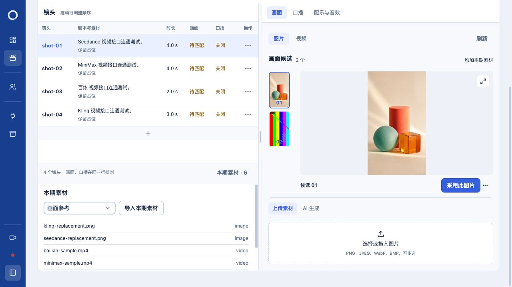

# 视频 API 实测与替代图

2026-11-01，Asia/Shanghai。本轮完成两条真实视频和两张真实生成的替代图，全部保存到验收生产单对应镜头的候选中。Seedance、Kling按用户指示停止继续测试；没有把它们记为视频生成通过。

## 实际结果

| 镜头 | API／模型 | 实测结果 | 留存产物 |
| --- | --- | --- | --- |
| shot-01 | Seedance／doubao-seedance-2-0-260128 | 一次提交返回404、ModelNotOpen，无任务ID。用户确认开通条件涉及最低充值200元，要求跳过；没有再次提交或充值 | [gpt-image-2替代图](seedance-replacement.png)，864×1536 |
| shot-02 | MiniMax国内站／MiniMax-H3 | 一次提交成功，原任务轮询成功；下载边界修复后恢复同一任务，实际MP4完整解码、页面播放至结束 | [视频](minimax-sample.mp4)，768×1344、24fps，申请4秒，实际4.458333秒，含AAC音频 |
| shot-03 | 百炼／wan2.6-i2v-flash | 一次提交、轮询、下载HTTP200；完整解码、页面播放至结束 | [视频](bailian-sample.mp4)，720×1280、30fps、2秒、无声 |
| shot-04 | Kling／kling-v3 | 一次最短提交连接中断，无任务ID；随后只读任务查询也连接失败，结果未确认。用户说明未充值并要求跳过；未重发、未充值 | [gpt-image-2替代图](kling-replacement.png)，864×1536 |

两张替代图分别调用现有「gpt-image2」连接，模型 `gpt-image-2`、`quality=medium`、`size=864x1536`、`n=1`。用户明确批准复用原凭据。两次HTTP200，PNG完整解码与页面预览通过；替代图不是Seedance或Kling视频接口的成功证据。

MiniMax远端任务 `458656441229509`，百炼远端任务 `647b245c-db67-4f42-a82f-50ffea1c5bef`。OpenAI请求ID、usage、文件大小及SHA分别保存在各项 `*-result.json`。Kling的原始运行器结果标签为 `generation_failed`，但其私有账本明确记录 `unknown`；本报告按“提交结果未确认”解释，不能据此断言余额不足、未接收或未扣费。

## 生产单与文件

[验收生产单](http://127.0.0.1:5174/?episode=79eb3098-8733-472a-9bde-873edd4cd26c)：`视频 API 逐项真实生成 · 1101`。

目录：`/Volumes/Ebuget 1T/Media/流程验收1101--2fb0abe3-a125-429c-97b9-3330929c5c6b/未分系列--469c8e63-de75-4f1c-b61e-84929254527f/视频 API 逐项真实生成 · 1101--79eb3098-8733-472a-9bde-873edd4cd26c`。

四项生成产物均通过正式UI导入、预览、刷新和数据库读回；对应镜头、候选、素材及磁盘字节SHA一致，见 [最终断言](final-assertions.json)。另保留原始测试首帧、脚本及工程，共8文件、5,576,156字节，见 [完整文件清单](production-files.json)。没有自动采用候选、导出交付或覆盖旧生产单，因此镜头仍显示待匹配。

## MiniMax适配修复

真实已认证任务返回 `algeng-video-infer.oss-cn-shanghai.aliyuncs.com`，原下载白名单漏了这个具体结果桶；日常执行端口同时漏了国内站 `api.minimax.cn` 的Provider分派。修复范围仅包括：

- `src/worker/officialVideoProvider.ts`：只允许MiniMax使用该确切OSS桶；继续拒绝其他OSS租户、伪装域名、HTTP、带用户名密码的URL和跨Provider使用。
- `src/local-app/narrationWorker.ts`：国内站归入MiniMax，继续使用原网络白名单、预算及秘密存储。
- `src/worker/officialVideoProvider.test.ts`、`src/local-app/narrationWorker.network.test.ts`：恢复原任务不重新POST、下载不携带Authorization、国内轮询与OSS下载通过真实私有网络账本。

先运行失败回归，保留 [红灯](minimax-download-red.log)；随后 [39项相关测试](minimax-download-green.log)、[类型检查](check.log)通过。中间一次新测试夹具因macOS临时目录别名被私有路径检查拒绝，已改为规范路径，原日志保留为 `minimax-download-fixture-path.log`，没有放松业务路径检查。

`npm run runtime:prepare` 已重新编译正式Worker与后端产物，见 [准备日志](runtime-prepare.log)。没有重启日常服务。更新后的正式 `narrationPorts` 以 `mode=live` 读取原任务并再次下载，字节SHA一致，新增生成调用0，见 [正式执行端口证据](minimax-runtime-ports.json)。

## 费用与执行边界

用户批准总额30元、单条10元，并明确要求跳过Seedance和Kling、不充值。四次视频提交加两次图片提交均各一次；MiniMax恢复只有查询和下载，没有二次生成。合计预留13.40元，不等同实际扣费；失败与未知提交的预留没有重置或伪装成退款。

本轮复用项目正式客户端，在独立的受限 `createProviderFetcher` 账本下真实调用供应商；成功产物通过日常UI导入。这验证API生成、下载、解码及导入预览，不代表已经执行“生产单按钮入队→正式Worker付费生成”的整条路径。账号已保存预算、连接及日常服务部署配置未更改；日常Provider网络授权仍保留原配置，本轮30元限额只作用于独立测试账本。

六份本轮私有请求账本已全部暂停，最多一次生成的计数及原策略SHA保留，见 [关闭后的台账](closed-network-ledgers.json)。本地活动任务0；Kling没有可核验任务ID，不能声称其远端状态已确认。

## 日志与收尾

- [逐请求与恢复日志](events.jsonl)：请求方法、host、path、状态、远端任务ID和脱敏错误；不记录认证头或签名查询参数值。
- [页面操作](browser-steps.jsonl)、[控制台](browser-console.json)、[数据库脱敏读回](production-evidence.json)、[运行日志](app-runtime-sanitized.log)均保留。
- [MiniMax播放](minimax-playback.json)、[百炼播放](bailian-playback.json)均记录到 `ended=true`；生成图已逐张查看并在正式页面预览。
- 未脱敏原始DB快照、输入、执行脚本、授权回复、私有台账和原始服务日志保留在 `.loop-control/maintenance/video-api-live-20261101/`，凭据只在进程内解析，没有写入证据。
- [测试页清理](browser-cleanup.json)：本轮页7、8均关闭，原用户页1保留，没有打开原生编辑器。未提交或推送代码，保留其他既有改动。

价格依据分别见 [视频费用记录](price-evidence.md)、[图片费用记录](image-price-evidence.md)。图片尺寸与计费规则核对自 [OpenAI图片生成指南](https://developers.openai.com/api/docs/guides/image-generation)及[官方价格页](https://developers.openai.com/api/docs/pricing)；供应商实际扣费仍以其账单为准。
