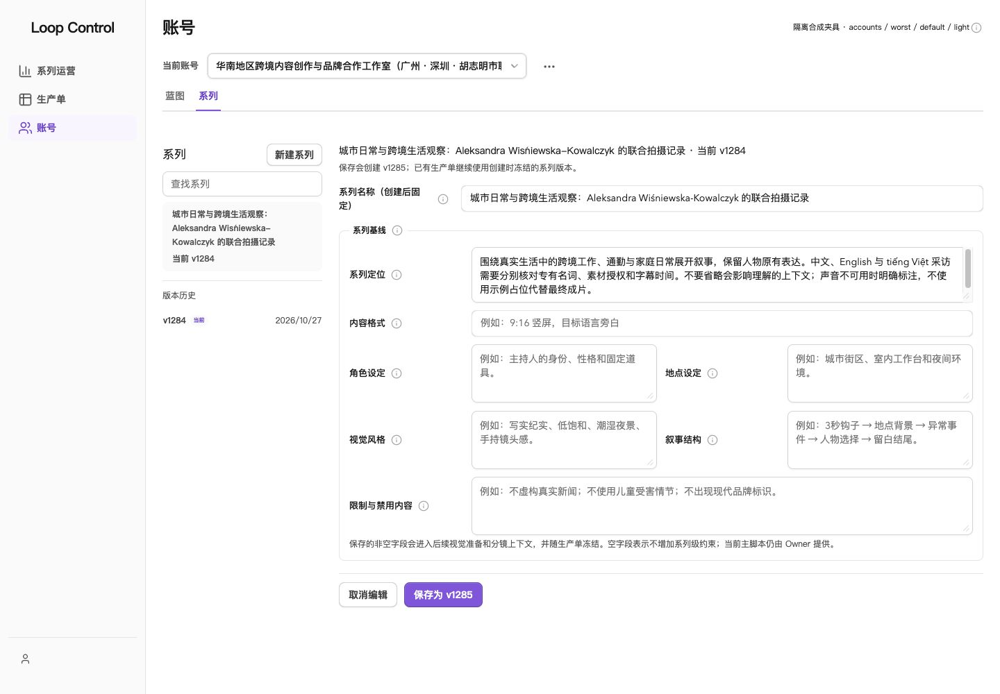

# PC 视觉问题修复与复验

2026-10-28。原[视觉审查](../visual-audit-20261028/REPORT.md)中的 **16项全部修复并完成对应复验**。沿用现有Dan UI，优先保证PC内容清晰、对齐和无非预期溢出；没有重做视觉风格、改变业务流程或修改真实数据。

## 逐项验收

| # | 修复 | 复验结果与证据 |
| --- | --- | --- |
| 1 | 共用TabPanel隐藏data-inert的非活动面板，保持挂载与草稿；焦点导航跳过非活动内容 | 维护页旧面板height=0、display=none；镜头声音／预览面板均为0，画面面板正常显示。切回保留草稿。[维护尺寸](tabs-fixed.json)、[镜头尺寸](shot-tabs-fixed.json)、[截图](screenshots/maintenance-fixed-1440-light.png) |
| 2 | 系列按钮、文字列约束宽度并完整换行 | 四种PC宽度、浅深主题下按钮均为230px，没有进入右侧编辑区。[8组尺寸](series-widths-fixed.json)、[1440px截图](screenshots/final-pc-series-light.jpg) |
| 3 | InputBase把禁用状态传给原生输入与密码按钮，支持独立与TextField上下文；全禁用弹窗保留焦点容器；安全表单同步锁定 | 原生Chrome中账号名称、标识、下拉和操作均disabled；连续Tab留在弹窗。单元回归覆盖禁用、提交不触发、TextField上下文。[原生键盘](native-pending-keyboard.txt)、[回归](../../../src/ui/PcVisualFixes.test.tsx) |
| 4 | 深色弱品牌背景改为brand-950；旧宿主说明、选中项等改用弱品牌背景，与实心按钮色区分 | 蓝图说明约5.63:1、活动导航约9.85:1、选中密钥引用约5.99:1。[对比度](contrast-fixed.json)、[密钥截图](screenshots/selected-secret-fixed-1440-dark.jpg) |
| 5 | 浅色warning文字改为yellow-700，保留浅底 | 审核状态约4.76:1，深色约9.29:1。[最终列表](screenshots/episodes-worst-1440-light.jpg) |
| 6 | OpenChatCut使用独立iconLeading，收起态固定方形入口 | 按钮36×36px、图标20×20px；日常5174页面也已加载。[尺寸](sidebar-fixed.json)、[截图](screenshots/app-huge-1440-dark.jpg) |
| 7 | 产物预览和灯箱关闭操作使用配对主题前景／背景 | 深色按钮可读，打开／关闭灯箱正常，采样不再有低对比候选。[预览](screenshots/artifact-fixed-dark.jpg)、[灯箱](screenshots/artifact-lightbox-fixed-dark.jpg) |
| 8 | 运营列表标题列minmax(0,1fr)、正常换行，按钮与文字限定宽度 | 1280/1440/1920/2560下运营列表没有非预期局部横滚。[1440px截图](screenshots/operations-worst-1440-light.jpg) |
| 9 | 头像不收缩，账号列顶部对齐；修正浅色头像上的白色首字母 | 8组PC尺寸／主题中所有头像22×22px；六种头像色系最低文字对比4.72:1。[最终尺寸与对比](avatars-fixed-final.json) |
| 10 | 当前账号选择器按空间增长至480px；Harness摘要正常换行 | 1280px下普通Harness标识无省略，日常页面选择器480px；完整账号仍可在原生下拉中读取。[日常页尺寸](daily-page-readonly.json)、[1280px截图](screenshots/accounts-worst-1280-light.jpg) |
| 11 | 镜头更多操作改用带碰撞检测的React Aria Popover，保留原操作与设置表单 | 1280×720下菜单自动向上展开，top=12、bottom=358，完整位于视口；Escape返回触发按钮。进入设置再关闭连续3轮均正确恢复焦点，修复了延迟恢复的竞态。[菜单边界](menu-fixed-short-pc.json)、[焦点往返](menu-settings-transition.json)、[截图](screenshots/menu-fixed-short-pc-dark.jpg) |
| 12 | 蓝图正文列和系列编辑区最大960px，表格继续使用可用宽度 | 1920/2560下正文不再无限拉长；左导航、正文、右检查栏仍成组对齐。[超宽屏](screenshots/accounts-worst-2560-light.jpg)、[系列编辑宽度](series-widths-fixed.json) |
| 13 | 密钥列表用途保留两行摘要，详情展示全文 | 长说明不再在列表中完整重复，名称、分类、引用编号仍可读；选中可核对全文。[截图](screenshots/selected-secret-fixed-1440-dark.jpg) |
| 14 | 系列增加全量名称搜索、20条分页，并预计算最新版本；稳定默认规则对象 | 1284个系列只渲染20个按钮；可搜索到第1284项。页面高度从87658降至2254px。翻页和搜索不清空当前编辑草稿。[规模](series-huge-fixed.json)、[搜索](series-search-fixed.json)、[回归](../../../src/ui/PcVisualFixes.test.tsx) |
| 15 | 新建生产单标题前端限制200字符，显示当前长度，与后端一致 | 输入200后无法继续增加；0字符仍合法，不静默裁剪已有数据；提示通过aria-describedby关联。[行为回归](../../../src/ui/PcVisualFixes.test.tsx) |
| 16 | Prompt名称、摘要、正文及密码验证字段显式命名，帮助动作保留独立名称 | 原生可访问树分别播报“版本名称”“版本摘要”“Harness 内容”，不混入“说明”；帮助按钮仍可聚焦操作。[字段证据](prompt-labels-fixed.txt)、[截图](screenshots/prompt-labels-fixed.jpg) |

复验还移除了空态残留装饰圆：它在隐藏边缘产生额外28px的滚动宽度，虽然未遮挡正文，但与当前简洁的空态样式不一致。没有新增装饰、依赖或业务限制。

## 验证范围与结果

- **页面**：18个隔离入口；16个生产阶段的实际抽屉浅深主题。媒体预览、灯箱、维护页签、Prompt表单、密钥选中态、镜头操作与设置另做交互复验。
- **PC**：1280×900、1440×1000、1920×1080、2560×1440；另补1280×720低高度弹窗与菜单。移动端不作为本轮验收重点。
- **数据与状态**：Demo、Worst、Empty、One、1284总数；20／21条分页边界；放大文字、loading、error、pending、denied、ready及审核成员。
- **尺寸证据**：保留349组去重页面采样，另有专项JSON。没有整页横向越界，也没有可见内容的非预期局部横向溢出。1px读屏辅助节点的隐藏宽度不当作内容溢出；长列表的纵向滚动正常保留。
- **文字可读性**：本轮可见正文的computed CSS采样没有低于对应阈值的候选；另对原报告问题逐项测量。头像虽为装饰性标记，也补测至最低4.72:1。不将此结果当作全应用WCAG认证。
- **键盘与缩放**：原生Chrome 200%缩放的新建账号表单内容及操作完整可见；全禁用弹窗连续Tab不逃逸。原生Chrome恢复100%并关闭本轮测试标签。root字号32px测试与实际浏览器缩放分别记录。[原生200%证据](native-zoom200.txt)
- **自动回归**：32个UI测试文件、292项通过；包括审核失效、草稿保留、权限、菜单、输入、分页及密钥交互。另有聚焦复验与新增缺陷回归。类型检查、夹具类型检查、CSS重建和独立目录Vite构建通过。[最终UI日志](ui-suite-final.log)、[类型日志](typecheck.log)、[构建日志](app-build.log)
- **机械扫描**：布局扫描初始和最终均0项；仅作为辅助，实际结论来自尺寸、截图与操作证据。[最终扫描](detector-final.json)
- **日常页面**：5174原进程93487保持运行，未重启服务；只读确认热更新后的480px账号选择器和36px剪辑入口已生效。未提交真实表单、读取真实密钥或调用Provider。[日常页面](daily-page-readonly.json)

## 实现与保留边界

产品变更以本轮起点哈希为界，逐文件清单见[results.json](results.json)，改动差异见[implementation.diff](implementation.diff)。保留此前所有无关工作区修改；未提交、推送、部署或修改真实业务数据。采用组件的本地适配同步记录在LOCAL-PATCHES.md。

现有大chunk提示仍在，主JS约956.82kB/gzip287.54kB；这是原审查中的资源观察，不属于编号缺陷的额外功能改造。本轮通过系列分页限制实际渲染规模，没有声称完成运行性能剖析。第三方编辑器内部、真实Provider生成与真实凭据操作没有执行。

## 查看效果

[打开可切换演示](http://127.0.0.1:5189/docs/verification/visual-audit-20261028/fixture.html?scene=accounts&data=worst&theme=light)。原Demo / Worst / Empty / One / 1,000+及主题、阶段切换继续保留，未进入产品导航。完整截图见[索引](SCREENSHOTS.md)。

