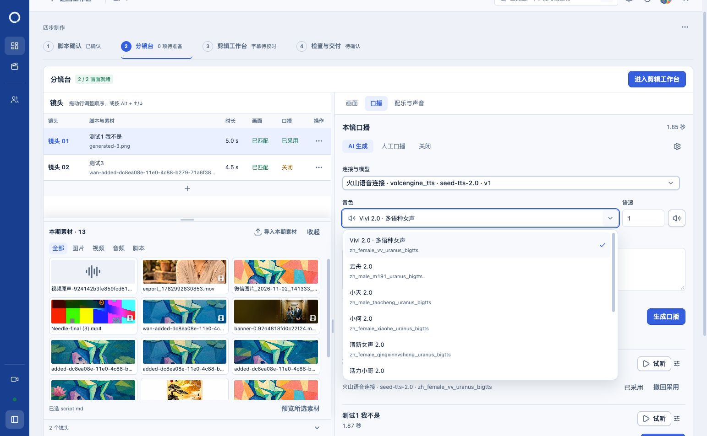

# 可搜索中文音色验收

2026-11-08。正式分镜台和本期口播默认设置使用同一音色选择组件。

## 实现

- 音色下拉显示名称，可按中文名称或原始供应商 ID 搜索。列表保留较小的 ID 辅助辨认；选择后的主字段显示名称。
- 仅显示当前模型已有的音色目录，不增加模型或音色。提交、试听、缓存和已有配置继续使用原 ID。
- 搜索输入不改动已选音色；Escape、失焦或关闭恢复当前名称。未知旧 ID 不被替换，当前目录不兼容时仍给出原有提示。
- 音色输入框、语速输入和试听按钮统一 38px 高并对齐底边；本镜与本期默认采用相同控件。

Vivi、小何、云舟、小天等名称参考[官方音色表](https://docs.volcengine.com/docs/doubao-voice/tone-list-3?lang=zh)。Vivi 保留官方品牌名并补充中文说明。已有未匹配名称的 ID 保持原样。

## 验证

64 项测试通过，包含名称和 ID 搜索、鼠标及键盘选择、无匹配、Escape、禁用、未知旧配置、原 ID 生成请求、本期默认、试听合成确认和原下拉组件回归。类型检查、生产构建及运行产物准备通过。

正式 5174 实测中文筛选“云舟”、ID 筛选“xiaohe”、选择后试听按钮可用、本期设置中 Escape 只关闭列表，以及 1152×790 窄窗。三个控件实测高度均为 38px，底边同为 495.5px；窄窗列表右边界 964px，未超过 1152px 视口。测试后已恢复原音色和浏览器尺寸。

未点击音频生成、样音合成或保存，没有供应商调用，无数据库迁移或服务重启。保留其他未提交工作，未提交或推送。修改前相关文件保存在当前聊天目录 `voice-picker-baseline`。

