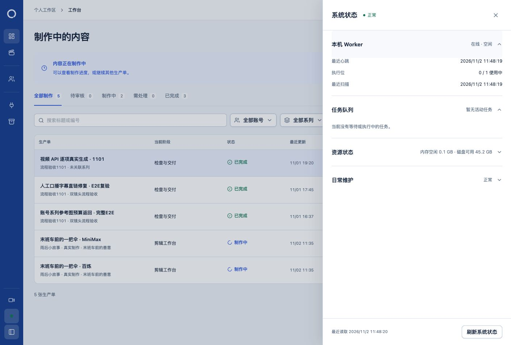

# SQL133 日常启用与验证

日期：2026-11-02。授权：用户明确要求应用 SQL133、更新运行产物并使本次优化在日常服务生效。不提交或推送。

## 执行记录

首次检查时，日常数据库的待应用清单仅含 `133-native-output-publication-fences.sql`，旧迁移指纹一致，没有 ready／running 任务。已保留私有数据库快照、旧运行产物归档、原有工程文件指纹及部署身份。

停止前复核发现并行制作流程已应用 SQL133 并重启服务，且百炼视频任务正在运行。本轮没有中断该任务。任务结束后检查确认 SQL133 的登记指纹与当前文件一致，旧迁移记录未变。正式执行 `npm run runtime:migrate` 返回 `applied: []`，没有重复应用或修改旧迁移。

并行工作先后修改了 `artifactRoute.ts`／`localRoute.ts` 和 `artifactRoute.ts`／`deliveryArchive.ts`，使此前运行清单过期。每次均定位具体源码差异，待队列为空且原生编辑器端口未监听后，使用正常的 `npm stop` → `npm run runtime:prepare` → `npm start` 流程同步最新源码。未覆盖并行源码，未改动部署绑定或自动完整备份设置。

## 验证结果

- SQL133 迁移指纹与当前文件一致，无待应用迁移；已有迁移记录保留。
- 实际 `loop_worker` 连接通过数据库身份与能力检查；发布开始／恢复／完成函数可执行，应用账号不能读取保护表，Worker 不能直接修改保护表，旧回报包装函数不对 Worker 开放，状态保护触发器及租约恢复排除条件存在。
- 运行准备完成后台与 Worker 编译，运行清单核验源码、编译产物、项目根和 Node 主版本。
- 日常原生即时健康检查验证实际数据库、媒体目录和运行产物，三项通过。
- 额外登记一次 `health` 运维任务，由已启动的日常自动化执行真实检查并写入完成记录；不修改旧失败记录、不更改每日 09:00 计划。此前 09:02 的旧运行程序失败保留为历史。
- 使用日常编译目录重跑 `workerOutcomes.integration.test.ts`：10 项通过。数据库仍为隔离测试数据库，外部响应受控，没有为验证发起付费生成。
- 真实页面重新加载成功，系统状态正常，Worker 在线并显示心跳及扫描时间；恢复 CLI 的只读查询返回 `pending: []`。页面证据见下图。
- 最初 3 张生产单的 82 份 JSON／SQLite／运行附属文件指纹未变，3 条原工程记录未变。快照中的既有任务、任务运行、产物、采用和导出记录逐行保留。并行新建的两张故事生产单仍按其自身流程变化，未回滚这些正常变化。

## 证据与范围

私有证据目录：`.loop-control/local/sql133-update-20261102-XMQuRz/`。保留数据库快照、旧运行产物、迁移与源码差异诊断、权限检查、业务行／工程文件对比和命令日志。快照表示采集时现场；采集期间存在并行制作，不能把整库差异误当作本次迁移修改，更不能用旧快照覆盖并行工作。

本轮只执行服务更新、维护检查和隔离回归，没有发起 Provider 生成或改写原工程。日常业务继续运行；不以页面 HTTP 200 代替 Worker、数据库权限或产物完整性验证。

最终进程及清单核对见私有证据 `final.json`；最终运行产物更新日志与健康任务记录一并保留。

最终验收点为 11:48：日常进程 PID `76008`，运行清单有效，即时健康检查三项通过，ready／running／待核对发布均为 0；页面系统状态正常，Worker 心跳和扫描时间持续更新。

本轮计划与验证文档的差异空白检查通过。全仓检查另发现并行改动 `WorkspaceVisualPreparation.tsx:142` 的行尾空格，未在服务更新任务中修改该文件。
