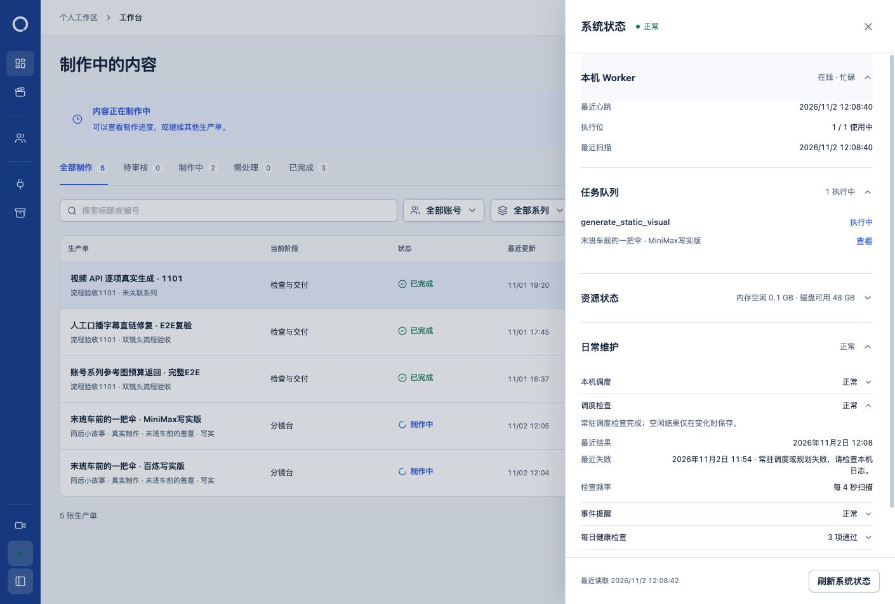

# 等并行修改完成后的调度恢复

日期：2026-11-02。授权：等待当前源码修改完成后，重新编译并重启日常服务，确认调度检查恢复正常；下一项只讨论影响。

## 执行与结果

先通过并行对话状态及其验收报告，确认「生成设置与逐镜头交付查看」已完成源码、回归、宽窄屏与正式下载验收，再执行本轮服务更新。停止前重新核对任务队列为空、原生编辑器端口无监听；没有中断正在生成的任务。

保存数据库快照、旧运行产物和 114 份工程 JSON／SQLite／附属文件指纹后，按正常入口停止日常服务，显式执行 `worker:build`、`backend:build`、`runtime:prepare`，随后 `npm start`。最终本轮启动的日常进程 PID 为 `80712`。

验证结果：

- 源码与后台／Worker 编译产物清单一致，实际 Worker 数据库身份及能力校验通过。
- 日常数据库、媒体目录、运行程序三项即时健康检查通过，首页 HTTP 200。
- 持久调度结果为成功，真实页面的「本机调度」「调度检查」「日常维护」均显示正常；心跳和最近扫描持续更新。
- 页面验收期间，新进程正常领取了并行制作的 `generate_static_visual` 任务，显示在线／忙碌，调度检查仍正常。本轮没有主动提交生成请求。
- 旧失败记录保留。空闲成功会去重保存，最近结果时间可以早于最近心跳；新任务启动后，调度成功记录更新至 12:08。
- 114 份原工程文件指纹一致，5 条原工程记录、原任务／尝试／产物及候选采用／导出记录保留。

数据库快照采集后，并行制作新建了两张写实生产单，并将两张旧试作单归档；账号规则、任务与审计记录也随正常业务更新。整库指纹因此不同，不能记为「43 张表全部不变」。已核对原工程、文件和具体归档字段，没有回滚并行内容或用旧快照覆盖新业务。

私有证据目录：`.loop-control/local/scheduler-recovery-20261102-r9hPnd/`，包含更新前副本、编译／启动日志、即时健康与调度记录、业务差异明细、工程指纹及页面证据。未重复应用 SQL133，未修改业务代码、提交或推送。

## 下一项的事实核对

第二项沿用上次复查排序：工程保存中减少被丢弃的完整盘点。当前 `saveWorkspaceStudio` 调用 `updateWorkspaceProject` 后不使用其返回状态；后者末尾已经调用 `readProductionWorkspace`。上层完成字幕同步后，又完整读取一次工程状态。

建议先仅处理原生保存路径：完成原有写入、版本与文件身份检查、字幕同步，再组装最终状态。保留其他直接使用返回值的调用者及最终真实核验，不引入跨请求缓存。收益是减少重复查询、文件检查和媒体探测，耗时改善尚未测量；保存方式、内容、字幕及冲突保护保持。后续实施须保留真实保存／重开、字幕、候选采用与版本冲突验证。当前未实施这项优化。
