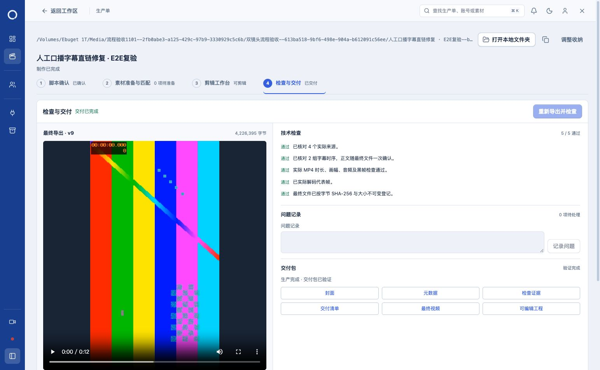

# 三项 E2E 问题修复与复验

2026-11-01，正式本机服务 `http://127.0.0.1:5174/`。三项均修复并通过实际流程复验；新生产单已交付，旧生产单保留。本次使用本地测试素材、真实 WhisperX、原生编辑和 FFmpeg 导出，未调用付费生成服务。

## 修复与实际结果

| 问题 | 根因与改动 | 正式页面复验 |
| --- | --- | --- |
| 人工口播 MP3 上传后无法采用 | 上传素材未接入工作台音轨登记；新增迁移130及受约束登记入口，将已上传口播列入原有选择器，通过既有候选准备和显式采用链进入原生工程 | 两镜头分别上传、选择、采用成功；第二镜头在第一镜头已更新工程后仍可采用，实际音频可播放，重开工程保留 |
| 第二镜头真实对齐采用409 | React autosave 队列可能仍保存上一次渲染文档，flush 成功并不代表当前文档已持久化；宿主桥接明确提交当前文档至SDK保存队列，再确认队列完成及文档身份 | 同一编辑器连续采用两个真实 WhisperX 结果，无需退出绕行；即时数据库及重开工程均保留两镜头 `method=alignment`，导出前均已确认 |
| MP4直链无法播放 | 文件路由旧CSP禁止浏览器生成的媒体文档加载自身；仅MP4／MP3／WAV允许 `media-src 'self'`、`sandbox allow-same-origin`，其他文件原策略保持 | 同字节旧／新CSP对照由失败恢复播放；正式服务旧片和新片均播放结束，新片进度条跳转成功，HTTP200 |

登记同时校验素材所属生产单、用途、音频字节身份、时长、当前脚本和镜头版本；未自动采用。字幕修复没有放宽后端文件身份、修订和采用检查。媒体路由继续验证所有者、路径、大小、SHA及Range，脚本执行仍禁止。

## 留存的生产单与交付

- [新生产单：人工口播字幕直链修复 · E2E复验](http://127.0.0.1:5174/?episode=b232b4fd-b43c-470c-bbdf-d97ae3f62f9d)，状态 `production_completed`，账号「流程验收1101」，系列「双镜头流程验收」v1。
- [旧生产单](http://127.0.0.1:5174/?episode=2f7553cb-c3e9-4dc5-b900-f1439329a0b0) 保留；账号、蓝图、系列、系列版本、预算以及旧生产单和旧工程字节与本次基线一致。
- 新生产目录：`/Volumes/Ebuget 1T/Media/流程验收1101--2fb0abe3-a125-429c-97b9-3330929c5c6b/双镜头流程验收--613ba518-9bf6-498e-904a-b612091c56ee/人工口播字幕直链修复 · E2E复验--b232b4fd-b43c-470c-bbdf-d97ae3f62f9d`。
- [成片](files/final.mp4)：1080×1920，30fps，360帧，视频12秒，媒体容器12.032秒，4,226,395字节，SHA-256 `05e3367235dccff57c8c66d29c7675b1be4397054c25d0fc07156273a376c35e`。
- [可编辑工程](files/project.json)：v9，SHA-256 `c2fe4d820231873d181eb25f8677d1c166b0b2cf6d71308155ba000401fc9ed5`。
- 两个人工登记任务、两个本地对齐任务、一个交付任务全部完成；真实Worker运行3次，登记任务无需Worker。活动任务0，实际记录费用0。
- 导出检查5/5，实际解码代表帧并检查两镜头字幕；显式确认该成片后生成交付，交付包验证通过，重开生产单仍显示完成。

六项交付文件逐文件核对大小及SHA，见 [文件身份](delivery-files.json)。五项非视频文件还读取了浏览器实际HTTP200响应正文并核对SHA，见 [浏览器下载证据](browser-downloads.json)。MP4浏览器HTTP200、播放、跳转及结束均通过；CDP无法读取暂停媒体文档的正文，故未将MP4计入“浏览器正文SHA通过”，其磁盘字节SHA已核对。

## 检查与日志

- [相关组件与HTTP单元回归](focused-final.log)：6个文件52项通过，包含延迟autosave下当前文档保存、失败／过期保存拒绝、音轨选择采用及媒体CSP／Range／篡改边界。
- [真实隔离HTTP／DB集成](integration-final.log)：5项通过，12项由明确的 `-t` 范围筛选跳过；覆盖两镜头连续人工采用、重复登记、旧修订／跨单拒绝、字幕身份和真实横竖屏像素。未宣称执行全仓测试。
- [类型检查](check-final.log)：`npm run check` 通过。
- [迁移](runtime-migrate.log)／[正式服务启动](service-start.log)：迁移130已应用，服务更新后经用户重新登录完成正式验证。
- [最终数据断言](final-assertions.json)：两镜头人工采用及真实对齐确认、五项任务完成、旧数据未变、六文件身份及交付一致性全部通过。
- [操作日志](browser-steps.jsonl)：61条页面状态记录；[网络日志](network.jsonl)：2292条脱敏请求／响应元数据。保留失败回归及调试过程日志，未覆盖为成功结果。
- [运行日志](app-runtime-sanitized.log)、[控制台](browser-console.json)、[清理记录](browser-cleanup.json) 均保留。控制台4条为SDK字体请求数警告，无错误级记录；未扩大为字体优化任务。
- [新片播放证据](final-video-playback.json)／[响应策略](final-video-http.json)、[旧片播放](old-production-video-playback.json)、[CSP修复前](media-browser-before.json)／[修复后](media-browser-after.json)。新片真实播放至 `ended=true`，时长12.032秒，跳转后记录7.186481秒继续播放。
- [完整生产文件清单](production-files.json)：44文件，6,349,557字节；六项交付副本在 `files/`，五项真实HTTP响应副本在 `downloads/`。

未脱敏原始DB快照、输入文件、只读审计脚本和本次日志起点后的原始服务日志保存在 `.loop-control/maintenance/workspace-three-fixes-20261101/`，权限受限；公开证据递归移除令牌字段，不保存凭据原文。浏览器在跨文档切换时的CDP缓冲边界已记录，最终播放及交付保存由实际页面状态另行留证。

本轮测试页5、对照页6以及编辑iframe均已关闭，临时对照服务器已退出；原用户页1保留。未提交或推送代码，未修改无关既有工作。
